# State machine reference

Generated by `scripts/gen_state_diagrams.py`; do not edit by hand.

The source of truth is `docs/STATE_MACHINE_DESIGN.md` and the transition
tables under `harness/machines/`. This file is derived from those tables.

## Gate

```mermaid
stateDiagram-v2
    [*] --> await_diagnosis
    await_diagnosis --> escalated : abort
    await_diagnosis --> escalated : budget_exhausted
    await_diagnosis --> no_fault_cleared : diagnosis_submitted
    await_diagnosis --> approved : diagnosis_submitted
    await_diagnosis --> await_diagnosis : diagnosis_submitted
    await_diagnosis --> await_diagnosis : diagnosis_submitted
    await_diagnosis --> escalated : diagnosis_submitted
    await_diagnosis --> escalated : escalate
    await_diagnosis --> await_diagnosis : nudge
    await_diagnosis --> rejected : nudge (reject: nudge cap reached)
    await_diagnosis --> rejected : repair_finished (reject: no repair before diagnosis)
    await_diagnosis --> await_diagnosis : repair_proposed
    await_diagnosis --> rejected : unknown_effect (reject: no tool before diagnosis)
    approved --> escalated : abort
    approved --> escalated : budget_exhausted
    approved --> approved : diagnosis_submitted
    approved --> await_diagnosis : diagnosis_submitted
    approved --> await_diagnosis : diagnosis_submitted
    approved --> escalated : diagnosis_submitted
    approved --> escalated : escalate
    approved --> rejected : nudge (reject: nudge only before diagnosis)
    approved --> repaired : repair_finished
    approved --> approved : repair_finished
    approved --> approved : repair_proposed
    approved --> approved : repair_proposed
    approved --> approved : repair_proposed
    approved --> escalated : unknown_effect
    repaired --> rejected : abort (reject: terminal)
    no_fault_cleared --> rejected : abort (reject: repair after no fault is the only cleared transition)
    repaired --> rejected : budget_exhausted (reject: terminal)
    no_fault_cleared --> rejected : budget_exhausted (reject: repair after no fault is the only cleared transition)
    repaired --> rejected : diagnosis_submitted (reject: terminal)
    no_fault_cleared --> rejected : diagnosis_submitted (reject: repair after no fault is the only cleared transition)
    repaired --> rejected : escalate (reject: terminal)
    no_fault_cleared --> rejected : escalate (reject: repair after no fault is the only cleared transition)
    repaired --> rejected : nudge (reject: terminal)
    no_fault_cleared --> rejected : nudge (reject: repair after no fault is the only cleared transition)
    repaired --> rejected : repair_finished (reject: terminal)
    no_fault_cleared --> rejected : repair_finished (reject: repair after no fault is the only cleared transition)
    repaired --> rejected : repair_proposed (reject: terminal)
    no_fault_cleared --> no_fault_cleared : repair_proposed
    repaired --> rejected : unknown_effect (reject: terminal)
    no_fault_cleared --> rejected : unknown_effect (reject: repair after no fault is the only cleared transition)
    escalated --> rejected : abort (reject: terminal)
    escalated --> rejected : budget_exhausted (reject: terminal)
    escalated --> rejected : diagnosis_submitted (reject: terminal)
    escalated --> rejected : escalate (reject: terminal)
    escalated --> rejected : nudge (reject: terminal)
    escalated --> rejected : repair_finished (reject: terminal)
    escalated --> rejected : repair_proposed (reject: terminal)
    escalated --> rejected : unknown_effect (reject: terminal)
    rejected --> [*]
```



| State | Rank | Terminal | Resumable | Run terminal | End reason required | Crash action |
|---|---:|---|---|---|---|---|
| await_diagnosis | 0 | false | true | false | false | resume |
| approved | 1 | false | true | false | false | resume_or_abort |
| repaired | 2 | true | false | false | false | none |
| no_fault_cleared | 2 | true | false | false | false | none |
| escalated | 3 | true | false | false | true | none |

## Run

```mermaid
stateDiagram-v2
    [*] --> pending:queued
    pending:queued --> rejected : abandon (reject: terminal)
    pending:queued --> aborted:aborted : abort
    pending:queued --> rejected : agent_done (reject: terminal)
    pending:queued --> rejected : agent_terminal (reject: terminal)
    pending:queued --> rejected : baseline_failed (reject: terminal)
    pending:queued --> rejected : baseline_ok (reject: terminal)
    pending:queued --> rejected : begin_reset (reject: terminal)
    pending:queued --> pending:queued : create
    pending:queued --> rejected : fault_not_observed (reject: terminal)
    pending:queued --> rejected : fault_observed (reject: terminal)
    pending:queued --> aborted:aborted : illegal_transition
    pending:queued --> rejected : inject_failed (reject: terminal)
    pending:queued --> rejected : inject_ok (reject: terminal)
    pending:queued --> running:leased : lease
    pending:queued --> interrupted:interrupted : lease_expired
    pending:queued --> aborted:aborted : lease_expired
    pending:queued --> rejected : provider_error_all (reject: terminal)
    pending:queued --> interrupted:interrupted : reap
    pending:queued --> aborted:aborted : reap
    pending:queued --> rejected : reset_failed (reject: terminal)
    pending:queued --> rejected : reset_ok (reject: terminal)
    pending:queued --> skipped_unsupported:skipped_unsupported : skip_unsupported
    pending:queued --> rejected : verify_failed (reject: terminal)
    pending:queued --> rejected : verify_ok (reject: terminal)
    running:leased --> rejected : abandon (reject: terminal)
    running:leased --> aborted:aborted : abort
    running:leased --> rejected : agent_done (reject: terminal)
    running:leased --> rejected : agent_terminal (reject: terminal)
    running:leased --> rejected : baseline_failed (reject: terminal)
    running:leased --> rejected : baseline_ok (reject: terminal)
    running:leased --> running:resetting : begin_reset
    running:leased --> rejected : create (reject: terminal)
    running:leased --> rejected : fault_not_observed (reject: terminal)
    running:leased --> rejected : fault_observed (reject: terminal)
    running:leased --> aborted:aborted : illegal_transition
    running:leased --> rejected : inject_failed (reject: terminal)
    running:leased --> rejected : inject_ok (reject: terminal)
    running:leased --> rejected : lease (reject: terminal)
    running:leased --> interrupted:interrupted : lease_expired
    running:leased --> aborted:aborted : lease_expired
    running:leased --> rejected : provider_error_all (reject: terminal)
    running:leased --> interrupted:interrupted : reap
    running:leased --> aborted:aborted : reap
    running:leased --> rejected : reset_failed (reject: terminal)
    running:leased --> rejected : reset_ok (reject: terminal)
    running:leased --> skipped_unsupported:skipped_unsupported : skip_unsupported
    running:leased --> rejected : verify_failed (reject: terminal)
    running:leased --> rejected : verify_ok (reject: terminal)
    running:resetting --> rejected : abandon (reject: terminal)
    running:resetting --> aborted:aborted : abort
    running:resetting --> rejected : agent_done (reject: terminal)
    running:resetting --> rejected : agent_terminal (reject: terminal)
    running:resetting --> rejected : baseline_failed (reject: terminal)
    running:resetting --> rejected : baseline_ok (reject: terminal)
    running:resetting --> rejected : begin_reset (reject: terminal)
    running:resetting --> rejected : create (reject: terminal)
    running:resetting --> rejected : fault_not_observed (reject: terminal)
    running:resetting --> rejected : fault_observed (reject: terminal)
    running:resetting --> aborted:aborted : illegal_transition
    running:resetting --> rejected : inject_failed (reject: terminal)
    running:resetting --> rejected : inject_ok (reject: terminal)
    running:resetting --> rejected : lease (reject: terminal)
    running:resetting --> interrupted:interrupted : lease_expired
    running:resetting --> aborted:aborted : lease_expired
    running:resetting --> rejected : provider_error_all (reject: terminal)
    running:resetting --> interrupted:interrupted : reap
    running:resetting --> aborted:aborted : reap
    running:resetting --> aborted:aborted : reset_failed
    running:resetting --> running:baseline : reset_ok
    running:resetting --> rejected : skip_unsupported (reject: terminal)
    running:resetting --> rejected : verify_failed (reject: terminal)
    running:resetting --> rejected : verify_ok (reject: terminal)
    running:baseline --> rejected : abandon (reject: terminal)
    running:baseline --> aborted:aborted : abort
    running:baseline --> rejected : agent_done (reject: terminal)
    running:baseline --> rejected : agent_terminal (reject: terminal)
    running:baseline --> aborted:aborted : baseline_failed
    running:baseline --> running:injecting : baseline_ok
    running:baseline --> rejected : begin_reset (reject: terminal)
    running:baseline --> rejected : create (reject: terminal)
    running:baseline --> rejected : fault_not_observed (reject: terminal)
    running:baseline --> rejected : fault_observed (reject: terminal)
    running:baseline --> aborted:aborted : illegal_transition
    running:baseline --> rejected : inject_failed (reject: terminal)
    running:baseline --> rejected : inject_ok (reject: terminal)
    running:baseline --> rejected : lease (reject: terminal)
    running:baseline --> interrupted:interrupted : lease_expired
    running:baseline --> aborted:aborted : lease_expired
    running:baseline --> rejected : provider_error_all (reject: terminal)
    running:baseline --> interrupted:interrupted : reap
    running:baseline --> aborted:aborted : reap
    running:baseline --> rejected : reset_failed (reject: terminal)
    running:baseline --> rejected : reset_ok (reject: terminal)
    running:baseline --> rejected : skip_unsupported (reject: terminal)
    running:baseline --> rejected : verify_failed (reject: terminal)
    running:baseline --> rejected : verify_ok (reject: terminal)
    running:injecting --> rejected : abandon (reject: terminal)
    running:injecting --> aborted:aborted : abort
    running:injecting --> rejected : agent_done (reject: terminal)
    running:injecting --> rejected : agent_terminal (reject: terminal)
    running:injecting --> rejected : baseline_failed (reject: terminal)
    running:injecting --> rejected : baseline_ok (reject: terminal)
    running:injecting --> rejected : begin_reset (reject: terminal)
    running:injecting --> rejected : create (reject: terminal)
    running:injecting --> rejected : fault_not_observed (reject: terminal)
    running:injecting --> rejected : fault_observed (reject: terminal)
    running:injecting --> aborted:aborted : illegal_transition
    running:injecting --> aborted:aborted : inject_failed
    running:injecting --> running:fault_check : inject_ok
    running:injecting --> rejected : lease (reject: terminal)
    running:injecting --> interrupted:interrupted : lease_expired
    running:injecting --> aborted:aborted : lease_expired
    running:injecting --> rejected : provider_error_all (reject: terminal)
    running:injecting --> interrupted:interrupted : reap
    running:injecting --> aborted:aborted : reap
    running:injecting --> rejected : reset_failed (reject: terminal)
    running:injecting --> rejected : reset_ok (reject: terminal)
    running:injecting --> rejected : skip_unsupported (reject: terminal)
    running:injecting --> rejected : verify_failed (reject: terminal)
    running:injecting --> rejected : verify_ok (reject: terminal)
    running:fault_check --> rejected : abandon (reject: terminal)
    running:fault_check --> aborted:aborted : abort
    running:fault_check --> rejected : agent_done (reject: terminal)
    running:fault_check --> rejected : agent_terminal (reject: terminal)
    running:fault_check --> rejected : baseline_failed (reject: terminal)
    running:fault_check --> rejected : baseline_ok (reject: terminal)
    running:fault_check --> rejected : begin_reset (reject: terminal)
    running:fault_check --> rejected : create (reject: terminal)
    running:fault_check --> aborted:aborted : fault_not_observed
    running:fault_check --> running:agent_running : fault_observed
    running:fault_check --> aborted:aborted : illegal_transition
    running:fault_check --> rejected : inject_failed (reject: terminal)
    running:fault_check --> rejected : inject_ok (reject: terminal)
    running:fault_check --> rejected : lease (reject: terminal)
    running:fault_check --> interrupted:interrupted : lease_expired
    running:fault_check --> aborted:aborted : lease_expired
    running:fault_check --> rejected : provider_error_all (reject: terminal)
    running:fault_check --> interrupted:interrupted : reap
    running:fault_check --> aborted:aborted : reap
    running:fault_check --> rejected : reset_failed (reject: terminal)
    running:fault_check --> rejected : reset_ok (reject: terminal)
    running:fault_check --> rejected : skip_unsupported (reject: terminal)
    running:fault_check --> rejected : verify_failed (reject: terminal)
    running:fault_check --> rejected : verify_ok (reject: terminal)
    running:agent_running --> rejected : abandon (reject: terminal)
    running:agent_running --> aborted:aborted : abort
    running:agent_running --> running:verifying : agent_done
    running:agent_running --> aborted:aborted : agent_terminal
    running:agent_running --> rejected : baseline_failed (reject: terminal)
    running:agent_running --> rejected : baseline_ok (reject: terminal)
    running:agent_running --> rejected : begin_reset (reject: terminal)
    running:agent_running --> rejected : create (reject: terminal)
    running:agent_running --> rejected : fault_not_observed (reject: terminal)
    running:agent_running --> rejected : fault_observed (reject: terminal)
    running:agent_running --> aborted:aborted : illegal_transition
    running:agent_running --> rejected : inject_failed (reject: terminal)
    running:agent_running --> rejected : inject_ok (reject: terminal)
    running:agent_running --> rejected : lease (reject: terminal)
    running:agent_running --> interrupted:interrupted : lease_expired
    running:agent_running --> aborted:aborted : lease_expired
    running:agent_running --> aborted:aborted : provider_error_all
    running:agent_running --> interrupted:interrupted : reap
    running:agent_running --> aborted:aborted : reap
    running:agent_running --> rejected : reset_failed (reject: terminal)
    running:agent_running --> rejected : reset_ok (reject: terminal)
    running:agent_running --> rejected : skip_unsupported (reject: terminal)
    running:agent_running --> rejected : verify_failed (reject: terminal)
    running:agent_running --> rejected : verify_ok (reject: terminal)
    running:verifying --> rejected : abandon (reject: terminal)
    running:verifying --> aborted:aborted : abort
    running:verifying --> rejected : agent_done (reject: terminal)
    running:verifying --> rejected : agent_terminal (reject: terminal)
    running:verifying --> rejected : baseline_failed (reject: terminal)
    running:verifying --> rejected : baseline_ok (reject: terminal)
    running:verifying --> rejected : begin_reset (reject: terminal)
    running:verifying --> rejected : create (reject: terminal)
    running:verifying --> rejected : fault_not_observed (reject: terminal)
    running:verifying --> rejected : fault_observed (reject: terminal)
    running:verifying --> aborted:aborted : illegal_transition
    running:verifying --> rejected : inject_failed (reject: terminal)
    running:verifying --> rejected : inject_ok (reject: terminal)
    running:verifying --> rejected : lease (reject: terminal)
    running:verifying --> interrupted:interrupted : lease_expired
    running:verifying --> aborted:aborted : lease_expired
    running:verifying --> rejected : provider_error_all (reject: terminal)
    running:verifying --> interrupted:interrupted : reap
    running:verifying --> aborted:aborted : reap
    running:verifying --> rejected : reset_failed (reject: terminal)
    running:verifying --> rejected : reset_ok (reject: terminal)
    running:verifying --> rejected : skip_unsupported (reject: terminal)
    running:verifying --> finished:finished : verify_failed
    running:verifying --> finished:finished : verify_ok
    interrupted:interrupted --> aborted:aborted : abandon
    interrupted:interrupted --> aborted:aborted : abort
    interrupted:interrupted --> rejected : agent_done (reject: terminal)
    interrupted:interrupted --> rejected : agent_terminal (reject: terminal)
    interrupted:interrupted --> rejected : baseline_failed (reject: terminal)
    interrupted:interrupted --> rejected : baseline_ok (reject: terminal)
    interrupted:interrupted --> rejected : begin_reset (reject: terminal)
    interrupted:interrupted --> rejected : create (reject: terminal)
    interrupted:interrupted --> rejected : fault_not_observed (reject: terminal)
    interrupted:interrupted --> rejected : fault_observed (reject: terminal)
    interrupted:interrupted --> aborted:aborted : illegal_transition
    interrupted:interrupted --> rejected : inject_failed (reject: terminal)
    interrupted:interrupted --> rejected : inject_ok (reject: terminal)
    interrupted:interrupted --> rejected : lease (reject: terminal)
    interrupted:interrupted --> interrupted:interrupted : lease_expired
    interrupted:interrupted --> rejected : lease_expired (reject: leaseExpired idempotency key mismatch)
    interrupted:interrupted --> rejected : provider_error_all (reject: terminal)
    interrupted:interrupted --> interrupted:interrupted : reap
    interrupted:interrupted --> rejected : reap (reject: leaseExpired idempotency key mismatch)
    interrupted:interrupted --> rejected : reset_failed (reject: terminal)
    interrupted:interrupted --> rejected : reset_ok (reject: terminal)
    interrupted:interrupted --> rejected : skip_unsupported (reject: terminal)
    interrupted:interrupted --> rejected : verify_failed (reject: terminal)
    interrupted:interrupted --> rejected : verify_ok (reject: terminal)
    finished:finished --> rejected : abandon (reject: terminal)
    finished:finished --> rejected : abort (reject: terminal)
    finished:finished --> rejected : agent_done (reject: terminal)
    finished:finished --> rejected : agent_terminal (reject: terminal)
    finished:finished --> rejected : baseline_failed (reject: terminal)
    finished:finished --> rejected : baseline_ok (reject: terminal)
    finished:finished --> rejected : begin_reset (reject: terminal)
    finished:finished --> rejected : create (reject: terminal)
    finished:finished --> rejected : fault_not_observed (reject: terminal)
    finished:finished --> rejected : fault_observed (reject: terminal)
    finished:finished --> rejected : illegal_transition (reject: terminal)
    finished:finished --> rejected : inject_failed (reject: terminal)
    finished:finished --> rejected : inject_ok (reject: terminal)
    finished:finished --> rejected : lease (reject: terminal)
    finished:finished --> rejected : lease_expired (reject: terminal)
    finished:finished --> rejected : provider_error_all (reject: terminal)
    finished:finished --> rejected : reap (reject: terminal)
    finished:finished --> rejected : reset_failed (reject: terminal)
    finished:finished --> rejected : reset_ok (reject: terminal)
    finished:finished --> rejected : skip_unsupported (reject: terminal)
    finished:finished --> rejected : verify_failed (reject: terminal)
    finished:finished --> rejected : verify_ok (reject: terminal)
    aborted:aborted --> rejected : abandon (reject: terminal)
    aborted:aborted --> rejected : abort (reject: terminal)
    aborted:aborted --> rejected : agent_done (reject: terminal)
    aborted:aborted --> rejected : agent_terminal (reject: terminal)
    aborted:aborted --> rejected : baseline_failed (reject: terminal)
    aborted:aborted --> rejected : baseline_ok (reject: terminal)
    aborted:aborted --> rejected : begin_reset (reject: terminal)
    aborted:aborted --> rejected : create (reject: terminal)
    aborted:aborted --> rejected : fault_not_observed (reject: terminal)
    aborted:aborted --> rejected : fault_observed (reject: terminal)
    aborted:aborted --> rejected : illegal_transition (reject: terminal)
    aborted:aborted --> rejected : inject_failed (reject: terminal)
    aborted:aborted --> rejected : inject_ok (reject: terminal)
    aborted:aborted --> rejected : lease (reject: terminal)
    aborted:aborted --> rejected : lease_expired (reject: terminal)
    aborted:aborted --> rejected : provider_error_all (reject: terminal)
    aborted:aborted --> rejected : reap (reject: terminal)
    aborted:aborted --> rejected : reset_failed (reject: terminal)
    aborted:aborted --> rejected : reset_ok (reject: terminal)
    aborted:aborted --> rejected : skip_unsupported (reject: terminal)
    aborted:aborted --> rejected : verify_failed (reject: terminal)
    aborted:aborted --> rejected : verify_ok (reject: terminal)
    skipped_unsupported:skipped_unsupported --> rejected : abandon (reject: terminal)
    skipped_unsupported:skipped_unsupported --> rejected : abort (reject: terminal)
    skipped_unsupported:skipped_unsupported --> rejected : agent_done (reject: terminal)
    skipped_unsupported:skipped_unsupported --> rejected : agent_terminal (reject: terminal)
    skipped_unsupported:skipped_unsupported --> rejected : baseline_failed (reject: terminal)
    skipped_unsupported:skipped_unsupported --> rejected : baseline_ok (reject: terminal)
    skipped_unsupported:skipped_unsupported --> rejected : begin_reset (reject: terminal)
    skipped_unsupported:skipped_unsupported --> rejected : create (reject: terminal)
    skipped_unsupported:skipped_unsupported --> rejected : fault_not_observed (reject: terminal)
    skipped_unsupported:skipped_unsupported --> rejected : fault_observed (reject: terminal)
    skipped_unsupported:skipped_unsupported --> rejected : illegal_transition (reject: terminal)
    skipped_unsupported:skipped_unsupported --> rejected : inject_failed (reject: terminal)
    skipped_unsupported:skipped_unsupported --> rejected : inject_ok (reject: terminal)
    skipped_unsupported:skipped_unsupported --> rejected : lease (reject: terminal)
    skipped_unsupported:skipped_unsupported --> rejected : lease_expired (reject: terminal)
    skipped_unsupported:skipped_unsupported --> rejected : provider_error_all (reject: terminal)
    skipped_unsupported:skipped_unsupported --> rejected : reap (reject: terminal)
    skipped_unsupported:skipped_unsupported --> rejected : reset_failed (reject: terminal)
    skipped_unsupported:skipped_unsupported --> rejected : reset_ok (reject: terminal)
    skipped_unsupported:skipped_unsupported --> rejected : skip_unsupported (reject: terminal)
    skipped_unsupported:skipped_unsupported --> rejected : verify_failed (reject: terminal)
    skipped_unsupported:skipped_unsupported --> rejected : verify_ok (reject: terminal)
    rejected --> [*]
```

| State | Rank | Terminal | Resumable | Run terminal | End reason required | Crash action |
|---|---:|---|---|---|---|---|
| pending:queued | 0 | false | true | false | false | resume_re_lease |
| running:leased | 1 | false | true | false | false | resume_re_lease |
| running:resetting | 2 | false | true | false | false | resume_re_lease |
| running:baseline | 3 | false | true | false | false | resume_re_lease |
| running:injecting | 4 | false | true | false | false | new_run_after_reset |
| running:fault_check | 5 | false | true | false | false | new_run_after_reset |
| running:agent_running | 6 | false | true | false | false | resume |
| running:verifying | 7 | false | true | false | false | rerun_verify |
| interrupted:interrupted | 8 | false | true | false | true | resume |
| finished:finished | 9 | true | false | true | true | none |
| aborted:aborted | 10 | true | false | true | true | none |
| skipped_unsupported:skipped_unsupported | 11 | true | false | true | true | none |

## Tool

```mermaid
stateDiagram-v2
    [*] --> proposed
    proposed --> rejected : cancel (reject: terminal)
    proposed --> denied : deny
    proposed --> rejected : failure (reject: terminal)
    proposed --> rejected : lease_expired (reject: terminal)
    proposed --> proposed : prepare
    proposed --> finished : resume_supersede
    proposed --> rejected : resume_supersede (reject: mutating tool cannot be superseded)
    proposed --> started : start
    proposed --> rejected : success (reject: terminal)
    started --> failed : cancel
    started --> rejected : cancel (reject: read-only cancel after start)
    started --> rejected : deny (reject: terminal)
    started --> failed : failure
    started --> failed : lease_expired
    started --> finished : lease_expired
    started --> rejected : prepare (reject: terminal)
    started --> finished : resume_supersede
    started --> rejected : resume_supersede (reject: mutating tool cannot be superseded)
    started --> rejected : start (reject: terminal)
    started --> finished : success
    finished --> rejected : cancel (reject: terminal)
    finished --> rejected : deny (reject: terminal)
    finished --> rejected : failure (reject: terminal)
    finished --> rejected : lease_expired (reject: terminal)
    finished --> rejected : prepare (reject: terminal)
    finished --> rejected : resume_supersede (reject: terminal)
    finished --> rejected : start (reject: terminal)
    finished --> rejected : success (reject: terminal)
    failed --> rejected : cancel (reject: terminal)
    failed --> rejected : deny (reject: terminal)
    failed --> rejected : failure (reject: terminal)
    failed --> rejected : lease_expired (reject: terminal)
    failed --> rejected : prepare (reject: terminal)
    failed --> rejected : resume_supersede (reject: terminal)
    failed --> rejected : start (reject: terminal)
    failed --> rejected : success (reject: terminal)
    denied --> rejected : cancel (reject: terminal)
    denied --> rejected : deny (reject: terminal)
    denied --> rejected : failure (reject: terminal)
    denied --> rejected : lease_expired (reject: terminal)
    denied --> rejected : prepare (reject: terminal)
    denied --> rejected : resume_supersede (reject: terminal)
    denied --> rejected : start (reject: terminal)
    denied --> rejected : success (reject: terminal)
    failed --> rejected : cancel (reject: terminal)
    failed --> rejected : deny (reject: terminal)
    failed --> rejected : failure (reject: terminal)
    failed --> rejected : lease_expired (reject: terminal)
    failed --> rejected : prepare (reject: terminal)
    failed --> rejected : resume_supersede (reject: terminal)
    failed --> rejected : start (reject: terminal)
    failed --> rejected : success (reject: terminal)
    finished --> rejected : cancel (reject: terminal)
    finished --> rejected : deny (reject: terminal)
    finished --> rejected : failure (reject: terminal)
    finished --> rejected : lease_expired (reject: terminal)
    finished --> rejected : prepare (reject: terminal)
    finished --> rejected : resume_supersede (reject: terminal)
    finished --> rejected : start (reject: terminal)
    finished --> rejected : success (reject: terminal)
    rejected --> [*]
```



| State | Rank | Terminal | Resumable | Run terminal | End reason required | Crash action |
|---|---:|---|---|---|---|---|
| proposed | 0 | false | true | false | false | resolve_outcome |
| started | 1 | false | true | false | false | resolve_outcome |
| finished | 2 | true | false | false | false | none |
| failed | 3 | true | false | false | false | none |
| denied | 4 | true | false | false | false | none |
| failed | 5 | true | false | false | false | none |
| finished | 6 | true | false | false | false | none |
