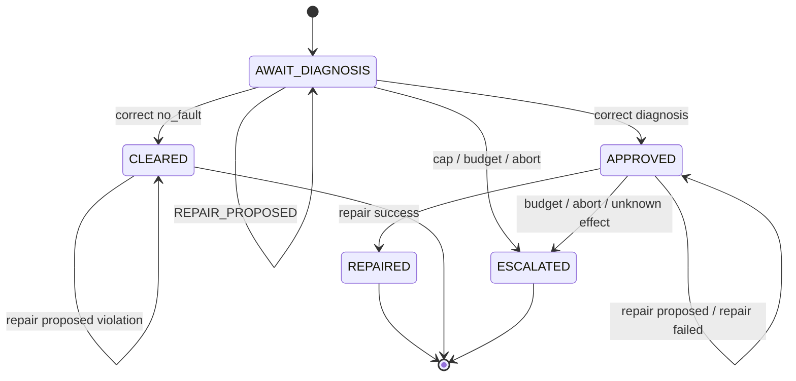
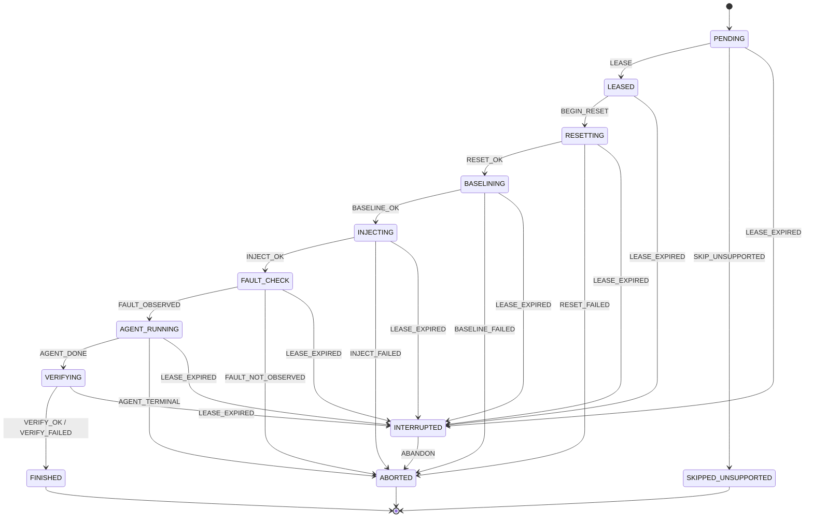
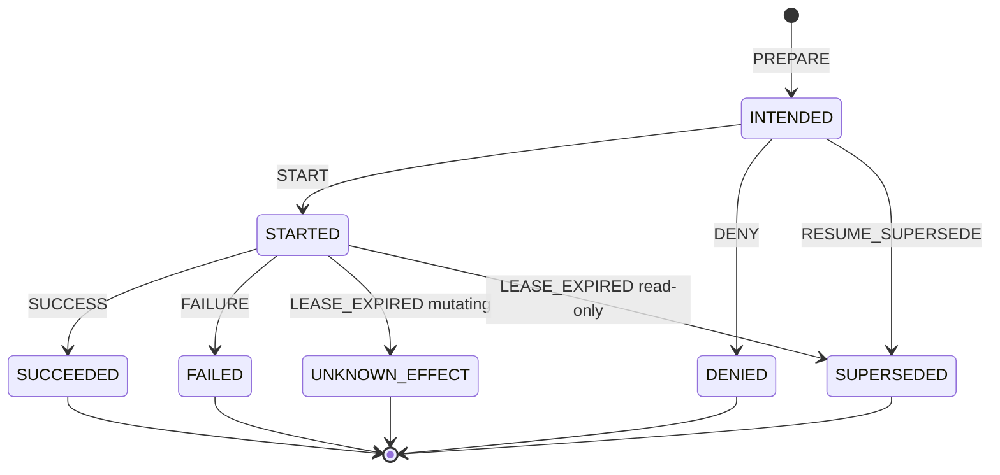

# State machine design

Status: authoritative design. This document defines the runtime contract.

The state machines own behavior. The append-only event log is the source of
truth; state projections are derived from it. Detailed concepts live in
[STATE_MACHINE_PRIMER.md](STATE_MACHINE_PRIMER.md), and delivery status lives in
[PHASES.md](../PHASES.md).

## Decision summary

| Decision | Short form | Section |
|---|---|---|
| Three machines | `GateState`, `RunState`, and `ToolState` own behavior. | §1, §4–§6 |
| Always-on gate | `GateRuntime` folds canonical gate events; no runtime modes. | §4 |
| Derived receipt | Receipt comes from `GateState` and `run_id`; tool arguments are never authoritative. | §4.7 |
| Event log | Append-only events drive fold, effects, projections, and rebuild. | §3.3, §9 |
| Pure core | `transition(state, event) -> Transition` plus a transactional shell. | §3 |
| Crash handling | Per-state crash actions and a reaper for expired leases. | §5.5, §5.6 |
| Tool outcomes | `ToolState` owns typed status/outcome; prefix strings are human evidence only. | §6 |
| One scorer | `gate-path-v1` reads folded state and `GatePath`. | §8 |
| Cross-machine order | Tool fold, then gate fold, then run fold. | §7.3 |
| Safety | No destructive `etcd-disk-full` sweeps; no secrets in traces or commits. | §11, §13 |

## 1. Scope and goals

The harness has exactly three state machines:

1. the gate machine, owned by `GateState`;
2. the run lifecycle, owned by `RunState`;
3. the tool-call lifecycle, owned by `ToolState`.

Goals:

- one explicit state per machine at any point in time;
- deterministic replay: `fold(events) == live_state`;
- illegal transitions are visible and testable;
- crash recovery is a per-state lookup, not scattered conditionals;
- typed gate and tool outcomes replace string-prefix inference;
- receipts are derived from state and run identity, never transported;
- generated diagrams come from the transition tables.

The design does not model the reset ladder, topology epoch, LLM loop, export
pipeline, or optional cluster-health observation. Those remain bounded
procedures, derived views, or out of scope.

## 2. Invariants

1. Every persisted state has a `StateSpec` with wire value, rank, `terminal`,
   `resumable`, `end_reason_required`, and crash action.
2. Terminal run states and parked `INTERRUPTED` runs require `end_reason`;
   resumability is separate from terminality.
3. `FINISHED` requires a score row and final record artifact.
4. Only the persistence shell writes state projections.
5. The reducer never performs I/O or reads the clock.
6. Replay is idempotent by `(run_id, machine, seq)`. Generated events without a
   producer seq carry an `idempotency_key` checked before append.
7. Illegal transitions append a rejection event, do not mutate projections, and
   make `apply()` raise after recording.
8. Final verification belongs to `RunState`, not `GateState`.
9. Export is outside both machines.
10. Responder provenance never overwrites chain identity fields.
11. A gate receipt is derived from `GateState` and `run_id`; no tool argument or
    event payload can supply it.
12. Tool result strings never determine authority; only `ToolState` and
    `ToolOutcome` do.
13. `state_json`, `state_snapshots`, UI rows, exports, and scores are rebuildable
    projections of the event log.
14. One canonical scorer consumes folded state; no second scorer is published.

## 3. Shared core design

### 3.1 Module layout

```text
harness/state_machine.py       generic core, Event, Effect, fold(), apply()
harness/machines/gate.py       gate states/events/table
harness/machines/run.py        run states/events/table
harness/machines/tools.py      tool-call states/events/table
scripts/gen_state_diagrams.py  Mermaid generator
```

Machine tables and the core stay small and dependency-free. Domain classifiers
turn raw model text, tool names, and scenario facts into typed event payloads
before the reducer sees them.

### 3.2 Core types

```python
class MachineKind(StrEnum):
    GATE = "gate"
    RUN = "run"
    TOOL = "tool"

class EffectKind(StrEnum):
    APPEND_EVENT = "append_event"
    SET_PROJECTION = "set_projection"
    SET_END_REASON = "set_end_reason"
    RECORD_ATTEMPT = "record_attempt"
    RECORD_VIOLATION = "record_violation"
    EMIT_NUDGE = "emit_nudge"
    ACQUIRE_LEASE = "acquire_lease"
    RENEW_LEASE = "renew_lease"
    RELEASE_LEASE = "release_lease"
    ABORT_AND_RETRY = "abort_and_retry"
    SCORE_PATH = "score_path"

@dataclass(frozen=True)
class Effect:
    kind: EffectKind
    payload: dict[str, Any]

@dataclass(frozen=True)
class Transition:
    state: State
    effects: tuple[Effect, ...] = ()
    reason: str | None = None

class IllegalTransition(ValueError):
    ...

@dataclass(frozen=True)
class StateSpec:
    value: str
    rank: int
    terminal: bool
    resumable: bool
    run_terminal: bool
    end_reason_required: bool
    crash_action: CrashAction | None
    renew_lease: bool = False
```

`terminal` means no further in-process work is expected. `resumable` means a new
process may continue the state after a crash. `INTERRUPTED` is terminal false,
resumable true, and requires an end reason. `run_terminal` is true only for
run-level end states.

### 3.3 Event envelope

Canonical event types use the append-only `trace_events` log:

```text
trace_events.type = "<machine>.<event_name_lowercase>"
trace_events.payload = {
  "state_before": "...",
  "state_after": "...",
  "event": "...",
  "reason": "..."
}
```

Canonical events include:

```text
gate.diagnosis_submitted
gate.nudge
gate.repair_proposed
gate.repair_finished
run.lease
run.reset_ok
run.fault_observed
run.agent_done
run.verify_ok
tool.prepare
tool.start
tool.success
tool.unknown_effect
state_transition_rejected
```

Every event payload carries its own typed facts. Receipts are not among them.

### 3.4 Persistence shell

The pure function changes nothing. The shell applies it:

```python
def apply(run_id: str, machine: MachineKind, event: MachineEvent) -> Transition:
    before = load_state(run_id, machine)
    try:
        result = transition(machine, before, event)
    except IllegalTransition as exc:
        with sqlite_transaction():
            append_event(run_id, "state_transition_rejected", {
                "machine": machine.value,
                "event": event.type,
                "state_before": before.value,
                "error": str(exc),
            })
        raise

    with sqlite_transaction():
        prior = find_idempotent_transition(run_id, machine, event)
        if prior is not None:
            return prior
        append_transition_event(run_id, machine, before, result, event)
        write_projections(run_id, machine, result.state, result.effects)

    execute_effects(run_id, result.effects)
    return result
```

`find_idempotent_transition()` checks `(run_id, machine, event.type,
event.idempotency_key)` when a key is present. Check and append happen in the
same transaction, so repeated reaper observations cannot append duplicate
transitions.

Caller contract:

- run loop: map an illegal transition to `ABORTED(reason=state_machine_bug)`;
- reaper: log and skip the affected run; do not retry the same event blindly;
- resume: fail closed and report the bug instead of continuing with stale state.

### 3.5 Fold

```python
def fold(machine: MachineKind, events: Sequence[TraceEvent]) -> State
```

Events are ordered by `(run_id, seq)`. The same event applied twice is a no-op.
Rebuild, resume, reaper, tests, and diagram generation all use `fold()`. A cache
is valid only when it matches the fold of the log.

### 3.6 Diagram generation

`scripts/gen_state_diagrams.py` imports the machine tables and writes
`docs/STATE_MACHINE.md`. Each state contributes a node with its wire value,
terminality, and crash action. Each transition contributes an edge labeled with
the event and guard. The generator fails on malformed tables.

## 4. Gate machine

### 4.1 Purpose

`GateRuntime` folds diagnosis, nudge, and repair events into `GateState`. It
authorizes repair, records violations, and produces a typed outcome for scoring.
It does not verify the cluster and does not write run terminal status.

### 4.2 State specs

| State | Wire value | Loop terminal | Run terminal | Resumable | End reason required | Crash action |
|---|---|---|---|---|---|---|
| `AWAIT_DIAGNOSIS` | `await_diagnosis` | no | no | yes | no | resume |
| `APPROVED` | `approved` | no | no | yes | no | resume; abort if mutating tool unknown |
| `REPAIRED` | `repaired` | yes | no | no | no | none |
| `CLEARED` | `no_fault_cleared` | yes | no | no | no | none |
| `ESCALATED` | `escalated` | yes | no | no | yes | none |

Loop terminal means the agent loop should stop. Run terminality belongs to
`RunState`.

### 4.3 Boundary classifiers

The reducer receives facts, not raw model text:

```python
classify_diagnosis(raw, scenario) -> DiagnosisFacts
classify_repair(canonical_name, args, scenario) -> RepairFacts
classify_repair_result(result) -> RepairResultFacts
```

`DiagnosisFacts` carries `label`, `correct`, `approved`, `is_no_fault`,
`attempts`, and `first_attempt_correct`. `RepairFacts` carries `canonical_name`,
`acceptable`, `forbidden`, and safe args. `RepairResultFacts` carries a typed
status such as `success`, `failed`, `timeout`, or `denied`.

`approved` distinguishes a correct diagnosis that earned a receipt from a
correct diagnosis where the operator declined. The latter records the correct
label but stays in `AWAIT_DIAGNOSIS`. A later denial from `APPROVED` also
withholds the receipt and clears any repair projection.

### 4.4 Events

| Event | Payload |
|---|---|
| `DIAGNOSIS_SUBMITTED` | `label`, `correct`, `approved`, `is_no_fault`, `attempts`, `first_attempt_correct`, `source` |
| `NUDGE` | `step`, `kind` (`no_tool` or `budget`), `nudge_count` |
| `REPAIR_PROPOSED` | `canonical_name`, `acceptable`, `forbidden`, `args` |
| `REPAIR_FINISHED` | `status`, `timed_out`, `result_summary` |
| `ESCALATE` | `reason` |
| `BUDGET_EXHAUSTED` | `reason`, `detail` |
| `ABORT` | `reason`, `actor` |
| `UNKNOWN_EFFECT` | `tool_call_id`, `reason` |

`GateState` carries `nudge_count`, incremented only by `NUDGE`. `MAX_NUDGES = 2`.
When the next nudge would exceed the cap, the nudge layer converts that
intention to `BUDGET_EXHAUSTED(reason=budget_tokens, detail=nudge_cap)` before
the transition; no further `NUDGE` event is emitted.

### 4.5 Transition table

| From | Event | Guard | To | End reason | Effects |
|---|---|---|---|---|---|
| `AWAIT_DIAGNOSIS` | `DIAGNOSIS_SUBMITTED` | correct, approved, no-fault | `CLEARED` | none | record attempt, derive receipt |
| `AWAIT_DIAGNOSIS` | `DIAGNOSIS_SUBMITTED` | correct, approved, not no-fault | `APPROVED` | none | record attempt, derive receipt |
| `AWAIT_DIAGNOSIS` | `DIAGNOSIS_SUBMITTED` | correct but not approved | `AWAIT_DIAGNOSIS` | none | record attempt, withhold receipt |
| `AWAIT_DIAGNOSIS` | `DIAGNOSIS_SUBMITTED` | wrong, below cap | `AWAIT_DIAGNOSIS` | none | record attempt |
| `AWAIT_DIAGNOSIS` | `DIAGNOSIS_SUBMITTED` | wrong, cap reached | `ESCALATED` | `diagnosis_attempts_exhausted` | record attempt |
| `AWAIT_DIAGNOSIS` | `NUDGE` | `nudge_count < MAX_NUDGES` | `AWAIT_DIAGNOSIS` | none | increment `nudge_count`, emit nudge |
| `AWAIT_DIAGNOSIS` | `BUDGET_EXHAUSTED` | nudge cap or token budget | `ESCALATED` | `budget_tokens` | record budget terminal |
| `AWAIT_DIAGNOSIS` | `REPAIR_PROPOSED` | always | `AWAIT_DIAGNOSIS` | none | record `premature_repair` violation |
| `AWAIT_DIAGNOSIS` | `ESCALATE` | always | `ESCALATED` | event `reason` | set end reason |
| `AWAIT_DIAGNOSIS` | `ABORT` | actor is operator | `ESCALATED` | `abandoned` | set end reason |
| `APPROVED` | `REPAIR_PROPOSED` | forbidden | `APPROVED` | none | record `forbidden_repair` violation |
| `APPROVED` | `REPAIR_PROPOSED` | not acceptable | `APPROVED` | none | record `unacceptable_repair` violation |
| `APPROVED` | `REPAIR_PROPOSED` | acceptable | `APPROVED` | none | record proposed repair |
| `APPROVED` | `REPAIR_FINISHED` | success | `REPAIRED` | none | record typed repair success |
| `APPROVED` | `REPAIR_FINISHED` | failure or timeout | `APPROVED` | none | record typed repair failure |
| `APPROVED` | `DIAGNOSIS_SUBMITTED` | correct and approved | `APPROVED` | none | record attempt, keep receipt |
| `APPROVED` | `DIAGNOSIS_SUBMITTED` | correct but not approved | `AWAIT_DIAGNOSIS` | none | record attempt, clear receipt and repair projection |
| `APPROVED` | `DIAGNOSIS_SUBMITTED` | wrong, below cap | `AWAIT_DIAGNOSIS` | none | record attempt, clear receipt |
| `APPROVED` | `DIAGNOSIS_SUBMITTED` | wrong, cap reached | `ESCALATED` | `diagnosis_attempts_exhausted` | record attempt, clear receipt |
| `APPROVED` | `UNKNOWN_EFFECT` | mutating tool ended unknown | `ESCALATED` | `unknown_effect` | set end reason; shell triggers retry |
| `APPROVED` | `ESCALATE` / `BUDGET_EXHAUSTED` / `ABORT` | always | `ESCALATED` | mapped reason | set end reason |
| `CLEARED` | `REPAIR_PROPOSED` | always | `CLEARED` | none | record `repair_after_no_fault` violation |
| `REPAIRED` / `CLEARED` / `ESCALATED` | any | always | reject | unchanged | append rejection event |

End-reason mapping:

- `ESCALATE` uses `event.reason` verbatim.
- `BUDGET_EXHAUSTED` maps to `budget_tokens`; `event.detail` is retained.
- `ABORT` maps to `abandoned` when `actor=operator`; other reasons are verbatim.
- If multiple terminal events arrive in one step, precedence is
  `BUDGET_EXHAUSTED` > `ESCALATE` > `ABORT`.

### 4.6 Escalation reason contract

| Reason | Source | Strict success | Headline treatment |
|---|---|---|---|
| `diagnosis_attempts_exhausted` | wrong diagnosis at cap | false | excluded from numerator, included in denominator |
| `budget_tokens` | nudge or token cap | false | excluded from numerator, included in denominator |
| `premature_repair` | repair before diagnosis | false via violations | excluded from numerator, included in denominator |
| `forbidden_repair` | forbidden tool | false via violations | excluded from numerator, included in denominator |
| `repair_after_no_fault` | repair on control run | false via violations | excluded from numerator, included in denominator |
| `unknown_effect` | mutating tool crash | false | excluded from numerator, included in denominator |
| `state_machine_bug` | illegal transition | false | excluded from numerator, included in denominator |

Run-level reasons such as `provider_error_all`, `fault_not_observed`,
`injection_failed`, and `abandoned` follow the same rule.

### 4.7 Receipt model

```python
def receipt_for(run_id: str) -> str:
    return f"approved:{run_id}"
```

- The receipt is derived from the folded `GateState` and the current `run_id`.
- It is never carried in tool arguments, approval event payloads, messages,
  exports, or UI output.
- Repair authorization reads `GateState`; arguments containing receipt-like
  strings have no authority.
- A retry uses its own `run_id` and therefore its own receipt.

### 4.8 Tool visibility

Default `--tool-visibility always` keeps all tools visible and measures illegal
attempts. `--tool-visibility gated` injects the currently valid tool list into
the prompt for the ablation. Both use the same gate machine; gating changes what
the model sees, not what counts as a violation.

## 5. Run lifecycle machine

### 5.1 Purpose

`RunState` owns run status, phase, end reason, lease lifecycle, crash actions,
resume triage, final verification, and terminal outcome. It does not own
diagnosis correctness or repair authorization.

### 5.2 State specs

| State | `status` | `phase` | Terminal | Resumable | End reason required | Crash action |
|---|---|---|---|---|---|---|
| `PENDING` | `pending` | `queued` | no | yes | no | resume (re-lease) |
| `LEASED` | `running` | `leased` | no | yes | no | resume (re-lease) |
| `RESETTING` | `running` | `resetting` | no | yes | no | resume (re-lease) |
| `BASELINING` | `running` | `baseline` | no | yes | no | resume (re-lease) |
| `INJECTING` | `running` | `injecting` | no | yes | no | new run after reset |
| `FAULT_CHECK` | `running` | `fault_check` | no | yes | no | new run after reset |
| `AGENT_RUNNING` | `running` | `agent_running` | no | yes | no | resume or retry |
| `VERIFYING` | `running` | `verifying` | no | yes | no | rerun verify |
| `INTERRUPTED` | `interrupted` | `interrupted` | no | yes | yes | per previous state |
| `FINISHED` | `finished` | `finished` | yes | no | yes | none |
| `ABORTED` | `aborted` | `aborted` | yes | no | yes | none |
| `SKIPPED_UNSUPPORTED` | `skipped_unsupported` | `skipped_unsupported` | yes | no | yes | none |

`INTERRUPTED` is a parked nonterminal state. It records `previous_state` and
`lease_expires_at` in the `LEASE_EXPIRED` payload. `--abandon` moves it to
`ABORTED(reason=abandoned)`.

### 5.3 Events

| Event | Payload |
|---|---|
| `CREATE` | `scenario_id`, `backend`, `config_hash`, `topology_hash` |
| `LEASE` | `lease_owner`, `lease_expires_at` |
| `SKIP_UNSUPPORTED` | `reason` |
| `BEGIN_RESET` | none |
| `RESET_OK` / `RESET_FAILED` | `output_ref` |
| `BASELINE_OK` / `BASELINE_FAILED` | `output_ref` |
| `INJECT_OK` / `INJECT_FAILED` | `output_ref`, `reason` |
| `FAULT_OBSERVED` / `FAULT_NOT_OBSERVED` | `detail`, `elapsed`, `timeout`, `targets` |
| `AGENT_DONE` | `gate_terminal`, `gate_reason` |
| `AGENT_TERMINAL` | `reason` |
| `VERIFY_OK` / `VERIFY_FAILED` | `output_ref` |
| `ABORT` | `reason`, `actor` |
| `ABANDON` | `actor`, `reason=abandoned` |
| `PROVIDER_ERROR_ALL` | `attempts`, `errors`, `last_backend`, `chain_id` |
| `ILLEGAL_TRANSITION` | `machine`, `event`, `state_before`, `error` |
| `LEASE_EXPIRED` | `reason`, `detected_by`, `previous_state`, `lease_expires_at`, `idempotency_key` |
| `REAP` | `from_state`, `owner_status`, `lease_expires_at`, `idempotency_key` |

### 5.4 Transition table

| From | Event | To | End reason | Effects |
|---|---|---|---|---|
| none | `CREATE` | `PENDING` | none | create run row, emit event |
| `PENDING` | `LEASE` | `LEASED` | none | acquire lease |
| `PENDING` / `LEASED` | `SKIP_UNSUPPORTED` | `SKIPPED_UNSUPPORTED` | `unsupported` | set reason, write terminal record |
| `LEASED` | `BEGIN_RESET` | `RESETTING` | none | start setup renewal |
| `RESETTING` | `RESET_OK` | `BASELINING` | none | continue lease renewal through baseline |
| `RESETTING` | `RESET_FAILED` | `ABORTED` | `reset_failed` | release lease |
| `BASELINING` | `BASELINE_OK` | `INJECTING` | none | continue lease renewal |
| `BASELINING` | `BASELINE_FAILED` | `ABORTED` | `baseline_failed` | release lease |
| `INJECTING` | `INJECT_OK` | `FAULT_CHECK` | none | continue lease renewal |
| `INJECTING` | `INJECT_FAILED` | `ABORTED` | `injection_failed` | release lease |
| `FAULT_CHECK` | `FAULT_OBSERVED` | `AGENT_RUNNING` | none | pass `fault_present=true` to agent |
| `FAULT_CHECK` | `FAULT_NOT_OBSERVED` | `ABORTED` | `fault_not_observed` | release lease |
| `AGENT_RUNNING` | `AGENT_DONE` | `VERIFYING` | none | carry gate outcome into score path |
| `AGENT_RUNNING` | `AGENT_TERMINAL` | `ABORTED` | gate end reason | gate escalation or budget |
| `AGENT_RUNNING` | `PROVIDER_ERROR_ALL` | `ABORTED` | `provider_error_all` | persist ordered attempts, release lease |
| `VERIFYING` | `VERIFY_OK` | `FINISHED` | `verify_ok` | write score and final record, release lease |
| `VERIFYING` | `VERIFY_FAILED` | `FINISHED` | `verify_failed` | write score and final record, `verify_ok=false`, release lease |
| any nonterminal, including `INTERRUPTED` | `ABORT` | `ABORTED` | typed abort reason | release lease |
| `INTERRUPTED` | `ABANDON` | `ABORTED` | `abandoned` | release lease |
| any nonterminal | `ILLEGAL_TRANSITION` | `ABORTED` | `state_machine_bug` | log machine/event, release lease |
| any nonterminal except `INTERRUPTED` | `LEASE_EXPIRED` | `INTERRUPTED` | `lease_expired` | preserve previous state and idempotency key |
| `INTERRUPTED` | `LEASE_EXPIRED` | `INTERRUPTED` | unchanged | idempotent no-op when key matches; otherwise reject |
| terminal | any | reject | unchanged | append rejection event |

An `ILLEGAL_TRANSITION` reaching `RunState` is a harness bug. It aborts with
`state_machine_bug` and the rejection remains in the trace.

A second lease-expiry observation on an already `INTERRUPTED` run is not a
re-entry. Matching `idempotency_key` values return the stored `Transition`
without appending; a different key is rejected and the original
`previous_state` is preserved.

### 5.5 Resume triage

The key is `previous_state` from the `LEASE_EXPIRED` payload. If it is missing,
the reaper aborts with `interrupted_unknown_previous_state`.

| Previous state | Action | Rationale |
|---|---|---|
| `PENDING`, `LEASED`, `RESETTING`, `BASELINING` | resume (re-lease) | No fault has been injected. |
| `INJECTING`, `FAULT_CHECK` | new run after reset | Fault may be half-applied or unproven. |
| `AGENT_RUNNING` | resume | Conversation and gate state can be replayed. |
| `AGENT_RUNNING` with mutating tool `UNKNOWN_EFFECT` | abort and retry; gate `APPROVED -> ESCALATED(unknown_effect)` | Repair may have side effects. |
| `VERIFYING` | rerun verify | Verification is read-only. |
| terminal | no action | Already complete. |

`--force-resume` bypasses only config-hash mismatch. It never bypasses topology
mismatch or an unknown mutating effect. `--abandon` is the explicit operator
exit from `INTERRUPTED`.

### 5.6 Lease renewal and reaper

- Keep the 300-second lease TTL.
- Extend lease renewal through reset, baseline, inject, and fault-check.
- The reaper lives in `harness/reaper.py` and is invoked by `chaos_cli.py`
  startup and `./chaos status`.
- The reaper scans nonterminal runs with expired leases and no live owner, then
  emits `run.lease_expired`.
- The reaper never runs from the crashed process.
- Generated events carry
  `idempotency_key = "reap:{run_id}:{previous_state}:{lease_expires_at}"`.
- `INTERRUPTED` stores `previous_state`, `lease_expires_at`, and the key so
  resume can select the crash action.
- `./chaos abort <run_id> --abandon` applies `run.ABANDON` and refuses
  non-`INTERRUPTED` runs.

### 5.7 Verify and export boundaries

The agent loop emits `AGENT_DONE`; `RunState` transitions to `FINISHED`. Export
happens after terminal state and outside the machine, so export failure cannot
make a completed run look unfinished.

## 6. Tool-call machine

### 6.1 Purpose

`ToolState` makes mutating side effects explicit. A crash between intent and
outcome becomes a named state instead of a heuristic over status rows and result
strings.

### 6.2 State specs

| State | Wire value | Outcome code | Terminal | Mutating semantics |
|---|---|---|---|---|
| `INTENDED` | `intended` | none | no | intent persisted before execution |
| `STARTED` | `started` | none | no | execution began |
| `SUCCEEDED` | `succeeded` | `success` | yes | typed success |
| `FAILED` | `failed` | typed failure code | yes | typed failure |
| `DENIED` | `denied` | `denied` | yes | gate denied before execution |
| `UNKNOWN_EFFECT` | `unknown_effect` | `unknown_effect` | yes | mutating outcome unknown |
| `SUPERSEDED` | `superseded` | `superseded_after_resume` | yes | read-only call closed by resume |

### 6.3 Events

| Event | Payload |
|---|---|
| `PREPARE` | `name`, `args`, `mutating`, `destructive` |
| `START` | none |
| `SUCCESS` | typed result, artifact ref |
| `FAILURE` | typed error, artifact ref |
| `DENY` | `reason`, `violation_kind` |
| `CANCEL` | `reason`, `detected_by` |
| `LEASE_EXPIRED` | `mutating`, `detected_by` |
| `RESUME_SUPERSEDE` | `reason` |

### 6.4 Transition table

| From | Event | Guard | To | Effects |
|---|---|---|---|---|
| none | `PREPARE` | always | `INTENDED` | persist intent before execution |
| `INTENDED` | `START` | always | `STARTED` | update status |
| `STARTED` | `SUCCESS` | always | `SUCCEEDED` | persist typed result |
| `STARTED` | `FAILURE` | always | `FAILED` | persist typed error |
| `INTENDED` | `DENY` | gate denied before execution | `DENIED` | record violation, no execution |
| `STARTED` | `DENY` | always | reject | append `state_transition_rejected` |
| `STARTED` | `CANCEL` | mutating | `UNKNOWN_EFFECT` | force abort-and-retry |
| `STARTED` | `LEASE_EXPIRED` | mutating | `UNKNOWN_EFFECT` | force abort-and-retry |
| `STARTED` | `LEASE_EXPIRED` | read-only | `SUPERSEDED` | allow resume |
| `INTENDED` / `STARTED` | `RESUME_SUPERSEDE` | read-only | `SUPERSEDED` | allow resume |
| terminal | any | always | reject | append rejection event |

Denial is valid only before execution. A post-start cancellation cannot claim
`DENIED`; it must surface as `UNKNOWN_EFFECT` for mutating calls.

### 6.5 Typed outcomes

`ToolOutcome.status` and `ToolOutcome.code` are authoritative for repair
success. Strings such as `ERROR:`, `BLOCKED:`, and `timeout waiting for` remain
in artifacts for humans but are never parsed to decide state or score. A repair
call reaching `RESUME_SUPERSEDE` is a bug: the tool machine rejects it and the
run follows the unknown-effect path.

## 7. Event and projection integration

### 7.1 Writes by machine

| Machine | Primary event source | Projections updated |
|---|---|---|
| `GateState` | `gate.*` | `runs.diagnosis*`, `approval_granted`, repair and policy fields, `state_json` |
| `RunState` | `run.*` | `runs.status`, `phase`, `end_reason`, lease fields, final record |
| `ToolState` | `tool.*` | `tool_calls.status`, typed result fields, artifact refs |

### 7.2 Projection ownership

Only the persistence shell writes:

- `runs.status`, `runs.phase`, `runs.end_reason`;
- gate scalar columns and policy/repair scalar columns;
- `tool_calls.status` and typed result fields;
- `state_json` and `state_snapshots`.

UI and replay are read-only consumers.

### 7.3 Cross-machine coordination

Machines never call each other directly. A coordinator folds them in a fixed
order:

1. tool states, per call;
2. gate state;
3. run state.

The run machine consumes gate terminal state and tool outcome as read-only
observations. Rules:

- mutating tool `UNKNOWN_EFFECT` -> gate `APPROVED -> ESCALATED(unknown_effect)`
  -> run `AGENT_RUNNING -> ABORTED(unknown_effect)` with `ABORT_AND_RETRY`;
- gate `REPAIRED` or `CLEARED` -> run `AGENT_DONE -> VERIFYING`;
- gate `ESCALATED` -> run `AGENT_TERMINAL -> ABORTED` with the gate end reason;
- tool `SUPERSEDED` on a read-only call -> no gate or run transition; resume
  proceeds from the gate fold.

The shell executes coordination effects after all folds agree, so a partial
crash cannot leave the gate in `APPROVED` while the run has already retried.

## 8. Scoring

### 8.1 Gate path record

Each gate emits a derived path record:

```python
@dataclass(frozen=True)
class GatePath:
    visited: tuple[GateState, ...]
    terminal: GateState
    terminal_reason: str | None
    diagnosis_submitted: bool
    first_attempt_correct: bool
    receipt_issued: bool
    repair_proposed: bool
    repair_executed: bool
    repair_status: str | None
    violations: tuple[str, ...]
```

It is stored as a `run_artifacts` row with kind `gate_path`, and its fields are
merged into the score payload. `GatePath` is derived from the fold and is never
an authoritative source for gate state.

### 8.2 Strict success

```text
strict = true iff
  fault_present
  and run state reached FINISHED
  and gate terminal in {REPAIRED, CLEARED}
  and if gate terminal is REPAIRED, APPROVED was visited
  and first_attempt_correct
  and receipt_issued
  and verify_ok
  and violations is empty
  and end_reason == verify_ok
  and budget was not exhausted
```

The excluded reason set is explicit: any gate escalation reason in §4.6,
`provider_error_all`, `fault_not_observed`, `reset_failed`, `baseline_failed`,
`injection_failed`, `state_machine_bug`, `lease_expired`,
`interrupted_unknown_previous_state`, `abandoned`, and any budget end reason.
Only `verify_ok` is a strict-success end reason. Adding a new strict-eligible
end reason changes this rule, §5.4, and the scorer tests together.

A control run reaching `CLEARED` needs no repair. A control run that attempts a
repair stays `CLEARED` but records `repair_after_no_fault`, so it fails strict.

Provider failure means all configured candidates failed and the end reason is
`provider_error_all`; earlier failed fallback candidates do not fail strict.
Fallback-enabled headline rates are grouped by `chain_id`. Per-backend baselines
are reported separately with `CHAOS_LLM_FALLBACK=0`.

### 8.3 Funnel metrics

The path yields counts for:

- fault observed;
- diagnosis submitted;
- diagnosis correct;
- approved;
- repair proposed;
- repair executed;
- verification passed;
- escalated;
- policy violation observed.

These are views over one path, not separate scorers.

### 8.4 One canonical scorer

`SCORER_VERSION = "gate-path-v1"`. It reads folded `GatePath`, `RunState`, and
`ToolState` values. No second scorer is published and no score comparison
window is required. Existing read-only exclusions continue to apply: resumed,
interactive, provider-error, unsupported, and unverified-fault runs are handled
by the canonical rules.

## 9. Data model

- `trace_events` is the authoritative append-only log with `seq`, `type`,
  `payload`, and `ts`.
- `tool_calls` records the current `ToolState` projection and typed outcome.
- `runs` records the `RunState` projection, lease fields, and end reason.
- `run_artifacts` holds `GatePath`, final records, and evidence artifacts.
- `scores` stores the canonical scorer version.
- `state_json` and `state_snapshots` are caches that can be dropped and rebuilt
  from the event log.
- Derived traces, exports, replay HTML, and score summaries are read-only
  projections.

The schema evolves with these facts. No projection is a source of truth.

## 10. Observability and operations

### 10.1 Replay

Replay shows machine transitions as compact events, with full payloads in
artifacts. Secrets are never written to event payloads. Gate receipts are not
stored in payloads or displayed.

### 10.2 Doctor checks

`db_cli.py doctor --strict` checks for:

- terminal run without `end_reason`;
- `FINISHED` without score row or final record;
- nonterminal run with expired lease and live owner;
- illegal transition events;
- gate terminal state that disagrees with projections;
- unfinished mutating tool calls with outcome `unknown_effect`;
- semantically duplicate generated transitions with the same `idempotency_key`;
- `INTERRUPTED` runs without `previous_state` or an end reason;
- cached projections that disagree with `fold(events)`.

### 10.3 UI

`LiveView` reads folded machine states and projections. It does not infer state
itself. The topology line stays health-free.

## 11. Safety and operational boundaries

- Destructive tools require the context/cluster/topology allow-list enforced by
  `tools/safety.py`.
- Fixture topology is test-only and requires an explicit opt-in; the destructive
  guard still applies.
- A topology hash mismatch refuses resume and requires an explicit discard for
  intentional cleanup.
- No secrets in event payloads, traces, prompts, exports, commits, or UI output.
- Receipts are derived and never passed as tool arguments.
- `etcd-disk-full` is excluded from live sweeps: filling an etcd data filesystem
  can leave a member unrecoverable and require host-level cleanup.
- Live and destructive validation requires operator confirmation.

## 12. Test plan

### 12.1 Table tests

For every machine:

- every `(state, event)` pair yields either a defined transition or a defined
  rejection;
- a missing cell is a test failure, not a runtime surprise;
- every terminal state has required invariants;
- every nonterminal state has a crash action;
- every state is reachable or explicitly marked historical;
- transition ranks never decrease except for defined retry paths;
- illegal transitions append a rejection event and preserve state.

### 12.2 Fold and rebuild tests

- `fold(events) == live_state` for seeded scenarios;
- replaying events twice is idempotent;
- reordering by `seq` yields deterministic state;
- caches can be dropped and rebuilt from the event log;
- later denial clears receipt and correctness;
- responder provenance does not change chain identity;
- doctor detects cache and projection disagreement.

### 12.3 Gate tests

- correct diagnosis derives a receipt and reaches `APPROVED`;
- correct no-fault reaches `CLEARED`;
- wrong diagnosis at cap reaches `ESCALATED`;
- repair before diagnosis is a typed violation;
- forbidden and unacceptable repairs are distinct typed violations;
- repair timeout is typed, not a successful repair;
- duplicate nudge cannot be emitted after resume;
- operator decline withholds authorization.

### 12.4 Run lifecycle tests

- each transition writes the expected status/phase projection;
- fault not observed aborts before the agent starts;
- injection failure aborts with `injection_failed`;
- lease expiry emits `INTERRUPTED` exactly once;
- crash action lookup returns the expected action for every state;
- resume refuses topology mismatch;
- unknown mutating effect forces retry;
- verify failure still reaches `FINISHED` with `verify_ok=false`;
- export failure does not change run state.

### 12.5 Tool-call tests

- intent is persisted before execution;
- success, failure, and denial are typed;
- mutating crash becomes `UNKNOWN_EFFECT`;
- read-only crash becomes `SUPERSEDED`;
- resume supersedes only read-only calls;
- prefix strings are preserved but never used as outcome authority.

### 12.6 Scorer tests

- strict success requires folded gate, run, and tool outcomes;
- no-fault strict success still works;
- fallback success remains headline-eligible;
- all-candidate failure is provider error;
- earlier fallback failure is not provider error;
- policy violations fail strict success;
- budget cutoffs fail strict success but remain visible.

### 12.7 Live acceptance

- one healthy control run;
- one injected fault run with successful repair;
- one fault-not-observed run;
- one resume after agent crash;
- one retry after mutating tool crash;
- one no-fault run with attempted repair;
- one fallback run where the primary fails and another endpoint answers.

## 13. Implementation plan

This is the single ordered implementation plan for the design. Each step builds
on the previous one and updates `PHASES.md` with concise status.

1. **Reducer core.** Define `StateSpec`, `Event`, `Transition`, `Machine`,
   `fold()`, and `apply()`. Add exhaustive `(state, event)` matrix tests,
   idempotent replay tests, and the diagram generator.
2. **GateRuntime.** Fold diagnosis, nudge, repair proposal, and typed repair
   outcome events into `GateState`. Derive the receipt from `GateState` and
   `run_id`; remove receipt transport from tool arguments and payloads. Derive
   `GatePath` for the canonical scorer.
3. **RunState.** Move status, phase, end reason, lease, verification, resume
   triage, and terminal outcome into the shell. Add setup lease renewal, the
   reaper, and `--abandon`.
4. **ToolState.** Persist intent before execution, type all outcomes, name
   `UNKNOWN_EFFECT` and `SUPERSEDED`, and stop parsing prefix strings as
   authority.
5. **Projection rebuild.** Make `state_json`, snapshots, exports, UI, replay,
   and doctor checks derive from the event log. Verify cache rebuild from the
   fold.
6. **Canonical scorer.** Publish `gate-path-v1` from folded state and gate paths.
   Funnel metrics read the same path.
7. **Acceptance.** Regenerate diagrams, run focused and full suites, and record
   live results for the matrix in §12.7.

Verification commands:

```bash
python3 -m unittest discover -s tests -v
python3 -m compileall -q .
bash -n run_benchmark.sh
git diff --check
python3 db_cli.py init
python3 db_cli.py migrate
python3 db_cli.py doctor --strict
python3 score.py --db results.sqlite3 --format json
python3 replay.py --db results.sqlite3 --output /tmp/opencode/replay.html
```

Focused suites by workstream:

- reducer: `tests.test_state_machine`, `tests.test_state_machine_tables`,
  `tests.test_gate_runtime`;
- gate: `tests.test_gate`, `tests.test_tooling`,
  `tests.test_review_hardening`, `tests.test_domain_objects`,
  `tests.test_resume`;
- run: `tests.test_run_benchmark_topology`, `tests.test_chaos_cli`,
  `tests.test_reaper`, `tests.test_sqlite_store`;
- tool: `tests.test_tooling`, `tests.test_domain_objects`,
  `tests.test_sqlite_store`, `tests.test_db_cli`;
- scoring: `tests.test_score_db`, `tests.test_replay`, `tests.test_hardening`.

`etcd-disk-full` stays out of live sweeps. Never put secrets in traces or
commits.

## 14. Risks and mitigations

| Risk | Mitigation |
|---|---|
| Crash between event append and projection write | Shell transaction plus cache rebuild from fold. |
| Expired lease during long setup | Renew through reset, baseline, inject, and fault-check. |
| Reaper races with runner | Lease owner check plus idempotent transition key. |
| Mutating outcome cannot be inferred | `UNKNOWN_EFFECT` forces abort-and-retry. |
| Generated events arrive twice | `idempotency_key` checked before append. |
| Prefix strings influence state | Classifiers produce typed outcomes; strings stay in artifacts. |
| Projection drift | Doctor checks and rebuild from event log. |
| Secret leakage | Redaction at write time and review of traces, prompts, exports, and commits. |
| Destructive filesystem fault | Keep `etcd-disk-full` outside live sweeps. |

## Appendix A — gate diagram

The generator owns the final file.



## Appendix B — run lifecycle diagram



Both `VERIFY_OK` and `VERIFY_FAILED` enter `FINISHED` only after the shell writes
the score row and final record artifact.

## Appendix C — tool-call diagram



Denial is valid only from `INTENDED`; a deny after `STARTED` is rejected.

## Appendix D — glossary

| Term | Meaning |
|---|---|
| Reducer | Pure `(state, event) -> (state, effects)` function. |
| Effect | Declarative side effect returned by the reducer. |
| Shell | Persistence layer that applies a transition transactionally and runs effects. |
| Projection | Cache derived from the authoritative event log. |
| Fold | Replay of ordered events into current state. |
| Gate-local terminal | Agent loop should stop, but run lifecycle continues. |
| Crash action | Recovery rule chosen from the state where a process died. |
| Gate receipt | Value derived from `GateState` and `run_id`; never transported in tool arguments. |
| Idempotency key | Deterministic key on generated events that prevents duplicate transitions. |
| Parked nonterminal | A resumable, reason-required state such as `INTERRUPTED` that is not actively executing. |
| Chain ID | Hash of the ordered LLM endpoint list; grouping key for fallback-enabled headline rates. |
