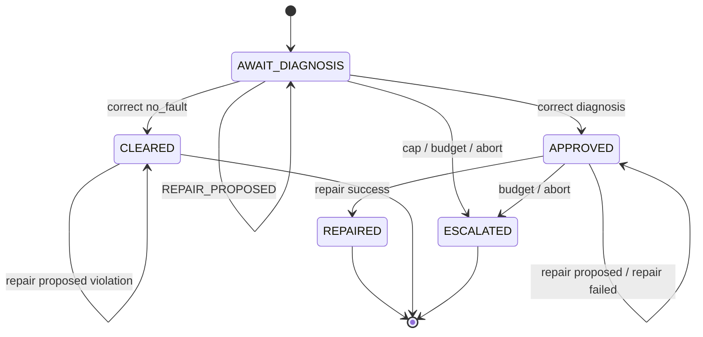
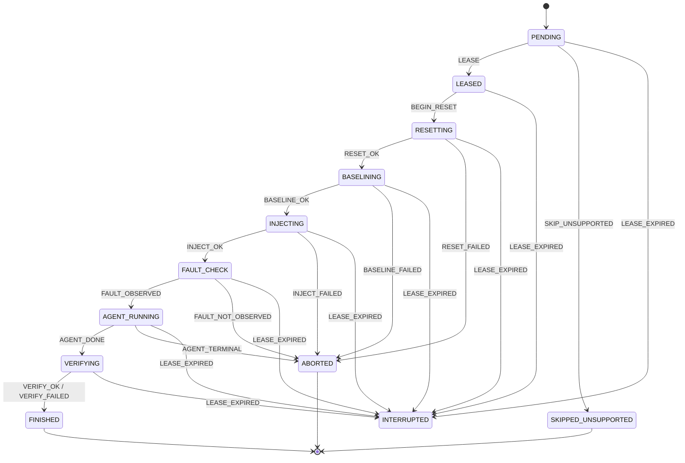
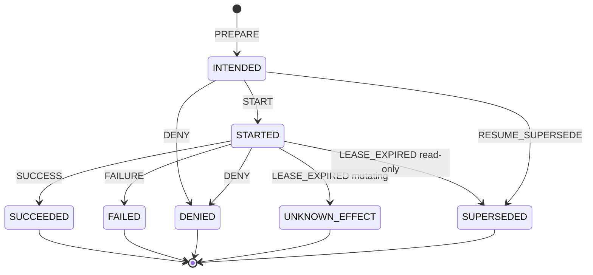

# State machine design

Status: proposed for review. Source discussions: `statemachine.md` and
`new_feedback.md`. Line references are from HEAD `e30674a` before implementation;
current code wins if lines drift.

This document is a design proposal only. No runtime behavior is changed by this
document. It is intended to give reviewers enough concrete detail to comment on
state ownership, transitions, persistence, compatibility, tests, and rollout.

## Decision summary

These are the decisions a reviewer needs to approve. The rest of the document is
the defense.

| Decision | Short form | Section |
|---|---|---|
| Three machines | Gate, run lifecycle, tool call; no reset-ladder, topology, LLM-loop, export, or health machine. | §3.3 |
| Pure core | `transition(state, event) -> Transition` plus a transactional persistence shell. | §4 |
| No schema bump | Events and paths use existing `trace_events` and `run_artifacts` tables. | §10.1 |
| Receipt derivation | `approved:<current run_id>`, derived by fold, absent from payloads; retries get a new receipt. | §5.7 |
| `INTERRUPTED` | Parked nonterminal, resumable, reason-required state with an operator `--abandon` path. | §6.2, §6.6 |
| Fallback identity | Responder is provenance; chain identity stays on the run; headline grouped by `chain_id`. | §1.3, §9.2 |
| Tool status v1 | New states are internal aliases; v1 persists legacy `finished`/`failed` plus a typed `result.code`. | §7.2, §10.1 |
| Scorer v1 | `gate-path-v1` is annotation-only for one release; parity report is public. | §9.4 |
| Lease safety | Setup lease renewal lands before the reaper is enabled. | §6.6 |
| Cross-machine order | Tool fold, then gate fold, then run fold; unknown mutating effect escalates outward. | §8.4 |

## 0. Executive summary

The harness already behaves like three small state machines:

1. the agent/gate machine, currently represented by booleans and repair strings;
2. the run lifecycle, currently represented by `runs.status`, `runs.phase`,
   `runs.end_reason`, and procedural code in `run_benchmark.py`;
3. the tool-call lifecycle, currently represented by `tool_calls.status` and
   resume heuristics.

The proposal is to make those machines explicit with hand-rolled enums, frozen
event dataclasses, and `(state, event)` transition tables. The transition core is
pure: `transition(state, event) -> (state, effects)`. A thin persistence shell
appends the transition event and updates projections in one SQLite transaction.
State becomes `fold(events)`, and the current scalar columns become projections
for compatibility, UI, and reporting.

Rollout order:

1. build the core, adapters, exhaustive tests, and shadow comparison;
2. cut over the gate machine;
3. add setup-phase lease renewal, lifecycle transitions, and a reaper that
   derives `interrupted`;
4. cut over tool calls and typed outcomes;
5. publish `gate-path-v1` as an annotation-only scorer for one release, with a
   public parity report, before any canonical switch;
6. leave the optional cluster-health observer out of the first implementation.

### 0.1 What this design does not fix

This is one refactor among several, not the whole hardening program. The state
machines resolve P0.3, P1.5, P1.7, P1.12, P2.6, the run-crash state gap, resume
ambiguity, and tool unknown effect. They do **not** resolve the following known
gaps, which remain tracked in `docs/ARCHITECTURE.md` §5:

- P1.4: success is still computed independently in `common/scoring.py`,
  `score.py`, and `replay.py`; `gate-path-v1` adds another version rather than
  unifying the read side.
- P1.6: the trace is still written by the engine and rewritten by
  `export_all()`.
- P1.8: `tools/` still mixes domain tools with infrastructure.
- P1.9: primitive-obsession leftovers such as `config_hash`, `Backend`, and
  `call_id` remain; typed events reduce but do not eliminate them.
- P1.10: destructive policy is still split across the gate machine,
  `safety.py`, `topology.py:capability`, and `prompt.py`.
- P1.14: `run_benchmark.main()` and `chaos_cli.main()` still mix argv, exit, and
  subprocess concerns; Phase 2 changes what they call, not their shape.
- P2.1: streaming fallback invisibility is unrelated to machines.
- P2.5: score-version precedence on the read side, including the `ORDER BY`
  ambiguity, is unchanged.

## 1. Review inputs and decisions

### 1.1 Where the reviewers agree

- Two core machines: gate and run lifecycle.
- A third small tool-call machine for resume safety.
- Hand-rolled tables, not a state-machine library.
- Do not model the reset ladder; it is a bounded bash escalation.
- Do not model topology epoch; it is an active/stale flag.
- Do not wrap the LLM loop in a machine; it remains a budgeted loop.
- SQLite events are the source of truth; `state_json`, `state_snapshots`, and
  scalar `runs.*` fields are projections.
- Illegal transitions are logged as bugs, not silently ignored.
- Tests should cover every state/event pair and generated diagrams should come
  from the same tables.

### 1.2 Decisions where reviewers differed

| Topic | Decision | Rationale |
|---|---|---|
| First machine | Gate | Smallest, purest, maps to several known gaps. |
| Reducer style | Pure reducer plus persistence shell | Keeps replay deterministic and effects explicit. |
| Crash handling | Crash-action table per state | Resume, retry-after-reset, rerun-verify, and do-nothing are different actions. |
| `interrupted` | Derived by reaper/startup sweep | A crashed process cannot record its own crash. |
| Verify | Run lifecycle, not gate | Avoids combined gate/run state explosion. |
| Export | Not a run state | Already derived and rerunnable. |
| Tool visibility | `always` default, `gated` ablation | Current metrics measure forbidden/premature attempts. |
| No-fault path | Explicit `CLEARED` gate state | Control scenarios need a clean terminal gate result. |
| Receipt | Derive from `run_id`; remove from event payload | The receipt is `approved:<run_id>`, not a secret. |
| Cluster-health observer | Defer | It may be useful later, but it must never gate or leak to the model. |

### 1.3 Third-review prerequisite: fallback comparability

The fallback-eligibility question in `new_feedback.md` is settled:

- A run that eventually answers on a fallback is headline-eligible. Failures of
  earlier candidates are not a run-level `provider_error_*` when a later
  candidate answers.
- The responder is provenance, not a score gate. `runs.backend` and `runs.model`
  keep the selected chain identity and are not rewritten to the responder.
  `llm_requests.backend`, messages, `llm_response_full`, and `assistant` events
  record the actual responder, requested backend, fallback path, and skipped
  candidates.
- Current score tables group by `runs.backend`; fallback-enabled runs are
  comparable as configured chains, not as clean per-backend baselines.
  Per-backend baselines require `--backend <name>` and `CHAOS_LLM_FALLBACK=0`.
- With fallback enabled, comparability has three dimensions: scenario,
  temperature (fixed at `0.2`), and chain configuration. `--seed` is recorded
  metadata, not sampling control.
- When all configured candidates fail, the end reason is exactly
  `provider_error_all`; the ordered attempts and their error codes remain in the
  event payload. There is no `provider_error_<last>` variant.
- A `chain_id` is derived from the ordered endpoint list and stored as a run
  projection. Fallback-enabled headline rates are grouped by `chain_id`, not by
  `backend`; per-backend baselines remain separate and require
  `CHAOS_LLM_FALLBACK=0`.

The path scorer in §9 must preserve these rules.

## 2. Current state, as built

### 2.1 Gate state

`AgentState` is defined at `harness/tooling.py:31-47` and serialized by
`AgentState.snapshot()` at `harness/tooling.py:73-99`. Important fields include
`diagnosis`, `diagnosis_correct`, `diagnosis_attempts`,
`diagnosis_first_attempt_correct`, `approval_token`, `approval_source`, `repair`,
`policy_violations`, and `forbidden_reason`.

Diagnosis handling is at `harness/tooling.py:137-208`:

- attempt cap: `MAX_DIAGNOSIS_ATTEMPTS = 2` at `harness/tooling.py:13`;
- correctness is computed by label comparison at `harness/tooling.py:142`;
- receipt is issued as `approved:<run_id>` at `harness/tooling.py:161`;
- approval event is emitted at `harness/tooling.py:194-205`;
- diagnosis attempt row is written at `harness/tooling.py:206-207`.

Repair handling is at `harness/tooling.py:256-329`:

- repair name canonicalization at `:257`;
- diagnosis and receipt checks at `:259-271`;
- forbidden/acceptable checks at `:272-275`;
- refusal kind is inferred from the substring `"forbidden"` at `:283`;
- `forbidden_reason` is inferred from the same substring at `:305`;
- timeout is inferred from the `timeout waiting for` prefix at `:316-317`;
- status is inferred from the `ERROR:` prefix at `:318-320`.

Rebuild and cache behavior:

- `storage/sqlite_store.py:1218-1276` rebuilds state from events and tool rows;
- later approval events clear and reapply receipt-derived fields at
  `:1246-1256`;
- cache hits refresh receipt-derived keys at `:1281-1289`;
- `set_state()` strips `approval_token` from `state_json` at `:1294-1318`.

Checkpoint projections are in `harness/checkpoint.py:42-82`. Four overlapping
representations remain: live `AgentState`, `runs.state_json`, `state_snapshots`,
and scalar `runs.*` fields.

### 2.2 Run lifecycle

`run_benchmark.py:124-262` implements a fresh run:

- lease at `:144-146`;
- `status=running`, `phase=resetting` at `:152`;
- reset at `:153-158`;
- baseline at `:160-166`;
- injection at `:177-190`;
- fault-present check at `:192-217`;
- agent loop at `:255-256`;
- export at `:260-261`.

`run_benchmark.py:265-341` implements resume. `run_benchmark.py:344-382`
implements abort-and-retry with a `-retryN` ID.

Resume triage is at `run_benchmark.py:608-659`:

- unsafe phase set is `{"queued", "resetting", "baseline", "injecting"}` at
  `:630`;
- `fault_check` is currently treated as resume-safe;
- config mismatch is handled at `:632-633`;
- unknown mutating side effect is handled at `:634-635`.

`interrupted` is recognized for resume candidates at
`storage/sqlite_store.py:1202-1216` and in active rows at `:171-178`, but no
code writes it.

Lease APIs are at `storage/sqlite_store.py:1174-1200`. Renewal already exists in
the agent loop: `harness/checkpoint.py:14-39` and `harness/checkpoint.py:63`.
Setup phases are not renewed today.

### 2.3 Tool calls

Schema is at `storage/sqlite_store.py:576-594`. Statuses used in practice are
`proposed`, `started`, `finished`, `failed`, and `denied`. `unknown` is queried
but never written, and `superseded` exists only as a result string.

Writers:

- `begin_tool_call()` at `:967-993`, called from `harness/call.py:48-57`;
- `update_tool_call_status()` at `:995-1000`;
- `finish_tool_call()` at `:1002-1030`.

Queries:

- `unfinished_tool_calls()` at `:1044-1052`;
- `has_unknown_mutating_tool_call()` at `:1054-1063`.

On resume, unfinished read-only calls are closed as `finished` with a
`"superseded_after_resume"` result string at `run_benchmark.py:288-298`. Unfinished
mutating calls trigger abort-and-retry.

### 2.4 Scoring and export

`common/scoring.py:57-110` computes `Score.from_record()`. Current strict success
requires loop success, acceptable repair, approval, first-attempt correctness,
no excluded reason, no budget cutoff, no forbidden repair, and no policy
violations.

`finish_run()` at `storage/sqlite_store.py:1391-1460` writes terminal fields,
final record artifact, and score row, then releases the lease. Export is
separate at `storage/sqlite_store.py:1515-1575`; it is already idempotent and
does not determine run completion.

### 2.5 Confirmed gaps this design addresses

| Gap | Current symptom |
|---|---|
| P0.3 | Gate receipt rebuild depends on an allowlisted raw event field. |
| P1.5 | State exists in four overlapping representations. |
| P1.7 | Repair success/failure is inferred from string prefixes. |
| P1.12 | Forbidden repair is inferred from the substring `"forbidden"`. |
| P2.6 | Early nudge is not an event, so resume can nudge twice. |
| Run crash state | Crashed runs usually stay `running`. |
| Resume ambiguity | Resume safety is a phase-string set plus tool-row heuristic. |
| Tool unknown effect | Unknown effects are inferred instead of named. |

## 3. Goals and invariants

### 3.1 Goals

- One explicit state per machine at any point in time.
- Deterministic replay: `fold(events) == live_state`.
- Illegal transitions are visible and testable.
- Crash recovery is a per-state lookup, not scattered conditionals.
- Typed gate and tool outcomes replace string-prefix inference.
- Existing DB records, exports, scores, and replay remain readable.
- Generated diagrams come from the transition tables.

### 3.2 Invariants

1. Every persisted state has a `StateSpec` with wire value, rank, `terminal`,
   `resumable`, `end_reason_required`, and crash action.
2. Terminal run states and parked `INTERRUPTED` runs require `end_reason`;
   resumability is a separate dimension from terminality.
3. `FINISHED` requires a score row and final record artifact.
4. Only the persistence shell writes state projections.
5. The reducer never performs I/O or reads the clock.
6. Replay is idempotent by `(run_id, machine, seq)`. Generated events without a
   producer seq, such as `REAP`, carry an `idempotency_key` checked before append.
7. Illegal transitions append a rejection event, do not mutate projections, and
   make `apply()` raise after recording.
8. Gate final verification belongs to the run machine, not the gate machine.
9. Export is outside both machines.
10. Fallback responder provenance never overwrites chain identity fields.

### 3.3 Non-goals

- No new state-machine dependency.
- No reset-ladder rewrite.
- No topology-epoch machine.
- No LLM-loop machine.
- No export state.
- No cluster-health observer in the first implementation.
- No DB migration that breaks existing archives.
- No change to public CLI flags unless the rollout explicitly calls for it.

## 4. Shared core design

### 4.1 Module layout

Add `harness/state_machine.py` and, only if it stays small, machine definitions
in the same module. If the core grows, split into:

```text
harness/state_machine.py       generic core, Event, Effect, fold(), apply()
harness/machines/gate.py       gate states/events/table
harness/machines/run.py        run states/events/table
harness/machines/tools.py      tool-call states/events/table
harness/machines/adapters.py   legacy event adapters
scripts/gen_state_diagrams.py  Mermaid generator
```

Initial implementation can keep all machines in `harness/state_machine.py`.

### 4.2 Core types

Illustrative API:

```python
class MachineKind(StrEnum):
    GATE = "gate"
    RUN = "run"
    TOOL = "tool"

class EffectKind(StrEnum):
    APPEND_EVENT = "append_event"
    SET_PROJECTION = "set_projection"
    SET_END_REASON = "set_end_reason"
    ISSUE_RECEIPT = "issue_receipt"
    RECORD_ATTEMPT = "record_attempt"
    RECORD_VIOLATION = "record_violation"
    EMIT_NUDGE = "emit_nudge"
    ACQUIRE_LEASE = "acquire_lease"
    RENEW_LEASE = "renew_lease"
    RELEASE_LEASE = "release_lease"
    SUPERSEDE_TOOL_CALLS = "supersede_tool_calls"
    ABORT_AND_RETRY = "abort_and_retry"
    SCORE_PATH = "score_path"

@dataclass(frozen=True)
class Effect:
    kind: EffectKind
    payload: dict[str, Any]

@dataclass(frozen=True)
class Transition:
    state: State
    effects: tuple[Effect, ...] = ()
    reason: str | None = None

class IllegalTransition(ValueError):
    ...

@dataclass(frozen=True)
class StateSpec:
    value: str
    rank: int
    terminal: bool
    resumable: bool
    run_terminal: bool
    end_reason_required: bool
    crash_action: CrashAction | None
    renew_lease: bool = False
```

`terminal` means no further in-process work is expected. `resumable` means a
new process may continue the state after a crash; `INTERRUPTED` is `terminal =
false, resumable = true, end_reason_required = true`. `run_terminal` is only true
for run-level end states. `State`, `Event`, `CrashAction`, and `EndReason` are
enums or frozen dataclasses in each machine module. The core is generic over
those types.

### 4.3 Event envelope

New transition events use `trace_events`, which already provides append-only
`seq`, `type`, `payload`, and `ts` columns. No new event table is required.

Persisted form:

```text
trace_events.type = "<machine>.<event_name_lowercase>"
trace_events.payload = {
  "state_before": "...",
  "state_after": "...",
  "event": "...",
  "reason": "...",       # when present
  ...event payload...
}
```

Examples:

```text
gate.diagnosis_submitted
gate.repair_proposed
gate.repair_finished
run.lease
run.reset_ok
run.fault_observed
run.agent_done
run.verify_ok
tool.prepare
tool.start
tool.success
tool.unknown_effect
state_transition_rejected
```

Existing event types (`approval`, `tool`, `reset`, `verify`, `record`, and so on)
continue to be emitted during the compatibility phase so replay, UI, and older
reports do not break.

### 4.4 Persistence shell

The pure function changes nothing. A shell applies it:

```python
def apply(run_id: str, machine: MachineKind, event: MachineEvent) -> Transition:
    before = load_state(run_id, machine)
    try:
        result = transition(machine, before, event)
    except IllegalTransition as exc:
        with sqlite_transaction():
            append_event(run_id, "state_transition_rejected", {
                "machine": machine.value,
                "event": event.type,
                "state_before": before.value,
                "error": str(exc),
            })
        raise

    with sqlite_transaction():
        prior = find_idempotent_transition(run_id, machine, event)
        if prior is not None:
            return prior
        append_transition_event(run_id, machine, before, result, event)
        write_projections(run_id, machine, result.state, result.effects)

    execute_effects(run_id, result.effects)
    return result
```

`find_idempotent_transition()` checks `(run_id, machine, event.type,
event.idempotency_key)` when the key is present. The check and append happen in
the same SQLite transaction; the harness has a single writer, so two reaper
ticks cannot both append the same generated transition. No new table or column
is needed because the key lives in the event payload.

`apply()` returns the whole `Transition` so callers can log state, effects, and
reason without recomputing them. It raises `IllegalTransition` after recording
the rejection. Caller contract:

- run loop: map an illegal transition to `ABORTED(reason=state_machine_bug)`;
- reaper: log and skip the affected run; do not retry the same event blindly;
- resume: fail closed and report the bug instead of continuing with stale state;
- shadow comparison: log the mismatch and continue using legacy behavior.

`execute_effects()` may emit compatibility events, write scalar columns, update
`state_json`, record violations, or trigger abort-and-retry. The reducer only
returns what should happen.

### 4.5 Fold

```python
def fold(machine: MachineKind, events: Sequence[TraceEvent], context: Context) -> State
```

- Events must be ordered by `(run_id, seq)`.
- The same event applied twice is a no-op.
- Legacy events are mapped to machine events by `harness/machines/adapters.py`.
- `fold()` is used by rebuild, shadow comparison, tests, and the reaper.

### 4.6 Diagram generation

`scripts/gen_state_diagrams.py` imports the machine tables and writes
`docs/STATE_MACHINE.md`. Each state contributes a node with its wire value,
terminality, and crash action. Each transition contributes an edge labeled with
the event and guard. The generator fails if a state has no `StateSpec`, if a
run-terminal or parked-resumable state lacks an end reason, or if a resumable
state lacks a crash action. Gate-loop terminal states do not require a run end
reason because the run machine owns run terminality.

## 5. Gate machine

### 5.1 Purpose

The gate machine decides whether the agent may repair, records violations, and
produces a typed outcome for scoring. It does not verify the cluster and does
not write run terminal status.

### 5.2 State specs

| State | Wire value | Agent-loop terminal | Run terminal | Resumable | End reason required | Crash action |
|---|---|---|---|---|---|---|
| `AWAIT_DIAGNOSIS` | `await_diagnosis` | no | no | yes | no | resume |
| `APPROVED` | `approved` | no | no | yes | no | resume; abort if mutating tool unknown |
| `REPAIRED` | `repaired` | yes | no | no | no | none |
| `CLEARED` | `no_fault_cleared` | yes | no | no | no | none |
| `ESCALATED` | `escalated` | yes | no | no | yes | none |

Agent-loop terminal means the agent loop should stop. It is not run terminality;
the run machine still owns the run's status and final verification. The
`no_fault_cleared` wire value is chosen for log readability; the legacy adapter
maps `cleared` to `CLEARED`.

### 5.3 Boundary classifiers

The reducer receives facts, not raw model text:

```python
classify_diagnosis(raw, scenario) -> DiagnosisFacts
classify_repair(canonical_name, args, scenario) -> RepairFacts
classify_repair_result(result) -> RepairResultFacts
```

`DiagnosisFacts` carries `label`, `correct`, `approved`, `is_no_fault`,
`attempts`, and `first_attempt_correct`. `RepairFacts` carries `canonical_name`,
`acceptable`, `forbidden`, and safe args. `RepairResultFacts` carries a typed
status such as `success`, `failed`, `timeout`, or `denied`.

`approved` distinguishes a correct diagnosis that earned a receipt from a
correct diagnosis in prompt mode where the operator declined. The former may
repair; the latter records the correct label but stays in `AWAIT_DIAGNOSIS`
without a receipt. A later denial from `APPROVED` also withholds the receipt and
clears any repair projection; a later wrong submission from `APPROVED` clears
the receipt and may escalate at the diagnosis-attempt cap.

This keeps the pure machine independent of scenario JSON and string prefixes.

### 5.4 Events

| Event | Payload |
|---|---|
| `DIAGNOSIS_SUBMITTED` | `label`, `correct`, `approved` (default true), `is_no_fault`, `attempts`, `first_attempt_correct`, `source` |
| `NUDGE` | `step`, `kind` (`no_tool` or `budget`), `nudge_count` |
| `REPAIR_PROPOSED` | `canonical_name`, `acceptable`, `forbidden`, `args` |
| `REPAIR_FINISHED` | `status`, `timed_out`, `result_summary` |
| `ESCALATE` | `reason` |
| `BUDGET_EXHAUSTED` | `reason`, `detail` |
| `ABORT` | `reason`, `actor` |
| `UNKNOWN_EFFECT` | `tool_call_id`, `reason` |

Gate state carries `nudge_count`, incremented only by `NUDGE`. `MAX_NUDGES = 2`.
When the next nudge would exceed the cap, the nudge layer converts that
intention to `BUDGET_EXHAUSTED(reason=budget_tokens, detail=nudge_cap)` before
the gate transition; no further `NUDGE` event is emitted. `BUDGET_EXHAUSTED` may
also arrive directly from the token-budget guard with `detail=token_budget`.

### 5.5 Transition table

| From | Event | Guard | To | End reason | Effects |
|---|---|---|---|---|---|
| `AWAIT_DIAGNOSIS` | `DIAGNOSIS_SUBMITTED` | correct, approved, no-fault | `CLEARED` | none | record attempt, issue receipt |
| `AWAIT_DIAGNOSIS` | `DIAGNOSIS_SUBMITTED` | correct, approved, not no-fault | `APPROVED` | none | record attempt, issue receipt |
| `AWAIT_DIAGNOSIS` | `DIAGNOSIS_SUBMITTED` | correct but not approved | `AWAIT_DIAGNOSIS` | none | record attempt, withhold receipt |
| `AWAIT_DIAGNOSIS` | `DIAGNOSIS_SUBMITTED` | wrong, below cap | `AWAIT_DIAGNOSIS` | none | record attempt |
| `AWAIT_DIAGNOSIS` | `DIAGNOSIS_SUBMITTED` | wrong, cap reached | `ESCALATED` | `diagnosis_attempts_exhausted` | record attempt |
| `AWAIT_DIAGNOSIS` | `NUDGE` | `nudge_count < MAX_NUDGES` | `AWAIT_DIAGNOSIS` | none | increment `nudge_count`, emit nudge event |
| `AWAIT_DIAGNOSIS` | `BUDGET_EXHAUSTED` | nudge cap converted or token budget exhausted | `ESCALATED` | `budget_tokens` | record budget terminal |
| `AWAIT_DIAGNOSIS` | `REPAIR_PROPOSED` | always | `AWAIT_DIAGNOSIS` | none | record `premature_repair` violation |
| `AWAIT_DIAGNOSIS` | `ESCALATE` | always | `ESCALATED` | event `reason` | set end reason |
| `AWAIT_DIAGNOSIS` | `ABORT` | actor is operator | `ESCALATED` | `abandoned` | set end reason |
| `APPROVED` | `REPAIR_PROPOSED` | forbidden | `APPROVED` | none | record `forbidden_repair` violation |
| `APPROVED` | `REPAIR_PROPOSED` | not acceptable | `APPROVED` | none | record `unacceptable_repair` violation |
| `APPROVED` | `REPAIR_PROPOSED` | acceptable | `APPROVED` | none | record proposed repair projection only |
| `APPROVED` | `REPAIR_FINISHED` | success | `REPAIRED` | none | record typed repair success |
| `APPROVED` | `REPAIR_FINISHED` | failure or timeout | `APPROVED` | none | record typed repair failure |
| `APPROVED` | `DIAGNOSIS_SUBMITTED` | correct and approved | `APPROVED` | none | record attempt, keep receipt |
| `APPROVED` | `DIAGNOSIS_SUBMITTED` | correct but not approved | `AWAIT_DIAGNOSIS` | none | record attempt, clear receipt and repair projection |
| `APPROVED` | `DIAGNOSIS_SUBMITTED` | wrong, below cap | `AWAIT_DIAGNOSIS` | none | record attempt, clear receipt |
| `APPROVED` | `DIAGNOSIS_SUBMITTED` | wrong, cap reached | `ESCALATED` | `diagnosis_attempts_exhausted` | record attempt, clear receipt |
| `APPROVED` | `UNKNOWN_EFFECT` | mutating tool ended unknown | `ESCALATED` | `unknown_effect` | set end reason; shell triggers retry |
| `APPROVED` | `ESCALATE` / `BUDGET_EXHAUSTED` / `ABORT` | always | `ESCALATED` | mapped reason below | set end reason |
| `CLEARED` | `REPAIR_PROPOSED` | always | `CLEARED` | none | record `repair_after_no_fault` violation |
| `REPAIRED` / `CLEARED` / `ESCALATED` | any | always | reject | unchanged | append rejection event |

Diagnosis submissions remain accepted in `APPROVED` so a later operator denial
or wrong re-submission can revoke the repair receipt before verification. Any
transition out of `APPROVED` back to `AWAIT_DIAGNOSIS` clears the stored repair
name and repair status; wrong submissions at the cap escalate with
`diagnosis_attempts_exhausted`.

End-reason mapping and precedence:

- `ESCALATE` uses `event.reason` verbatim.
- `BUDGET_EXHAUSTED` always maps to `budget_tokens`; `event.detail` is retained
  in the transition payload.
- `ABORT` maps to `abandoned` when `actor=operator`; other abort reasons are used
  verbatim.
- If multiple terminal events arrive in one step, precedence is
  `BUDGET_EXHAUSTED` > `ESCALATE` > `ABORT`. They should not co-occur in valid
  control flow.

#### 5.5.1 Escalation reason contract

| Reason | Source | Strict success | Headline treatment | Funnel visibility |
|---|---|---|---|---|
| `diagnosis_attempts_exhausted` | wrong diagnosis at cap | false | excluded from strict numerator, included in denominator | diagnosis failure funnel |
| `budget_tokens` | nudge/token cap | false | excluded from strict numerator, included in denominator | budget funnel |
| `premature_repair` | repair before diagnosis | false via violations | excluded from strict numerator, included in denominator | violation funnel |
| `forbidden_repair` | forbidden tool | false via violations | excluded from strict numerator, included in denominator | violation funnel |
| `repair_after_no_fault` | repair on control run | false via violations | excluded from strict numerator, included in denominator | control-violation funnel |
| `unknown_effect` | mutating tool crash | false | excluded from strict numerator, included in denominator | abort/retry funnel |
| `state_machine_bug` | illegal transition | false | excluded from strict numerator, included in denominator | harness bug funnel |

Run-level reasons such as `provider_error_all`, `fault_not_observed`,
`injection_failed`, and `abandoned` are not gate reasons; they are enumerated in
§6 and obey the same "excluded numerator, visible denominator" rule.

### 5.6 Example paths

Correct repair:

```text
AWAIT_DIAGNOSIS --DIAGNOSIS_SUBMITTED(correct, approved)--> APPROVED
APPROVED --REPAIR_PROPOSED(acceptable)--> APPROVED
APPROVED --REPAIR_FINISHED(success)--> REPAIRED
```

Wrong twice:

```text
AWAIT_DIAGNOSIS --DIAGNOSIS_SUBMITTED(wrong, 1)--> AWAIT_DIAGNOSIS
AWAIT_DIAGNOSIS --DIAGNOSIS_SUBMITTED(wrong, 2)--> ESCALATED
```

Prompt-mode decline:

```text
AWAIT_DIAGNOSIS --DIAGNOSIS_SUBMITTED(correct, approved=false)--> AWAIT_DIAGNOSIS
```

Later denial after approval:

```text
AWAIT_DIAGNOSIS --DIAGNOSIS_SUBMITTED(correct, approved)--> APPROVED
APPROVED --DIAGNOSIS_SUBMITTED(correct, approved=false)--> AWAIT_DIAGNOSIS
```

Control/no-fault:

```text
AWAIT_DIAGNOSIS --DIAGNOSIS_SUBMITTED(no_fault)--> CLEARED
CLEARED --REPAIR_PROPOSED(any)--> CLEARED + violation
```

A control run that attempts a repair stays `CLEARED`, but the violation makes it
a strict failure by design; see §9.2.

### 5.7 Receipt model

The gate receipt is deterministic:

```python
def receipt_for(run_id: str) -> str:
    return f"approved:{run_id}"
```

- The receipt is always `approved:<run_id>` where `run_id` is the current run's
  ID. A retry gets a new `run_id` and therefore a new receipt; the old receipt
  is never carried into the retry.
- The fold derives receipt issuance from a correct, approved diagnosis event; a
  later denial or wrong re-submission clears it.
- The raw receipt is not stored in approval event payloads.
- Messages, UI, exports, and replay continue to redact receipts.
- The repair gate accepts absent or `[REDACTED]` wire receipts after resume,
  because authoritative state comes from the fold.

### 5.8 Tool visibility ablation

Default `--tool-visibility always` keeps all tools visible and measures illegal
attempts. `--tool-visibility gated` injects the currently valid tool list into
the prompt for the ablation. Both modes use the same gate machine; gating only
changes what the model is shown, not what counts as a violation.

## 6. Run lifecycle machine

### 6.1 Purpose

The run machine owns run status, phase, end reason, lease lifecycle, crash
actions, and final verification. It does not own diagnosis correctness or repair
authorization.

### 6.2 State specs

| State | `status` | `phase` | Terminal | Resumable | End reason required | Crash action |
|---|---|---|---|---|---|---|
| `PENDING` | `pending` | `queued` | no | yes | no | resume (re-lease) |
| `LEASED` | `running` | `leased` | no | yes | no | resume (re-lease) |
| `RESETTING` | `running` | `resetting` | no | yes | no | resume (re-lease) |
| `BASELINING` | `running` | `baseline` | no | yes | no | resume (re-lease) |
| `INJECTING` | `running` | `injecting` | no | yes | no | new run after reset |
| `FAULT_CHECK` | `running` | `fault_check` | no | yes | no | new run after reset |
| `AGENT_RUNNING` | `running` | `agent_running` | no | yes | no | resume or retry |
| `VERIFYING` | `running` | `verifying` | no | yes | no | rerun verify |
| `INTERRUPTED` | `interrupted` | `interrupted` | no | yes | yes | per previous state |
| `FINISHED` | `finished` | `finished` | yes | no | yes | none |
| `ABORTED` | `aborted` | `aborted` | yes | no | yes | none |
| `SKIPPED_UNSUPPORTED` | `skipped_unsupported` | `skipped_unsupported` | yes | no | yes | none |

`INTERRUPTED` is a parked nonterminal state: resumable, reason-required, and
included in resume candidate queries. `--abandon` moves it to
`ABORTED(reason=abandoned)` so it cannot sit in limbo indefinitely. The crash
action for an interrupted run is keyed by the `previous_state` recorded in the
`LEASE_EXPIRED` payload, not by `INTERRUPTED` itself.

### 6.3 Events

| Event | Payload |
|---|---|
| `CREATE` | `scenario_id`, `backend`, `config_hash`, `topology_hash` |
| `LEASE` | `lease_owner`, `lease_expires_at` |
| `SKIP_UNSUPPORTED` | `reason` |
| `BEGIN_RESET` | none |
| `RESET_OK` / `RESET_FAILED` | `output_ref` |
| `BASELINE_OK` / `BASELINE_FAILED` | `output_ref` |
| `INJECT_OK` / `INJECT_FAILED` | `output_ref`, `reason` |
| `FAULT_OBSERVED` / `FAULT_NOT_OBSERVED` | `detail`, `elapsed`, `timeout`, `targets` |
| `AGENT_DONE` | `gate_terminal`, `gate_reason` |
| `AGENT_TERMINAL` | `reason` |
| `VERIFY_OK` / `VERIFY_FAILED` | `output_ref` |
| `ABORT` | `reason`, `actor` |
| `ABANDON` | `actor`, `reason=abandoned` |
| `PROVIDER_ERROR_ALL` | `attempts`, `errors`, `last_backend`, `chain_id` |
| `ILLEGAL_TRANSITION` | `machine`, `event`, `state_before`, `error` |
| `LEASE_EXPIRED` | `reason`, `detected_by`, `previous_state`, `lease_expires_at`, `idempotency_key` |
| `REAP` | `from_state`, `owner_status`, `lease_expires_at`, `idempotency_key` |

### 6.4 Transition table

| From | Event | To | End reason | Effects |
|---|---|---|---|---|
| none | `CREATE` | `PENDING` | none | create run row, emit event |
| `PENDING` | `LEASE` | `LEASED` | none | acquire lease |
| `PENDING` / `LEASED` | `SKIP_UNSUPPORTED` | `SKIPPED_UNSUPPORTED` | `unsupported` | set reason, write terminal record |
| `LEASED` | `BEGIN_RESET` | `RESETTING` | none | start setup renewal |
| `RESETTING` | `RESET_OK` | `BASELINING` | none | continue lease renewal through baseline |
| `RESETTING` | `RESET_FAILED` | `ABORTED` | `reset_failed` | release lease |
| `BASELINING` | `BASELINE_OK` | `INJECTING` | none | continue lease renewal |
| `BASELINING` | `BASELINE_FAILED` | `ABORTED` | `baseline_failed` | release lease |
| `INJECTING` | `INJECT_OK` | `FAULT_CHECK` | none | continue lease renewal |
| `INJECTING` | `INJECT_FAILED` | `ABORTED` | `injection_failed` | release lease |
| `FAULT_CHECK` | `FAULT_OBSERVED` | `AGENT_RUNNING` | none | pass `fault_present=true` to agent |
| `FAULT_CHECK` | `FAULT_NOT_OBSERVED` | `ABORTED` | `fault_not_observed` | release lease |
| `AGENT_RUNNING` | `AGENT_DONE` | `VERIFYING` | none | carry gate outcome into score path |
| `AGENT_RUNNING` | `AGENT_TERMINAL` | `ABORTED` | gate end reason | gate escalation or budget |
| `AGENT_RUNNING` | `PROVIDER_ERROR_ALL` | `ABORTED` | `provider_error_all` | persist ordered attempts, release lease |
| `VERIFYING` | `VERIFY_OK` | `FINISHED` | `verify_ok` | write score and final record, release lease |
| `VERIFYING` | `VERIFY_FAILED` | `FINISHED` | `verify_failed` | write score and final record, `verify_ok=false`, release lease |
| any nonterminal, including `INTERRUPTED` | `ABORT` | `ABORTED` | typed abort reason | release lease |
| `INTERRUPTED` | `ABANDON` | `ABORTED` | `abandoned` | release lease |
| any nonterminal | `ILLEGAL_TRANSITION` | `ABORTED` | `state_machine_bug` | log machine/event, release lease |
| any nonterminal except `INTERRUPTED` | `LEASE_EXPIRED` | `INTERRUPTED` | `lease_expired` | preserve previous state and idempotency key |
| `INTERRUPTED` | `LEASE_EXPIRED` | `INTERRUPTED` | unchanged | idempotent no-op when `idempotency_key` matches; otherwise reject |
| terminal | any | reject | unchanged | append rejection event |

An `ILLEGAL_TRANSITION` reaching the run machine is always a harness bug. It
must not be treated as a successful continue; the run aborts with
`state_machine_bug` and the rejection event remains in the trace.

A second lease-expiry observation on an already `INTERRUPTED` run is not a
re-entry. With the same `idempotency_key`, `apply()` returns the stored
`Transition` without appending an event. With a different key, the transition is
rejected and the original `previous_state` is preserved.

### 6.5 Resume triage as crash-action lookup

The key is the `previous_state` stored in the `LEASE_EXPIRED` payload. If it is
missing, the reaper aborts with `interrupted_unknown_previous_state`.

| Previous state | Action | Rationale |
|---|---|---|
| `PENDING`, `LEASED`, `RESETTING`, `BASELINING` | resume (re-lease) | No fault has been injected; a new row would orphan the existing run. |
| `INJECTING`, `FAULT_CHECK` | new run after reset | Fault may be half-applied or unproven. |
| `AGENT_RUNNING` | resume | Conversation and gate state can be replayed. |
| `AGENT_RUNNING` with mutating tool `UNKNOWN_EFFECT` | abort and retry; gate `APPROVED -> ESCALATED(unknown_effect)` | Repair may have side effects; see §8.4. |
| `VERIFYING` | rerun verify | Verification is read-only. |
| terminal | no action | Already complete. |

`--force-resume` continues to bypass config-hash mismatch only. It never
bypasses topology mismatch or an unknown mutating effect. `--abandon` is the
explicit operator path out of `INTERRUPTED`.

### 6.6 Lease renewal and reaper

- Keep the 300-second lease TTL.
- Extend `LeaseRenewer` to setup phases. Without this, a 900-second reset would
  look crashed. Enable the reaper only after this renewal covers reset,
  baseline, inject, and fault-check phases.
- The reaper lives in `harness/reaper.py`. It is invoked by `chaos_cli.py` at
  startup and by `./chaos status`.
- The reaper/startup sweep scans nonterminal runs with expired leases and no
  live owner, then emits `run.lease_expired`.
- The reaper never runs from the crashed process.
- The generated event carries
  `idempotency_key = "reap:{run_id}:{previous_state}:{lease_expires_at}"`.
  `apply()` finds an existing transition with that key before appending, so
  repeated detection is a no-op even with different append-only `seq` values.
- `interrupted` records `previous_state`, `lease_expires_at`, and the
  idempotency key in the event payload so resume can pick the crash action.
- `./chaos abort <run_id> --abandon` moves `INTERRUPTED` to
  `ABORTED(reason=abandoned)` for operator-driven cleanup.

### 6.7 Verify and export boundaries

Verify is part of the run machine: the agent loop emits `AGENT_DONE`, and only
the run machine transitions to `FINISHED`. Export remains after terminal state
and outside the machine; export failure cannot make a completed run look
unfinished.

## 7. Tool-call machine

### 7.1 Purpose

The tool-call machine makes mutating side effects explicit. A crash between
intent and outcome becomes a named state instead of a heuristic over status
rows and result strings.

### 7.2 State specs

| State | v1 persisted status | v1 `result.code` | Terminal | Mutating semantics |
|---|---|---|---|---|
| `INTENDED` | `proposed` | none | no | intent persisted before execution |
| `STARTED` | `started` | none | no | execution began |
| `SUCCEEDED` | `finished` | `success` | yes | typed success |
| `FAILED` | `failed` | typed failure code | yes | typed failure |
| `DENIED` | `denied` | `denied` | yes | gate denied before execution |
| `UNKNOWN_EFFECT` | `failed` | `unknown_effect` | yes | mutating outcome unknown |
| `SUPERSEDED` | `finished` | `superseded_after_resume` | yes | read-only call closed by resume |

The new state names are internal machine states for the first release. They map
to existing persisted status strings plus a typed code stored in the existing
`result` TEXT field as JSON, so no schema bump is needed and old
`status IN ('finished', 'failed', 'denied')` queries do not silently skip rows.
Cleanup phase may promote them to first-class statuses after every query in
`score.py`, `replay.py`, and `storage/sqlite_store.py` is audited.

### 7.3 Events

| Event | Payload |
|---|---|
| `PREPARE` | `name`, `args`, `mutating`, `destructive` |
| `START` | none |
| `SUCCESS` | typed result, artifact ref |
| `FAILURE` | typed error, artifact ref |
| `DENY` | `reason`, `violation_kind` |
| `CANCEL` | `reason`, `detected_by` |
| `LEASE_EXPIRED` | `mutating`, `detected_by` |
| `RESUME_SUPERSEDE` | `reason` |

### 7.4 Transition table

| From | Event | Guard | To | Effects |
|---|---|---|---|---|
| none | `PREPARE` | always | `INTENDED` | persist intent before execution |
| `INTENDED` | `START` | always | `STARTED` | update status |
| `STARTED` | `SUCCESS` | always | `SUCCEEDED` | persist typed result |
| `STARTED` | `FAILURE` | always | `FAILED` | persist typed error |
| `INTENDED` | `DENY` | gate denied before execution | `DENIED` | record violation, no execution |
| `STARTED` | `DENY` | always | reject | append `state_transition_rejected` event |
| `STARTED` | `CANCEL` | mutating | `UNKNOWN_EFFECT` | force abort-and-retry |
| `STARTED` | `LEASE_EXPIRED` | mutating | `UNKNOWN_EFFECT` | force abort-and-retry |
| `STARTED` | `LEASE_EXPIRED` | read-only | `SUPERSEDED` | allow resume |
| `INTENDED` / `STARTED` | `RESUME_SUPERSEDE` | read-only | `SUPERSEDED` | allow resume |
| terminal | any | always | reject | append rejection event |

Denial is only valid before execution. A post-start cancellation cannot claim
`DENIED`; it must surface as `UNKNOWN_EFFECT` for mutating calls.

### 7.5 Typed outcomes

`ToolOutcome.status` becomes authoritative for repair success. The strings
`ERROR:`, `BLOCKED:`, and `timeout waiting for` remain in artifacts for humans
but are no longer used by rebuild or scoring. Compatibility adapters map legacy
strings to typed outcomes during shadow replay.

## 8. Event and projection integration

### 8.1 Writes by machine

| Machine | Primary event source | Projections updated |
|---|---|---|
| Gate | `gate.*`, legacy `approval`, `tool`, `nudge` | `runs.diagnosis*`, `approval_granted`, `repair`, policy fields, `state_json` |
| Run | `run.*`, legacy setup/verify/record events | `runs.status`, `phase`, `end_reason`, lease fields, final record |
| Tool | `tool.*`, `tool_calls` rows | `tool_calls.status`, result fields, artifact refs |

### 8.2 Projection ownership

Only the persistence shell writes:

- `runs.status`;
- `runs.phase`;
- `runs.end_reason`;
- gate scalar columns;
- policy/repair scalar columns;
- tool-call terminal statuses;
- `state_json` and `state_snapshots`.

UI and replay remain read-only consumers.

### 8.3 Legacy adapter

During rollout, `harness/machines/adapters.py` maps old events to machine events:

| Legacy evidence | Machine event |
|---|---|
| `approval` event with `granted=true` | `gate.diagnosis_submitted(correct)` plus receipt derived |
| `approval` event with `granted=false` | `gate.diagnosis_submitted(wrong)` |
| `nudge` event or early no-tool user message | `gate.nudge` |
| denied repair tool call | `gate.repair_proposed` with typed violation |
| finished repair tool call | `gate.repair_finished`; typed status extracted by the same classifier as §7.5 |
| `reset`, `baseline`, `inject`, `fault_check` | corresponding `run.*` events |
| `verify` / `record` | `run.verify_*` / run finish |
| `tool_calls.status` rows | `tool.*` events |

The adapter is used for shadow comparison and old-run scoring. New runs emit
both canonical and legacy events during cutover.

### 8.4 Cross-machine coordination

Machines never call each other directly. A recovery pass folds all three in a
fixed order and observes the results:

1. tool machine, per call, from `tool.*` events and `tool_calls` rows;
2. gate machine from `gate.*` and legacy adapter events;
3. run machine from `run.*` and legacy adapter events.

The run machine consumes gate terminal state and tool outcome as read-only
observations. Rules:

- mutating tool `UNKNOWN_EFFECT` → gate `APPROVED -> ESCALATED(unknown_effect)`
  → run `AGENT_RUNNING -> ABORTED(unknown_effect)` with `ABORT_AND_RETRY`;
- gate `REPAIRED` or `CLEARED` → run `AGENT_DONE -> VERIFYING`;
- gate `ESCALATED` → run `AGENT_TERMINAL -> ABORTED` with the gate end reason;
- tool `SUPERSEDED` on a read-only call → no gate or run transition; resume
  proceeds from the gate fold.

Repairs are mutating. A repair call that reaches `RESUME_SUPERSEDE` is a bug:
the tool machine rejects the transition, the shell records a
`state_transition_rejected` event, and the run follows the unknown-effect path
rather than treating the repair as cleanly superseded.

Coordination effects are deterministic and replayable.
 The shell executes them
after all folds agree, so a partial crash cannot leave the gate in `APPROVED`
while the run has already retried.

## 9. Scoring from machine paths

### 9.1 Gate path record

Each gate emits a derived path record:

```python
@dataclass(frozen=True)
class GatePath:
    visited: tuple[GateState, ...]
    terminal: GateState
    terminal_reason: str | None
    diagnosis_submitted: bool
    first_attempt_correct: bool
    receipt_issued: bool
    repair_proposed: bool
    repair_executed: bool
    repair_status: str | None
    violations: tuple[str, ...]
```

It is stored as a `run_artifacts` row with kind `gate_path`, and its fields are
merged into the score payload. No schema change is required because artifacts
and score payloads already accept JSON.

`receipt_issued` is set by the fold when `DIAGNOSIS_SUBMITTED(correct)` is
applied and `receipt_for(run_id)` was issued. `GatePath` is a derived artifact,
not a projection, and is never used as an authoritative source for gate state.

### 9.2 Path-based strict success

```text
strict_v3 = true iff
  fault_present
  and run state reached FINISHED
  and gate terminal in {REPAIRED, CLEARED}
  and if gate terminal is REPAIRED, APPROVED was visited
  and first_attempt_correct
  and receipt_issued
  and verify_ok
  and violations is empty
  and end_reason in {verify_ok}
  and not budget_exhausted
```

The excluded reason set is explicit: any gate escalation reason in §5.5.1,
`provider_error_all`, `fault_not_observed`, `reset_failed`, `baseline_failed`,
`injection_failed`, `state_machine_bug`, `lease_expired`,
`interrupted_unknown_previous_state`, `abandoned`, and any budget end reason.
Only `verify_ok` is a strict-success end reason. The allowlist is kept literal
deliberately: strict is intentionally narrow, and adding a new strict-eligible
end reason is a design change that must update §6.4, §9.2, and the scorer tests.
This is more auditable than a default-allow excluded-reason set.

`no_fault` runs reach `CLEARED` and require no repair. A control run that
attempts a repair keeps the `CLEARED` terminal state but records
`repair_after_no_fault`, so it fails strict. This is intentional: strict means
the agent behaved correctly, not merely that the cluster ended healthy.

Provider failure means all configured candidates failed and the end reason is
`provider_error_all`; earlier failed fallback candidates do not fail
`strict_v3`. Fallback-enabled runs are grouped by `chain_id` in the headline.
Per-backend baselines are reported separately with `CHAOS_LLM_FALLBACK=0`.

### 9.3 Funnel metrics

The path yields counts for:

- fault observed;
- diagnosis submitted;
- diagnosis correct;
- approved;
- repair proposed;
- repair executed;
- verification passed;
- escalated;
- policy violation observed.

These are funnel stages, not separate scorers with independent rules.

### 9.4 Scorer compatibility

- Keep `strict-loop-v2` keyed by its existing `scorer_version`.
- Add `gate-path-v1` as an annotation-only scorer for one full release. It is
  published alongside `strict-loop-v2` but never replaces the canonical
  `SCORER_VERSION` during that release.
- During shadow mode, compute both and store both.
- Compare across all archived DBs and current runs.
- Publish the parity report in `PHASES.md` and in the generated
  `docs/STATE_MACHINE.md`; it must show perfect agreement or enumerate every
  intentional difference before a canonical switch is proposed.
- Continue to exclude legacy, resumed, interactive, provider-error, unsupported,
  and unverified-fault runs according to current rules.
- Report fallback-enabled headline rates by `chain_id`, never aggregated with
  per-backend baselines.

## 10. Data model and compatibility

### 10.1 Schema impact

No schema version bump is planned:

- transition events and idempotency keys use existing `trace_events.payload`;
- gate path uses existing `run_artifacts`;
- new scorer uses existing `scores.scorer_version`;
- tool states are internal aliases persisted as existing `finished`/`failed`
  statuses plus `result.code` in the existing TEXT field;
- `leased` phase and `chain_id` are strings in existing TEXT columns or artifacts;
- scalar projection columns keep their current names and types.

### 10.2 Compatibility phases

| Phase | Behavior |
|---|---|
| Shadow | Legacy logic controls behavior; reducer computes state and logs differences. |
| Dual-write | Canonical machine events are appended alongside legacy events; projections still come from legacy logic unless parity holds. |
| Enforce | Reducer controls behavior; legacy events are still emitted for replay/UI compatibility. |
| Cleanup | Legacy-only inference can be removed after an audit window. |

Each machine has its own flag so rollout can proceed incrementally:
`CHAOS_SM_GATE=off|shadow|enforce`, `CHAOS_SM_RUN=...`, `CHAOS_SM_TOOL=...`.

### 10.3 Backward compatibility requirements

- Old DBs open without migration.
- Old replays render.
- Old score rows remain selectable by `scorer_version`.
- Old tool status strings are treated as valid projections.
- `runs.phase` values already in use keep their meaning.
- Archived DBs remain readable by the new fold.

## 11. Observability and operations

### 11.1 Events visible in replay

Replay should show machine transitions as compact events, with full payloads in
artifacts. Secrets remain redacted. Receipts remain redacted everywhere.

### 11.2 Doctor checks

`db_cli.py doctor --strict` should gain checks for:

- terminal run without `end_reason`;
- `FINISHED` without score row or final record;
- nonterminal run with expired lease and live owner;
- illegal transition events;
- gate terminal state that disagrees with `approval_granted`/repair projections;
- unfinished mutating tool calls with `result.code = unknown_effect`;
- semantically duplicate generated transitions with the same `idempotency_key`;
- `INTERRUPTED` runs without `previous_state` or an end reason.

### 11.3 UI impact

`LiveView` continues to read projections. It should show machine state as an
additional field, but should not infer state itself. The topology line remains
health-free.

## 12. Test plan

### 12.1 Exhaustive table tests

For every machine:

- every `(state, event)` pair yields either a defined transition or a defined
  rejection;
- the test loads the transition tables and asserts every `(state, event)` cell
  is either an explicit row or an explicit reject; a missing cell is a test
  failure, not a runtime `IllegalTransition`;
- every terminal state has required invariants;
- every nonterminal state has a crash action;
- every state is reachable or explicitly marked historical;
- transition ranks never decrease except for defined retry paths;
- illegal transitions append a rejection event and preserve state.

### 12.2 Fold and replay tests

- `fold(new_events) == fold(legacy_events)` for seeded scenarios.
- Replaying events twice is idempotent.
- Reordering by `seq` yields deterministic state.
- Redacted receipts do not break gate fold.
- Missing early nudge event is reconstructed from legacy user message.
- Later denial clears receipt and correctness.
- Fallback responder provenance does not change chain identity.

### 12.3 Gate tests

- correct diagnosis issues receipt and reaches `APPROVED`;
- correct no-fault reaches `CLEARED`;
- wrong diagnosis below cap returns to `AWAIT_DIAGNOSIS`;
- wrong diagnosis at cap reaches `ESCALATED`;
- repair before diagnosis is a typed violation;
- forbidden and unacceptable repairs are distinct typed violations;
- repair timeout is typed, not a successful repair;
- duplicate nudge cannot be emitted after resume;
- prompt-mode decline withholds receipt.

### 12.4 Run lifecycle tests

- each transition writes the expected status/phase projection;
- fault not observed aborts before agent starts;
- injection failed aborts with `injection_failed`;
- lease expiry emits `interrupted` exactly once;
- crash action lookup returns expected action for every state;
- resume refuses topology mismatch;
- `--force-resume` does not bypass topology mismatch;
- unknown mutating effect forces retry;
- verify failure still reaches `FINISHED` with `verify_ok=false`;
- export failure does not change run state.

### 12.5 Tool-call tests

- intent is persisted before execution;
- success/failure/denial are typed;
- mutating crash becomes `UNKNOWN_EFFECT`;
- read-only crash becomes `SUPERSEDED`;
- resume supersedes only read-only calls;
- legacy `ERROR:`/`BLOCKED:` artifacts map to typed outcomes in shadow mode.

### 12.6 Scoring tests

- `strict-loop-v2` and `gate-path-v1` agree on archived fixtures;
- intentional differences are enumerated;
- no-fault strict success still works;
- fallback success remains headline-eligible;
- all-candidate failure is provider error;
- earlier fallback failure is not provider error;
- policy violations fail strict success;
- budget cutoffs fail strict success but remain visible.

### 12.7 Live acceptance

Manual live checks before final cutover:

- one healthy control run;
- one injected fault run with successful repair;
- one fault-not-observed run;
- one resume after agent crash;
- one retry after mutating tool crash;
- one no-fault run with attempted repair;
- one fallback run where the primary fails and another endpoint answers.

`etcd-disk-full` is excluded from live benchmark sweeps: filling an etcd data
filesystem can leave the member unrecoverable and require host-level cleanup,
which is outside the harness's repair contract. The exclusion is enforced by
the operator-selected live matrix recorded in `PHASES.md` ("Skipped or deferred
live work") and in `README.md` §6; it is not a scenario-validation rule.

## 13. Implementation plan

### 13.0 Why this plan exists

The design is settled; the risk is now sequencing. A single large cutover would
mix reducer correctness, event adapter fidelity, crash recovery, tool outcome
semantics, and scorer changes. That would make failures hard to localize and
would put headline results at risk. This plan makes each phase independently
reviewable, revertible, and provable.

The execution order is deliberately:

1. pure machines and tests, with no runtime behavior change;
2. gate machine, because it owns the most volatile policy and receipt rules;
3. run lifecycle, after gate terminals are trustworthy;
4. tool calls, after the run machine can consume `UNKNOWN_EFFECT`;
5. scorer annotation and parity, after all state paths exist;
6. cleanup and any canonical scorer switch, only after an audit window and a
   separate explicit approval.

Do not change canonical scoring before Phase 4 approval. Do not enable the
reaper before lease renewal covers setup, baseline, inject, and fault-check.
Do not implement a schema bump, a reset-ladder rewrite, an LLM-loop machine, a
cluster-health observer, or a canonical scorer switch as a side effect of these
phases.

### 13.1 Progression rules

- One phase per review unit. A phase may contain several commits, but its exit
  gate must be green before the next phase begins.
- Build in this order inside every phase: pure reducer/table test → adapter →
  shadow comparison → flag-gated enforce → focused tests → full suite → doc
  update.
- Keep legacy events and legacy scalar projections during cutover. Replay and
  old DBs must remain readable throughout.
- Use `CHAOS_SM_GATE`, `CHAOS_SM_RUN`, and `CHAOS_SM_TOOL` with
  `off|shadow|enforce`. Start each machine in `shadow`; move to `enforce` only
  after that phase's exit gate. `off` is the rollback switch.
- Each phase ends with a written evidence note in `PHASES.md`: commands run,
  test counts, shadow mismatches, intentional differences, and the flag value
  used. This becomes the audit trail for the next phase.
- Archived DBs are read-only inputs. Shadow tests may use generated temp DBs or
  operator-supplied archives, but must never mutate them.
- Live or destructive validation requires explicit operator confirmation. The
  manual live matrix in §12.7 runs only after Phase 3 is green. `etcd-disk-full`
  remains excluded by operator decision.
- When a phase changes a locked decision in `DESIGN.md`, stop and update that
  doc first. `PHASES.md` records status; `docs/STATE_MACHINE_DESIGN.md` records
  the state-machine decision; current code wins on drift.

### 13.2 Phase 0 — core, adapters, and shadow mode

Goal: prove the reducers and replay model without changing runtime behavior.

Entry gate: design review complete; no live work; current full suite green.

Work order:

1. Define `StateSpec`, `Event`, `Transition`, `Machine`, and the pure
   `transition(state, event) -> Transition` contract in `harness/state_machine.py`.
2. Add gate, run, and tool transition tables in
   `harness/machines/{gate,run,tools}.py`; keep adapters in
   `harness/machines/adapters.py`.
3. Add the exhaustive `(state, event)` matrix test. Missing cells fail the test;
   reject cells must be explicit. Assert terminal invariants, resumability,
   crash actions, rank monotonicity, and reachability.
4. Add fold/replay tests: deterministic `seq` order, idempotent replay,
   rejection events preserve state, no I/O or clock reads in reducers.
5. Add legacy adapters from `trace_events`, tool rows, and scalar columns.
   Cover redacted receipts, missing early nudges, prompt-mode declines, later
   denial clearing a receipt, fallback responder provenance, legacy tool
   statuses, and scalar defaults with no supporting trace evidence.
6. Add `scripts/gen_state_diagrams.py`; it imports tables and writes
   `docs/STATE_MACHINE.md`. The generator fails on malformed tables.
7. Run shadow comparison over archived/current DBs. Log mismatches; do not
   guess or repair history.

Files:

- add `harness/state_machine.py`;
- add `harness/machines/{gate,run,tools,adapters}.py`;
- add `scripts/gen_state_diagrams.py`;
- add `docs/STATE_MACHINE.md`;
- add `tests/test_state_machine.py`;
- add `tests/test_state_machine_shadow.py`;
- update `PHASES.md` with the shadow report.

Exit gate:

- all table, fold, generated-diagram, and shadow tests pass;
- no runtime behavior change; `CHAOS_SM_*` flags are absent or `off`;
- every shadow mismatch is explained or fixed;
- `docs/STATE_MACHINE.md` is generated, not hand-maintained.

Stop/rollback: delete the new files or leave them inert. There are no runtime
projection writes yet, so rollback has no data consequence.

### 13.3 Phase 1 — gate machine cutover

Goal: make gate state, receipts, nudges, and repair outcomes one derived state.

Entry gate: Phase 0 exit gate green; shadow comparison shows no unexplained
gate mismatch.

Work order:

1. Introduce `GateState` as the single source for diagnosis, nudge count,
   approval, escalation, and repair outcome. Keep legacy booleans as read-only
   compatibility during the slice.
2. Derive the receipt as `approved:<current run_id>` from the fold. Stop
   persisting the receipt in payloads; accept absent or `[REDACTED]` after
   resume.
3. Convert nudges to events. Increment `nudge_count` only below the cap;
   convert the over-cap intention to
   `BUDGET_EXHAUSTED(reason=budget_tokens, detail=nudge_cap)` before transition.
4. Replace `BLOCKED:`/`ERROR:`/timeout prefix interpretation with typed
   `ToolOutcome` while leaving human-readable strings in artifacts.
5. Compute `GatePath` as an annotation only. Do not change `strict-loop-v2`.
6. Move `CHAOS_SM_GATE` from `shadow` to `enforce` after focused and full tests.

Files:

- `harness/tooling.py`;
- `harness/loop.py`;
- `harness/checkpoint.py`;
- `harness/journal.py`;
- `harness/message.py`;
- `storage/sqlite_store.py`;
- `common/scoring.py` for annotation plumbing only;
- optional `harness/spec.py` and prompt files for tool visibility;
- extend `tests/test_gate.py`, `tests/test_tooling.py`,
  `tests/test_review_hardening.py`, `tests/test_domain_objects.py`, and
  `tests/test_resume.py`.

Exit gate:

- one `GateState` replaces independent booleans;
- receipt derived from `run_id` and absent from event payloads;
- nudge is an event and cap conversion is in the nudge rule;
- typed repair outcomes replace prefixes;
- distinct strict outcomes for forbidden, unacceptable, premature, budget,
  no-fault-with-repair, and successful repair paths;
- `gate-path-v1` computed in shadow;
- existing suite remains green; `score.py` and replay output unchanged.

Stop/rollback: set `CHAOS_SM_GATE=off` or `shadow`, keep legacy events, and
retain `GatePath` as annotation only. Do not rewrite history.

### 13.4 Phase 2 — run lifecycle cutover

Goal: one run state drives phase projection, crash triage, resume, lease expiry,
verification, and abort semantics.

This phase executes in two slices. They report as one roadmap item, but slice A
must be green before slice B is enabled.

#### 13.4.1 Slice A — shell and lease foundation

1. Add `RunState` and the transition shell so `apply()` owns `runs.status`,
   `runs.phase`, `runs.end_reason`, and `state_json`.
2. Remove direct lifecycle writes from `run_benchmark.py`. Verify by search that
   it no longer writes `status`, `phase`, or `end_reason` directly.
3. Extend lease renewal through reset, baseline, inject, and fault-check before
   any reaper work.
4. Encode crash action as a lookup keyed by `previous_state`; require a reason
   for `INTERRUPTED` and fail closed on unknown previous state.
5. Move verification into the run machine; keep export outside it so export
   failure cannot make a finished run look unfinished.
6. Add resume triage as a table lookup, preserving `--force-resume` limits.

#### 13.4.2 Slice B — reaper and operator exit

1. Add `harness/reaper.py`. It must read the lease owner, use the idempotency
   key `reap:{run_id}:{previous_state}:{lease_expires_at}`, and never run from a
   crashed process.
2. Invoke the reaper from `chaos_cli.py` startup and `./chaos status` only after
   slice A is green.
3. Add `chaos abort <run_id> --abandon` as a separate dispatch path. It applies
   `run.ABANDON` through the shell and refuses non-`INTERRUPTED` runs. Do not
   reuse `abort_runs()`; that path terminates live PIDs and writes terminal
   `aborted`.
4. Preserve existing `abort` and `cluster nuke` semantics during cutover; route
   their final projection through the shell later if approved.
5. Add replay and doctor coverage for terminal-without-reason, `FINISHED`
   without score/final record, expired live lease, and duplicate generated
   transitions.

Files:

- `run_benchmark.py`;
- `harness/loop.py`;
- `harness/checkpoint.py`;
- `storage/sqlite_store.py`;
- `chaos_cli.py`;
- add `harness/reaper.py`;
- add `tests/test_reaper.py`;
- extend `tests/test_run_benchmark_topology.py`, `tests/test_chaos_cli.py`,
  `tests/test_resume.py`, and `tests/test_sqlite_store.py`.

Exit gate:

- phase writes only in the transition shell;
- `run_benchmark.py` no longer writes `status`, `phase`, or `end_reason`
  directly, and all writes go through `apply()`;
- setup lease renewal active before reaper enabled;
- reaper writes `interrupted` exactly once and `INTERRUPTED + LEASE_EXPIRED`
  remains idempotent;
- resume triage is a table lookup;
- verification transitions to `FINISHED`;
- `./chaos abort <run_id> --abandon` is the explicit exit from `INTERRUPTED`;
- export stays outside the machine;
- focused tests covering resume, topology mismatch, abort, lease, and reaper
  are green.

Stop/rollback: disable the reaper first, then set `CHAOS_SM_RUN=off|shadow`.
Keep emitted events; rebuild projections from the shell or legacy adapter. A
false `interrupted` is a release blocker, not an acceptable mismatch.

### 13.5 Phase 3 — tool-call cutover

Goal: make tool execution observable before mutation and typed after execution,
without breaking legacy status consumers.

Entry gate: Phase 2 exit gate green; unknown mutating effect can escalate to
gate and run.

Work order:

1. Persist the tool intent before execution in `harness/call.py`.
2. Introduce `ToolState` events and outcomes in `harness/tooling.py` and
   `tools/tool.py`. `SUCCEEDED` and `FAILED` are internal aliases; `UNKNOWN_EFFECT`
   covers mutating crash or post-start cancel; `SUPERSEDED` is read-only only.
   A repair call reaching `RESUME_SUPERSEDE` is rejected as a bug.
3. Persist legacy `status` strings plus JSON `result.code` in the existing TEXT
   field. New writes always use the envelope. Plain-text values from old rows
   remain `result.text`; they are not silently reinterpreted.
4. Keep denial valid only before execution. After `STARTED`, a mutating cancel
   becomes `UNKNOWN_EFFECT`, not a clean denial.
5. Extend doctor to detect unfinished mutating calls, duplicate generated
   transitions, and illegal transition events.
6. Verify replay redaction and legacy scoring remain unchanged.

Files:

- `harness/call.py`;
- `harness/tooling.py`;
- `tools/tool.py`;
- `storage/sqlite_store.py`;
- extend `tests/test_tooling.py`, `tests/test_domain_objects.py`,
  `tests/test_resume.py`, `tests/test_sqlite_store.py`, and
  `tests/test_db_cli.py`.

Exit gate:

- intents before execution;
- named `UNKNOWN_EFFECT` and `SUPERSEDED`;
- result status typed;
- new writes always use the JSON envelope in `result`, with `result.code`;
- existing plain-text result values are read as `result.code` only when JSON;
  otherwise preserved as legacy `result.text`;
- `doctor --strict` understands both legacy and machine-aware rows;
- no old tool status query starts skipping rows.

Stop/rollback: set `CHAOS_SM_TOOL=off|shadow`, keep legacy status writes, and
leave typed codes in `result` as annotation only. Do not delete envelope data.

### 13.6 Phase 4 — scorer annotation, parity, and cleanup

Goal: prove state-derived scoring agrees with the canonical metric before any
headline change.

Entry gate: Phases 0–3 green; all live manual checks in §12.7 completed with
operator confirmation.

Work order:

1. Add `gate-path-v1` as an annotation scorer in `common/scoring.py`. Keep
   `strict-loop-v2` canonical.
2. Run parity across every archived and current DB. Compare no-fault strict
   success, budget cutoffs, second attempts, forbidden repairs, policy
   violations, provider errors, fallback runs grouped by `chain_id`, and
   default exclusions for resumed/interactive/unsupported runs.
3. Publish the parity report in `PHASES.md` and generated
   `docs/STATE_MACHINE.md`. Require perfect agreement or an enumerated list of
   intentional differences before a canonical switch is even proposed.
4. Keep the annotation-only release for one audit window. During that window,
   fix adapters and tests, not headline definitions.
5. Legacy-only inference is removed only after the audit window. A canonical
   scorer switch requires a separate explicit approval and a new decision entry.

Files:

- `common/scoring.py`;
- `score.py` for display of both versions only;
- `replay.py` for annotation display only;
- `PHASES.md`;
- generated `docs/STATE_MACHINE.md`;
- extend `tests/test_score_db.py`, `tests/test_review_hardening.py`,
  `tests/test_hardening.py`, `tests/test_legacy_import.py`,
  `tests/test_replay.py`, and `tests/test_db_cli.py`.

Exit gate:

- `gate-path-v1` remains annotation-only for one release;
- parity report published in `PHASES.md` and generated `docs/STATE_MACHINE.md`;
- canonical scorer switch proposed only after separate explicit approval;
- legacy-only inference removed only after audit window;
- documentation updated from generated tables;
- `score.py summarize()` and `replay._matrix_rows()` outputs for existing rows
  remain unchanged.

Stop/rollback: stop publishing `gate-path-v1`; leave canonical scorer untouched.
Any unexplained parity difference blocks the cleanup phase.

### 13.7 Verification ladder

Run after every phase slice, before marking the phase exit gate:

```bash
python3 -m unittest discover -s tests -v
python3 -m compileall -q .
bash -n run_benchmark.sh
git diff --check
python3 db_cli.py init
python3 db_cli.py migrate
python3 db_cli.py doctor --strict
python3 score.py --db results.sqlite3 --format json
python3 replay.py --db results.sqlite3 --output /tmp/opencode/replay.html
```

Focused suites by phase:

- Phase 0: `tests.test_state_machine`, `tests.test_state_machine_shadow`.
- Phase 1: `tests.test_gate`, `tests.test_tooling`,
  `tests.test_review_hardening`, `tests.test_domain_objects`,
  `tests.test_resume`.
- Phase 2: `tests.test_run_benchmark_topology`, `tests.test_chaos_cli`,
  `tests.test_resume`, `tests.test_sqlite_store`, `tests.test_reaper`.
- Phase 3: `tests.test_tooling`, `tests.test_domain_objects`,
  `tests.test_resume`, `tests.test_sqlite_store`, `tests.test_db_cli`.
- Phase 4: `tests.test_score_db`, `tests.test_review_hardening`,
  `tests.test_hardening`, `tests.test_legacy_import`, `tests.test_replay`,
  `tests.test_db_cli`.

The canonical full suite command from `README.md` remains:

```bash
python3 -m unittest discover -s tests -v
OLLAMA_MODEL=qwen3:8b python3 -m unittest discover -s tests -v
CHAOS_LIVE_BACKEND_TESTS=1 python3 -m unittest tests.test_backends -v
```

The live backend test is opt-in and is not a phase exit gate unless the operator
explicitly includes it.

### 13.8 Phase gate summary

| Phase | Proof required | Default at start | Rollback | Next phase blocked by |
|---|---|---|---|---|
| 0 | table/fold/shadow/diagram tests pass | inert | delete or leave inert | unexplained shadow mismatch |
| 1 | one `GateState`, receipt derived, typed outcomes | `CHAOS_SM_GATE=shadow` | `off`/`shadow` | gate parity mismatch or score change |
| 2A | shell owns writes, setup lease renewal active | `CHAOS_SM_RUN=shadow` | `off`/`shadow` | direct writes remain or false resume |
| 2B | reaper idempotent, `--abandon` works | reaper disabled | disable reaper first | false `interrupted` |
| 3 | intents and typed results, legacy statuses valid | `CHAOS_SM_TOOL=shadow` | `off`/`shadow` | skipped legacy tool rows |
| 4A | parity report public | annotation only | stop annotation | unexplained parity difference |
| 4B | audit window complete | no canonical switch | none needed | explicit approval missing |

Documentation update points during execution: `PHASES.md` for status and parity
evidence, this section for plan changes, `docs/ARCHITECTURE.md` for gap-ledger
status, `README.md` only for user-visible behavior changes, and `DESIGN.md` only
if a locked decision changes.

## 14. Risks and mitigations

| Risk | Mitigation |
|---|---|
| Legacy events do not contain enough information | Shadow adapter uses events, tool rows, and scalar columns; mismatches are logged, not guessed. |
| New events break replay | Emit legacy events during cutover; replay ignores unknown machine events until updated. |
| False `interrupted` during long setup | Renew lease during setup phases before enabling reaper. |
| Reaper races with runner | Lease owner check plus idempotent transition by seq. |
| Tool status consumers break on new strings | v1 persists only legacy statuses plus `result.code`; new states are internal aliases; doctor checks result codes. |
| Scoring changes benchmark results | Dual scorers, parity report, explicit approval before canonical switch. |
| Prompt behavior changes | Tool visibility gated behind ablation flag; default remains `always`. |
| More events increase DB size | Existing SQLite retention/prune applies; transition payloads stay small. |
| Pure reducer misses real-world side effects | Effects are explicit values and execution is centralized in the shell. |

## 15. Resolved reviewer checkpoints

The six original questions are resolved as decisions; two semantic questions
from the review are also recorded here for auditability.

1. `CLEARED` stays as the enum name. The wire value becomes `no_fault_cleared`
   for log readability, with legacy `cleared` mapped by the adapter. See §5.2.
2. `INTERRUPTED` stays parked nonterminal with `resumable=true` and a required
   end reason. `./chaos abort <run_id> --abandon` is the explicit exit. See
   §6.2 and §6.6.
3. The receipt is `approved:<current run_id>`, derived by fold and absent from
   payloads. Retries get a new receipt; an old receipt is never carried over.
   See §5.7.
4. `gate-path-v1` is annotation-only for one release. The parity report is
   public in `PHASES.md` and generated `docs/STATE_MACHINE.md`; canonical switch
   needs separate approval. See §9.4.
5. `UNKNOWN_EFFECT` and `SUPERSEDED` are internal aliases in v1. Persisted rows
   use `failed`/`finished` plus `result.code`; first-class statuses are deferred
   to the cleanup phase. See §7.2 and §10.1.
6. Fallback runs stay headline-eligible, grouped by `chain_id`, never aggregated
   with per-backend baselines. `provider_error_all` is the sole all-candidate
   failure reason. See §1.3 and §9.2.
7. A correct `no_fault` diagnosis followed by a blocked repair remains
   `CLEARED` but fails strict because `repair_after_no_fault` is a violation.
   See §5.5.1 and §9.2.
8. Gate escalation reasons are enumerated with their strict/headline treatment;
   run-level end reasons follow the same excluded-numerator/visible-denominator
   rule. See §5.5.1 and §9.2.

No reviewer checkpoint remains open; any future disagreement is a new proposal,
not a reopened question. The decision summary at the top is authoritative.

## 16. Appendix A — gate diagram

Illustrative; the generator will own the final file.



## 17. Appendix B — run lifecycle diagram



Both `VERIFY_OK` and `VERIFY_FAILED` enter `FINISHED` only after the shell writes
the score row and final record artifact; see §6.4.

## 18. Appendix C — tool-call diagram



## 19. Appendix D — glossary

| Term | Meaning |
|---|---|
| Reducer | Pure `(state, event) -> (state, effects)` function. |
| Effect | Declarative side effect returned by the reducer. |
| Shell | Persistence layer that applies a transition transactionally and runs effects. |
| Projection | Compatibility field derived from machine state. |
| Fold | Replay of ordered events into current state. |
| Gate-local terminal | Agent loop should stop, but run lifecycle continues. |
| Crash action | Recovery rule chosen from the state where a process died. |
| Shadow mode | Reducer runs without controlling behavior; mismatches are logged. |
| Shadow comparison | The test that compares reducer projections with legacy behavior over archived and current runs. |
| Shadow adapter | The legacy-event mapper that converts old trace events into machine events before folding. |
| Idempotency key | Deterministic key on generated events that prevents duplicate transitions without a producer seq. |
| Parked nonterminal | A nonterminal state, such as `INTERRUPTED`, that is resumable and reason-required but not actively executing. |
| Internal alias | A machine state persisted through an existing status string plus a typed `result.code` instead of a new status value. |
| Chain ID | Hash of the ordered LLM endpoint list; the grouping key for fallback-enabled headline rates. |
