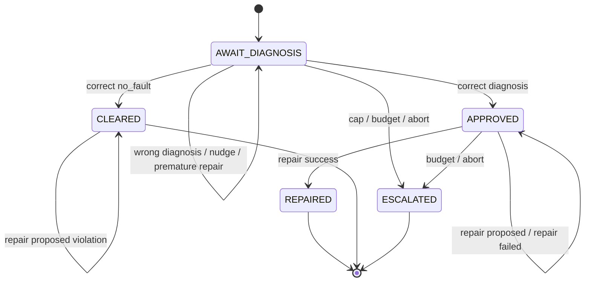
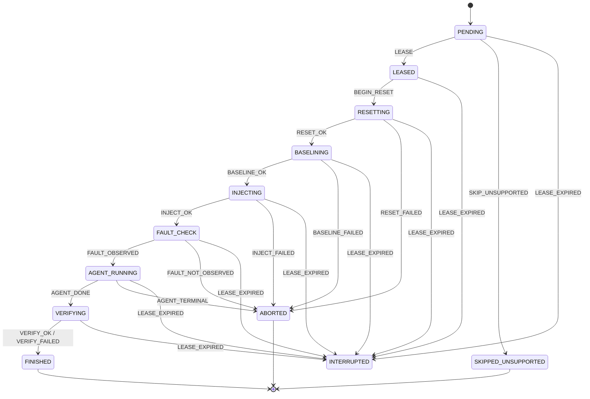
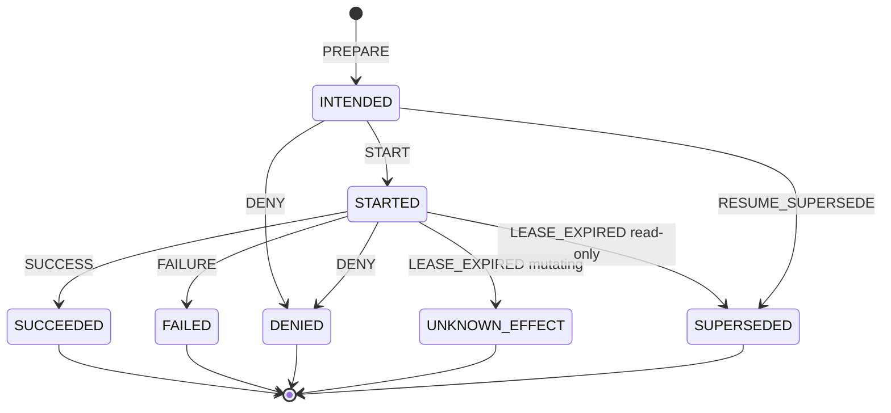

# State machine design

Status: proposed for review. Source discussions: `statemachine.md` and
`new_feedback.md`. Line references are from HEAD `e30674a` before implementation;
current code wins if lines drift.

This document is a design proposal only. No runtime behavior is changed by this
document. It is intended to give reviewers enough concrete detail to comment on
state ownership, transitions, persistence, compatibility, tests, and rollout.

## 0. Executive summary

The harness already behaves like three small state machines:

1. the agent/gate machine, currently represented by booleans and repair strings;
2. the run lifecycle, currently represented by `runs.status`, `runs.phase`,
   `runs.end_reason`, and procedural code in `run_benchmark.py`;
3. the tool-call lifecycle, currently represented by `tool_calls.status` and
   resume heuristics.

The proposal is to make those machines explicit with hand-rolled enums, frozen
event dataclasses, and `(state, event)` transition tables. The transition core is
pure: `transition(state, event) -> (state, effects)`. A thin persistence shell
appends the transition event and updates projections in one SQLite transaction.
State becomes `fold(events)`, and the current scalar columns become projections
for compatibility, UI, and reporting.

Rollout order:

1. build the core, adapters, exhaustive tests, and shadow comparison;
2. cut over the gate machine;
3. add setup-phase lease renewal, lifecycle transitions, and a reaper that
   derives `interrupted`;
4. cut over tool calls and typed outcomes;
5. switch scoring to a path-based scorer only after parity;
6. leave the optional cluster-health observer out of the first implementation.

## 1. Review inputs and decisions

### 1.1 Where the reviewers agree

- Two core machines: gate and run lifecycle.
- A third small tool-call machine for resume safety.
- Hand-rolled tables, not a state-machine library.
- Do not model the reset ladder; it is a bounded bash escalation.
- Do not model topology epoch; it is an active/stale flag.
- Do not wrap the LLM loop in a machine; it remains a budgeted loop.
- SQLite events are the source of truth; `state_json`, `state_snapshots`, and
  scalar `runs.*` fields are projections.
- Illegal transitions are logged as bugs, not silently ignored.
- Tests should cover every state/event pair and generated diagrams should come
  from the same tables.

### 1.2 Decisions where reviewers differed

| Topic | Decision | Rationale |
|---|---|---|
| First machine | Gate | Smallest, purest, maps to several known gaps. |
| Reducer style | Pure reducer plus persistence shell | Keeps replay deterministic and effects explicit. |
| Crash handling | Crash-action table per state | Resume, retry-after-reset, rerun-verify, and do-nothing are different actions. |
| `interrupted` | Derived by reaper/startup sweep | A crashed process cannot record its own crash. |
| Verify | Run lifecycle, not gate | Avoids combined gate/run state explosion. |
| Export | Not a run state | Already derived and rerunnable. |
| Tool visibility | `always` default, `gated` ablation | Current metrics measure forbidden/premature attempts. |
| No-fault path | Explicit `CLEARED` gate state | Control scenarios need a clean terminal gate result. |
| Receipt | Derive from `run_id`; remove from event payload | The receipt is `approved:<run_id>`, not a secret. |
| Cluster-health observer | Defer | It may be useful later, but it must never gate or leak to the model. |

### 1.3 Third-review prerequisite: fallback comparability

The fallback-eligibility question in `new_feedback.md` is settled:

- A run that eventually answers on a fallback is headline-eligible. Failures of
  earlier candidates are not a run-level `provider_error_*` when a later
  candidate answers.
- The responder is provenance, not a score gate. `runs.backend` and `runs.model`
  keep the selected chain identity and are not rewritten to the responder.
  `llm_requests.backend`, messages, `llm_response_full`, and `assistant` events
  record the actual responder, requested backend, fallback path, and skipped
  candidates.
- Current score tables group by `runs.backend`; fallback-enabled runs are
  comparable as configured chains, not as clean per-backend baselines.
  Per-backend baselines require `--backend <name>` and `CHAOS_LLM_FALLBACK=0`.
- With fallback enabled, comparability has three dimensions: scenario,
  temperature (fixed at `0.2`), and chain configuration. `--seed` is recorded
  metadata, not sampling control.

The path scorer in §10 must preserve these rules.

## 2. Current state, as built

### 2.1 Gate state

`AgentState` is defined at `harness/tooling.py:31-47` and serialized by
`AgentState.snapshot()` at `harness/tooling.py:73-99`. Important fields include
`diagnosis`, `diagnosis_correct`, `diagnosis_attempts`,
`diagnosis_first_attempt_correct`, `approval_token`, `approval_source`, `repair`,
`policy_violations`, and `forbidden_reason`.

Diagnosis handling is at `harness/tooling.py:137-208`:

- attempt cap: `MAX_DIAGNOSIS_ATTEMPTS = 2` at `harness/tooling.py:13`;
- correctness is computed by label comparison at `harness/tooling.py:142`;
- receipt is issued as `approved:<run_id>` at `harness/tooling.py:161`;
- approval event is emitted at `harness/tooling.py:194-205`;
- diagnosis attempt row is written at `harness/tooling.py:206-207`.

Repair handling is at `harness/tooling.py:256-329`:

- repair name canonicalization at `:257`;
- diagnosis and receipt checks at `:259-271`;
- forbidden/acceptable checks at `:272-275`;
- refusal kind is inferred from the substring `"forbidden"` at `:283`;
- `forbidden_reason` is inferred from the same substring at `:305`;
- timeout is inferred from the `timeout waiting for` prefix at `:316-317`;
- status is inferred from the `ERROR:` prefix at `:318-320`.

Rebuild and cache behavior:

- `storage/sqlite_store.py:1218-1276` rebuilds state from events and tool rows;
- later approval events clear and reapply receipt-derived fields at
  `:1246-1256`;
- cache hits refresh receipt-derived keys at `:1281-1289`;
- `set_state()` strips `approval_token` from `state_json` at `:1294-1318`.

Checkpoint projections are in `harness/checkpoint.py:42-82`. Four overlapping
representations remain: live `AgentState`, `runs.state_json`, `state_snapshots`,
and scalar `runs.*` fields.

### 2.2 Run lifecycle

`run_benchmark.py:124-262` implements a fresh run:

- lease at `:144-146`;
- `status=running`, `phase=resetting` at `:152`;
- reset at `:153-158`;
- baseline at `:160-166`;
- injection at `:177-190`;
- fault-present check at `:192-217`;
- agent loop at `:255-256`;
- export at `:260-261`.

`run_benchmark.py:265-341` implements resume. `run_benchmark.py:344-382`
implements abort-and-retry with a `-retryN` ID.

Resume triage is at `run_benchmark.py:608-659`:

- unsafe phase set is `{"queued", "resetting", "baseline", "injecting"}` at
  `:630`;
- `fault_check` is currently treated as resume-safe;
- config mismatch is handled at `:632-633`;
- unknown mutating side effect is handled at `:634-635`.

`interrupted` is recognized for resume candidates at
`storage/sqlite_store.py:1202-1216` and in active rows at `:171-178`, but no
code writes it.

Lease APIs are at `storage/sqlite_store.py:1174-1200`. Renewal already exists in
the agent loop: `harness/checkpoint.py:14-39` and `harness/checkpoint.py:63`.
Setup phases are not renewed today.

### 2.3 Tool calls

Schema is at `storage/sqlite_store.py:576-594`. Statuses used in practice are
`proposed`, `started`, `finished`, `failed`, and `denied`. `unknown` is queried
but never written, and `superseded` exists only as a result string.

Writers:

- `begin_tool_call()` at `:967-993`, called from `harness/call.py:48-57`;
- `update_tool_call_status()` at `:995-1000`;
- `finish_tool_call()` at `:1002-1030`.

Queries:

- `unfinished_tool_calls()` at `:1044-1052`;
- `has_unknown_mutating_tool_call()` at `:1054-1063`.

On resume, unfinished read-only calls are closed as `finished` with a
`"superseded_after_resume"` result string at `run_benchmark.py:288-298`. Unfinished
mutating calls trigger abort-and-retry.

### 2.4 Scoring and export

`common/scoring.py:57-110` computes `Score.from_record()`. Current strict success
requires loop success, acceptable repair, approval, first-attempt correctness,
no excluded reason, no budget cutoff, no forbidden repair, and no policy
violations.

`finish_run()` at `storage/sqlite_store.py:1391-1460` writes terminal fields,
final record artifact, and score row, then releases the lease. Export is
separate at `storage/sqlite_store.py:1515-1575`; it is already idempotent and
does not determine run completion.

### 2.5 Confirmed gaps this design addresses

| Gap | Current symptom |
|---|---|
| P0.3 | Gate receipt rebuild depends on an allowlisted raw event field. |
| P1.5 | State exists in four overlapping representations. |
| P1.7 | Repair success/failure is inferred from string prefixes. |
| P1.12 | Forbidden repair is inferred from the substring `"forbidden"`. |
| P2.6 | Early nudge is not an event, so resume can nudge twice. |
| Run crash state | Crashed runs usually stay `running`. |
| Resume ambiguity | Resume safety is a phase-string set plus tool-row heuristic. |
| Tool unknown effect | Unknown effects are inferred instead of named. |

## 3. Goals and invariants

### 3.1 Goals

- One explicit state per machine at any point in time.
- Deterministic replay: `fold(events) == live_state`.
- Illegal transitions are visible and testable.
- Crash recovery is a per-state lookup, not scattered conditionals.
- Typed gate and tool outcomes replace string-prefix inference.
- Existing DB records, exports, scores, and replay remain readable.
- Generated diagrams come from the transition tables.

### 3.2 Invariants

1. Every persisted state has a `StateSpec` with wire value, rank, terminality,
   end-reason requirement, and crash action.
2. Terminal run states require `end_reason`.
3. `FINISHED` requires a score row and final record artifact.
4. Only the persistence shell writes state projections.
5. The reducer never performs I/O or reads the clock.
6. Every event is idempotent by `(run_id, machine, seq)`.
7. Illegal transitions append a rejection event and do not mutate state.
8. Gate final verification belongs to the run machine, not the gate machine.
9. Export is outside both machines.
10. Fallback responder provenance never overwrites chain identity fields.

### 3.3 Non-goals

- No new state-machine dependency.
- No reset-ladder rewrite.
- No topology-epoch machine.
- No LLM-loop machine.
- No export state.
- No cluster-health observer in the first implementation.
- No DB migration that breaks existing archives.
- No change to public CLI flags unless the rollout explicitly calls for it.

## 4. Shared core design

### 4.1 Module layout

Add `harness/state_machine.py` and, only if it stays small, machine definitions
in the same module. If the core grows, split into:

```text
harness/state_machine.py       generic core, Event, Effect, fold(), apply()
harness/machines/gate.py       gate states/events/table
harness/machines/run.py        run states/events/table
harness/machines/tools.py      tool-call states/events/table
harness/machines/adapters.py   legacy event adapters
scripts/gen_state_diagrams.py  Mermaid generator
```

Initial implementation can keep all machines in `harness/state_machine.py`.

### 4.2 Core types

Illustrative API:

```python
class MachineKind(StrEnum):
    GATE = "gate"
    RUN = "run"
    TOOL = "tool"

class EffectKind(StrEnum):
    APPEND_EVENT = "append_event"
    SET_PROJECTION = "set_projection"
    SET_END_REASON = "set_end_reason"
    ISSUE_RECEIPT = "issue_receipt"
    RECORD_ATTEMPT = "record_attempt"
    RECORD_VIOLATION = "record_violation"
    EMIT_NUDGE = "emit_nudge"
    ACQUIRE_LEASE = "acquire_lease"
    RENEW_LEASE = "renew_lease"
    RELEASE_LEASE = "release_lease"
    SUPERSEDE_TOOL_CALLS = "supersede_tool_calls"
    ABORT_AND_RETRY = "abort_and_retry"
    SCORE_PATH = "score_path"

@dataclass(frozen=True)
class Effect:
    kind: EffectKind
    payload: dict[str, Any]

@dataclass(frozen=True)
class Transition:
    state: State
    effects: tuple[Effect, ...] = ()
    reason: str | None = None

class IllegalTransition(ValueError):
    ...

@dataclass(frozen=True)
class StateSpec:
    value: str
    rank: int
    terminal: bool
    run_terminal: bool
    end_reason_required: bool
    crash_action: CrashAction | None
    renew_lease: bool = False
```

`State`, `Event`, `CrashAction`, and `EndReason` are enums or frozen dataclasses
in each machine module. The core is generic over those types.

### 4.3 Event envelope

New transition events use `trace_events`, which already provides append-only
`seq`, `type`, `payload`, and `ts` columns. No new event table is required.

Persisted form:

```text
trace_events.type = "<machine>.<event_name_lowercase>"
trace_events.payload = {
  "state_before": "...",
  "state_after": "...",
  "event": "...",
  "reason": "...",       # when present
  ...event payload...
}
```

Examples:

```text
gate.diagnosis_submitted
gate.repair_proposed
gate.repair_finished
run.lease
run.reset_ok
run.fault_observed
run.agent_done
run.verify_ok
tool.prepare
tool.start
tool.success
tool.unknown_effect
state_transition_rejected
```

Existing event types (`approval`, `tool`, `reset`, `verify`, `record`, and so on)
continue to be emitted during the compatibility phase so replay, UI, and older
reports do not break.

### 4.4 Persistence shell

The pure function changes nothing. A shell applies it:

```python
def apply(run_id: str, machine: MachineKind, event: MachineEvent) -> State:
    before = load_state(run_id, machine)
    try:
        result = transition(machine, before, event)
    except IllegalTransition as exc:
        append_event(run_id, "state_transition_rejected", {...})
        raise
    with sqlite_transaction():
        append_transition_event(run_id, machine, before, result, event)
        write_projections(run_id, machine, result.state, result.effects)
    execute_effects(run_id, result.effects)
    return result.state
```

`execute_effects()` may emit compatibility events, write scalar columns, update
`state_json`, record violations, or trigger abort-and-retry. The reducer only
returns what should happen.

### 4.5 Fold

```python
def fold(machine: MachineKind, events: Sequence[TraceEvent], context: Context) -> State
```

- Events must be ordered by `(run_id, seq)`.
- The same event applied twice is a no-op.
- Legacy events are mapped to machine events by `harness/machines/adapters.py`.
- `fold()` is used by rebuild, shadow comparison, tests, and the reaper.

### 4.6 Diagram generation

`scripts/gen_state_diagrams.py` imports the machine tables and writes
`docs/STATE_MACHINE.md`. Each state contributes a node with its wire value,
terminality, and crash action. Each transition contributes an edge labeled with
the event and guard. The generator fails if a state has no `StateSpec` or a
terminal state lacks an end reason.

## 5. Gate machine

### 5.1 Purpose

The gate machine decides whether the agent may repair, records violations, and
produces a typed outcome for scoring. It does not verify the cluster and does
not write run terminal status.

### 5.2 State specs

| State | Wire value | Terminal | Run terminal | End reason required | Crash action |
|---|---|---|---|---|---|
| `AWAIT_DIAGNOSIS` | `await_diagnosis` | no | no | no | resume |
| `APPROVED` | `approved` | no | no | no | resume; abort if mutating tool unknown |
| `REPAIRED` | `repaired` | yes, gate-local | no | no | none |
| `CLEARED` | `cleared` | yes, gate-local | no | no | none |
| `ESCALATED` | `escalated` | yes, gate-local | no | yes | none |

Gate-local terminal means the agent loop should stop. The run machine still owns
the run's status and final verification.

### 5.3 Boundary classifiers

The reducer receives facts, not raw model text:

```python
classify_diagnosis(raw, scenario) -> DiagnosisFacts
classify_repair(canonical_name, args, scenario) -> RepairFacts
classify_repair_result(result) -> RepairResultFacts
```

`DiagnosisFacts` carries `label`, `correct`, `is_no_fault`, `attempts`, and
`first_attempt_correct`. `RepairFacts` carries `canonical_name`, `acceptable`,
`forbidden`, and safe args. `RepairResultFacts` carries a typed status such as
`success`, `failed`, `timeout`, or `denied`.

This keeps the pure machine independent of scenario JSON and string prefixes.

### 5.4 Events

| Event | Payload |
|---|---|
| `DIAGNOSIS_SUBMITTED` | `label`, `correct`, `is_no_fault`, `attempts`, `first_attempt_correct`, `source` |
| `NUDGE` | `step`, `kind` (`no_tool` or `budget`) |
| `REPAIR_PROPOSED` | `canonical_name`, `acceptable`, `forbidden`, `args` |
| `REPAIR_FINISHED` | `status`, `timed_out`, `result_summary` |
| `ESCALATE` | `reason` |
| `BUDGET_EXHAUSTED` | `reason` |
| `ABORT` | `reason` |

### 5.5 Transition table

| From | Event | Guard | To | Effects |
|---|---|---|---|---|
| `AWAIT_DIAGNOSIS` | `DIAGNOSIS_SUBMITTED` | correct and no-fault | `CLEARED` | record attempt, issue receipt |
| `AWAIT_DIAGNOSIS` | `DIAGNOSIS_SUBMITTED` | correct and not no-fault | `APPROVED` | record attempt, issue receipt |
| `AWAIT_DIAGNOSIS` | `DIAGNOSIS_SUBMITTED` | wrong, below cap | `AWAIT_DIAGNOSIS` | record attempt |
| `AWAIT_DIAGNOSIS` | `DIAGNOSIS_SUBMITTED` | wrong, cap reached | `ESCALATED` | record attempt, set end reason `diagnosis_attempts_exhausted` |
| `AWAIT_DIAGNOSIS` | `NUDGE` | always | `AWAIT_DIAGNOSIS` | emit nudge event |
| `AWAIT_DIAGNOSIS` | `REPAIR_PROPOSED` | always | `AWAIT_DIAGNOSIS` | record `premature_repair` violation |
| `AWAIT_DIAGNOSIS` | `ESCALATE` / `BUDGET_EXHAUSTED` / `ABORT` | always | `ESCALATED` | set end reason |
| `APPROVED` | `REPAIR_PROPOSED` | forbidden | `APPROVED` | record `forbidden_repair` violation |
| `APPROVED` | `REPAIR_PROPOSED` | not acceptable | `APPROVED` | record `unacceptable_repair` violation |
| `APPROVED` | `REPAIR_PROPOSED` | acceptable | `APPROVED` | record proposed repair projection only |
| `APPROVED` | `REPAIR_FINISHED` | success | `REPAIRED` | record typed repair success |
| `APPROVED` | `REPAIR_FINISHED` | failure or timeout | `APPROVED` | record typed repair failure |
| `APPROVED` | `ESCALATE` / `BUDGET_EXHAUSTED` / `ABORT` | always | `ESCALATED` | set end reason |
| `CLEARED` | `REPAIR_PROPOSED` | always | `CLEARED` | record `repair_after_no_fault` violation |
| `REPAIRED` / `CLEARED` / `ESCALATED` | any | always | reject | append rejection event |

### 5.6 Example paths

Correct repair:

```text
AWAIT_DIAGNOSIS --DIAGNOSIS_SUBMITTED(correct)--> APPROVED
APPROVED --REPAIR_PROPOSED(acceptable)--> APPROVED
APPROVED --REPAIR_FINISHED(success)--> REPAIRED
```

Wrong twice:

```text
AWAIT_DIAGNOSIS --DIAGNOSIS_SUBMITTED(wrong, 1)--> AWAIT_DIAGNOSIS
AWAIT_DIAGNOSIS --DIAGNOSIS_SUBMITTED(wrong, 2)--> ESCALATED
```

Control/no-fault:

```text
AWAIT_DIAGNOSIS --DIAGNOSIS_SUBMITTED(no_fault)--> CLEARED
CLEARED --REPAIR_PROPOSED(any)--> CLEARED + violation
```

### 5.7 Receipt model

The gate receipt is deterministic:

```python
def receipt_for(run_id: str) -> str:
    return f"approved:{run_id}"
```

- The fold derives receipt issuance from a correct diagnosis event.
- The raw receipt is not stored in approval event payloads.
- Messages, UI, exports, and replay continue to redact receipts.
- The repair gate accepts absent or `[REDACTED]` wire receipts after resume,
  because authoritative state comes from the fold.

### 5.8 Tool visibility ablation

Default `--tool-visibility always` keeps all tools visible and measures illegal
attempts. `--tool-visibility gated` injects the currently valid tool list into
the prompt for the ablation. Both modes use the same gate machine; gating only
changes what the model is shown, not what counts as a violation.

## 6. Run lifecycle machine

### 6.1 Purpose

The run machine owns run status, phase, end reason, lease lifecycle, crash
actions, and final verification. It does not own diagnosis correctness or repair
authorization.

### 6.2 State specs

| State | `status` | `phase` | Terminal | End reason required | Crash action |
|---|---|---|---|---|---|
| `PENDING` | `pending` | `queued` | no | no | new run |
| `LEASED` | `running` | `leased` | no | no | new run |
| `RESETTING` | `running` | `resetting` | no | no | new run |
| `BASELINING` | `running` | `baseline` | no | no | new run |
| `INJECTING` | `running` | `injecting` | no | no | new run after reset |
| `FAULT_CHECK` | `running` | `fault_check` | no | no | new run after reset |
| `AGENT_RUNNING` | `running` | `agent_running` | no | no | resume or retry |
| `VERIFYING` | `running` | `verifying` | no | no | rerun verify |
| `FINISHED` | `finished` | `finished` | yes | yes | none |
| `ABORTED` | `aborted` | `aborted` | yes | yes | none |
| `INTERRUPTED` | `interrupted` | `interrupted` | no, resume candidate | yes | per previous state |
| `SKIPPED_UNSUPPORTED` | `skipped_unsupported` | `skipped_unsupported` | yes | yes | none |

`INTERRUPTED` is not a true terminal state: it is a recoverable parked state
with a required reason. It remains in resume candidate queries.

### 6.3 Events

| Event | Payload |
|---|---|
| `CREATE` | `scenario_id`, `backend`, `config_hash`, `topology_hash` |
| `LEASE` | `lease_owner`, `lease_expires_at` |
| `SKIP_UNSUPPORTED` | `reason` |
| `BEGIN_RESET` | none |
| `RESET_OK` / `RESET_FAILED` | `output_ref` |
| `BASELINE_OK` / `BASELINE_FAILED` | `output_ref` |
| `INJECT_OK` / `INJECT_FAILED` | `output_ref`, `reason` |
| `FAULT_OBSERVED` / `FAULT_NOT_OBSERVED` | `detail`, `elapsed`, `timeout`, `targets` |
| `AGENT_DONE` | `gate_terminal`, `gate_reason` |
| `AGENT_TERMINAL` | `reason` |
| `VERIFY_OK` / `VERIFY_FAILED` | `output_ref` |
| `ABORT` | `reason`, `actor` |
| `LEASE_EXPIRED` | `reason`, `detected_by` |
| `REAP` | `from_state`, `owner_status` |

### 6.4 Transition table

| From | Event | To | Effects |
|---|---|---|---|
| none | `CREATE` | `PENDING` | create run row, emit event |
| `PENDING` | `LEASE` | `LEASED` | acquire lease |
| `PENDING` / `LEASED` | `SKIP_UNSUPPORTED` | `SKIPPED_UNSUPPORTED` | set reason, write terminal record |
| `LEASED` | `BEGIN_RESET` | `RESETTING` | start setup renewal |
| `RESETTING` | `RESET_OK` | `BASELINING` | stop no renewal yet |
| `RESETTING` | `RESET_FAILED` | `ABORTED` | `reset_failed`, release lease |
| `BASELINING` | `BASELINE_OK` | `INJECTING` | none |
| `BASELINING` | `BASELINE_FAILED` | `ABORTED` | `baseline_failed`, release lease |
| `INJECTING` | `INJECT_OK` | `FAULT_CHECK` | none |
| `INJECTING` | `INJECT_FAILED` | `ABORTED` | `injection_failed`, release lease |
| `FAULT_CHECK` | `FAULT_OBSERVED` | `AGENT_RUNNING` | pass `fault_present=true` to agent |
| `FAULT_CHECK` | `FAULT_NOT_OBSERVED` | `ABORTED` | `fault_not_observed`, release lease |
| `AGENT_RUNNING` | `AGENT_DONE` | `VERIFYING` | carry gate outcome into score path |
| `AGENT_RUNNING` | `AGENT_TERMINAL` | `ABORTED` | gate escalation, budget, or provider error |
| `VERIFYING` | `VERIFY_OK` | `FINISHED` | write score and final record, release lease |
| `VERIFYING` | `VERIFY_FAILED` | `FINISHED` | write score with `verify_ok=false`, release lease |
| any nonterminal | `ABORT` | `ABORTED` | typed abort reason, release lease |
| any nonterminal | `LEASE_EXPIRED` | `INTERRUPTED` | typed reason, preserve previous state in payload |
| terminal | any | reject | append rejection event |

### 6.5 Resume triage as crash-action lookup

| State in interrupted run | Action | Rationale |
|---|---|---|
| `PENDING`, `LEASED`, `RESETTING`, `BASELINING` | new run | Nothing has been injected. |
| `INJECTING`, `FAULT_CHECK` | new run after reset | Fault may be half-applied or unproven. |
| `AGENT_RUNNING` | resume | Conversation and gate state can be replayed. |
| `AGENT_RUNNING` with mutating tool `UNKNOWN_EFFECT` | abort and retry | Repair may have side effects. |
| `VERIFYING` | rerun verify | Verification is read-only. |
| terminal | no action | Already complete. |

`--force-resume` continues to bypass config-hash mismatch only. It never
bypasses topology mismatch or an unknown mutating effect.

### 6.6 Lease renewal and reaper

- Keep the 300-second lease TTL.
- Extend `LeaseRenewer` to setup phases. Without this, a 900-second reset would
  look crashed.
- The reaper/startup sweep scans nonterminal runs with expired leases and no
  live owner, then emits `run.lease_expired`.
- The reaper never runs from the crashed process.
- The sweep is idempotent: repeated detection of the same expired lease does not
  append duplicate transitions.
- `interrupted` records the previous state in the event payload so resume can
  pick the crash action.

### 6.7 Verify and export boundaries

Verify is part of the run machine: the agent loop emits `AGENT_DONE`, and only
the run machine transitions to `FINISHED`. Export remains after terminal state
and outside the machine; export failure cannot make a completed run look
unfinished.

## 7. Tool-call machine

### 7.1 Purpose

The tool-call machine makes mutating side effects explicit. A crash between
intent and outcome becomes a named state instead of a heuristic over status
rows and result strings.

### 7.2 State specs

| State | Persisted status | Terminal | Mutating semantics |
|---|---|---|---|
| `INTENDED` | `proposed` | no | intent persisted before execution |
| `STARTED` | `started` | no | execution began |
| `SUCCEEDED` | `finished` | yes | typed success |
| `FAILED` | `failed` | yes | typed failure |
| `DENIED` | `denied` | yes | gate denied before execution |
| `UNKNOWN_EFFECT` | `unknown_effect` | yes | mutating outcome unknown |
| `SUPERSEDED` | `superseded` | yes | read-only call closed by resume |

Existing status strings remain readable. New strings are valid in the existing
TEXT column, so no schema bump is needed.

### 7.3 Events

| Event | Payload |
|---|---|
| `PREPARE` | `name`, `args`, `mutating`, `destructive` |
| `START` | none |
| `SUCCESS` | typed result, artifact ref |
| `FAILURE` | typed error, artifact ref |
| `DENY` | `reason`, `violation_kind` |
| `LEASE_EXPIRED` | `mutating`, `detected_by` |
| `RESUME_SUPERSEDE` | `reason` |

### 7.4 Transition table

| From | Event | To | Effects |
|---|---|---|---|
| none | `PREPARE` | `INTENDED` | persist intent before execution |
| `INTENDED` | `START` | `STARTED` | update status |
| `STARTED` | `SUCCESS` | `SUCCEEDED` | persist typed result |
| `STARTED` | `FAILURE` | `FAILED` | persist typed error |
| `INTENDED` / `STARTED` | `DENY` | `DENIED` | record violation, no execution |
| `STARTED` | `LEASE_EXPIRED` | `UNKNOWN_EFFECT` if mutating | force abort-and-retry |
| `STARTED` | `LEASE_EXPIRED` | `SUPERSEDED` if read-only | allow resume |
| `INTENDED` / `STARTED` | `RESUME_SUPERSEDE` | `SUPERSEDED` | read-only only |
| terminal | any | reject | append rejection event |

### 7.5 Typed outcomes

`ToolOutcome.status` becomes authoritative for repair success. The strings
`ERROR:`, `BLOCKED:`, and `timeout waiting for` remain in artifacts for humans
but are no longer used by rebuild or scoring. Compatibility adapters map legacy
strings to typed outcomes during shadow replay.

## 8. Event and projection integration

### 8.1 Writes by machine

| Machine | Primary event source | Projections updated |
|---|---|---|
| Gate | `gate.*`, legacy `approval`, `tool`, `nudge` | `runs.diagnosis*`, `approval_granted`, `repair`, policy fields, `state_json` |
| Run | `run.*`, legacy setup/verify/record events | `runs.status`, `phase`, `end_reason`, lease fields, final record |
| Tool | `tool.*`, `tool_calls` rows | `tool_calls.status`, result fields, artifact refs |

### 8.2 Projection ownership

Only the persistence shell writes:

- `runs.status`;
- `runs.phase`;
- `runs.end_reason`;
- gate scalar columns;
- policy/repair scalar columns;
- tool-call terminal statuses;
- `state_json` and `state_snapshots`.

UI and replay remain read-only consumers.

### 8.3 Legacy adapter

During rollout, `harness/machines/adapters.py` maps old events to machine events:

| Legacy evidence | Machine event |
|---|---|
| `approval` event with `granted=true` | `gate.diagnosis_submitted(correct)` plus receipt derived |
| `approval` event with `granted=false` | `gate.diagnosis_submitted(wrong)` |
| `nudge` event or early no-tool user message | `gate.nudge` |
| denied repair tool call | `gate.repair_proposed` with typed violation |
| finished repair tool call | `gate.repair_finished` |
| `reset`, `baseline`, `inject`, `fault_check` | corresponding `run.*` events |
| `verify` / `record` | `run.verify_*` / run finish |
| `tool_calls.status` rows | `tool.*` events |

The adapter is used for shadow comparison and old-run scoring. New runs emit
both canonical and legacy events during cutover.

## 9. Scoring from machine paths

### 9.1 Gate path record

Each gate emits a derived path record:

```python
@dataclass(frozen=True)
class GatePath:
    visited: tuple[GateState, ...]
    terminal: GateState
    terminal_reason: str | None
    diagnosis_submitted: bool
    first_attempt_correct: bool
    receipt_issued: bool
    repair_proposed: bool
    repair_executed: bool
    repair_status: str | None
    violations: tuple[str, ...]
```

It is stored as a `run_artifacts` row with kind `gate_path`, and its fields are
merged into the score payload. No schema change is required because artifacts
and score payloads already accept JSON.

### 9.2 Path-based strict success

```text
strict_v3 = true iff
  fault_present
  and run state reached FINISHED
  and gate terminal in {REPAIRED, CLEARED}
  and if gate terminal is REPAIRED, APPROVED was visited
  and first_attempt_correct
  and receipt_issued
  and verify_ok
  and no violations
  and end_reason is not excluded
  and end_reason is not a budget end reason
```

`no_fault` runs reach `CLEARED` and require no repair. Provider failure means all
configured candidates failed; earlier failed fallback candidates do not fail
`strict_v3`.

### 9.3 Funnel metrics

The path yields counts for:

- fault observed;
- diagnosis submitted;
- diagnosis correct;
- approved;
- repair proposed;
- repair executed;
- verification passed;
- escalated;
- policy violation observed.

These are funnel stages, not separate scorers with independent rules.

### 9.4 Scorer compatibility

- Keep `strict-loop-v2` keyed by its existing `scorer_version`.
- Add `gate-path-v1` as a new scorer version.
- During shadow mode, compute both and store both.
- Compare across all archived DBs and current runs.
- Only switch the canonical version after parity or documented intentional
  differences.
- Continue to exclude legacy, resumed, interactive, provider-error, unsupported,
  and unverified-fault runs according to current rules.

## 10. Data model and compatibility

### 10.1 Schema impact

No schema version bump is planned:

- transition events use existing `trace_events`;
- gate path uses existing `run_artifacts`;
- new scorer uses existing `scores.scorer_version`;
- new tool statuses and `leased` phase are strings in existing TEXT columns;
- scalar projection columns keep their current names and types.

### 10.2 Compatibility phases

| Phase | Behavior |
|---|---|
| Shadow | Legacy logic controls behavior; reducer computes state and logs differences. |
| Dual-write | Canonical machine events are appended alongside legacy events; projections still come from legacy logic unless parity holds. |
| Enforce | Reducer controls behavior; legacy events are still emitted for replay/UI compatibility. |
| Cleanup | Legacy-only inference can be removed after an audit window. |

Each machine has its own flag so rollout can proceed incrementally:
`CHAOS_SM_GATE=off|shadow|enforce`, `CHAOS_SM_RUN=...`, `CHAOS_SM_TOOL=...`.

### 10.3 Backward compatibility requirements

- Old DBs open without migration.
- Old replays render.
- Old score rows remain selectable by `scorer_version`.
- Old tool status strings are treated as valid projections.
- `runs.phase` values already in use keep their meaning.
- Archived DBs remain readable by the new fold.

## 11. Observability and operations

### 11.1 Events visible in replay

Replay should show machine transitions as compact events, with full payloads in
artifacts. Secrets remain redacted. Receipts remain redacted everywhere.

### 11.2 Doctor checks

`db_cli.py doctor --strict` should gain checks for:

- terminal run without `end_reason`;
- `FINISHED` without score row or final record;
- nonterminal run with expired lease and live owner;
- illegal transition events;
- gate terminal state that disagrees with `approval_granted`/repair projections;
- unfinished mutating tool calls in `UNKNOWN_EFFECT`;
- duplicate transition events for the same `(run_id, machine, seq)`.

### 11.3 UI impact

`LiveView` continues to read projections. It should show machine state as an
additional field, but should not infer state itself. The topology line remains
health-free.

## 12. Test plan

### 12.1 Exhaustive table tests

For every machine:

- every `(state, event)` pair yields either a defined transition or a defined
  rejection;
- every terminal state has required invariants;
- every nonterminal state has a crash action;
- every state is reachable or explicitly marked historical;
- transition ranks never decrease except for defined retry paths;
- illegal transitions append a rejection event and preserve state.

### 12.2 Fold and replay tests

- `fold(new_events) == fold(legacy_events)` for seeded scenarios.
- Replaying events twice is idempotent.
- Reordering by `seq` yields deterministic state.
- Redacted receipts do not break gate fold.
- Missing early nudge event is reconstructed from legacy user message.
- Later denial clears receipt and correctness.
- Fallback responder provenance does not change chain identity.

### 12.3 Gate tests

- correct diagnosis issues receipt and reaches `APPROVED`;
- correct no-fault reaches `CLEARED`;
- wrong diagnosis below cap returns to `AWAIT_DIAGNOSIS`;
- wrong diagnosis at cap reaches `ESCALATED`;
- repair before diagnosis is a typed violation;
- forbidden and unacceptable repairs are distinct typed violations;
- repair timeout is typed, not a successful repair;
- duplicate nudge cannot be emitted after resume;
- prompt-mode decline withholds receipt.

### 12.4 Run lifecycle tests

- each transition writes the expected status/phase projection;
- fault not observed aborts before agent starts;
- injection failed aborts with `injection_failed`;
- lease expiry emits `interrupted` exactly once;
- crash action lookup returns expected action for every state;
- resume refuses topology mismatch;
- `--force-resume` does not bypass topology mismatch;
- unknown mutating effect forces retry;
- verify failure still reaches `FINISHED` with `verify_ok=false`;
- export failure does not change run state.

### 12.5 Tool-call tests

- intent is persisted before execution;
- success/failure/denial are typed;
- mutating crash becomes `UNKNOWN_EFFECT`;
- read-only crash becomes `SUPERSEDED`;
- resume supersedes only read-only calls;
- legacy `ERROR:`/`BLOCKED:` artifacts map to typed outcomes in shadow mode.

### 12.6 Scoring tests

- `strict-loop-v2` and `gate-path-v1` agree on archived fixtures;
- intentional differences are enumerated;
- no-fault strict success still works;
- fallback success remains headline-eligible;
- all-candidate failure is provider error;
- earlier fallback failure is not provider error;
- policy violations fail strict success;
- budget cutoffs fail strict success but remain visible.

### 12.7 Live acceptance

Manual live checks before final cutover:

- one healthy control run;
- one injected fault run with successful repair;
- one fault-not-observed run;
- one resume after agent crash;
- one retry after mutating tool crash;
- one no-fault run with attempted repair;
- one fallback run where the primary fails and another endpoint answers.

No live test uses `etcd-disk-full`, per the standing exclusion.

## 13. Implementation plan

### Phase 0 — core, adapters, and shadow mode

Files:

- add `harness/state_machine.py`;
- add `harness/machines/{gate,run,tools,adapters}.py` if split;
- add `scripts/gen_state_diagrams.py`;
- add `docs/STATE_MACHINE.md`;
- add `tests/test_state_machine.py`;
- add `tests/test_state_machine_shadow.py`.

Acceptance:

- all table and fold tests pass;
- no behavior change;
- shadow comparison runs over archived DBs;
- generated diagrams match the tables.

### Phase 1 — gate cutover

Files:

- `harness/tooling.py`;
- `harness/loop.py`;
- `harness/checkpoint.py`;
- `harness/journal.py`;
- `harness/message.py`;
- `storage/sqlite_store.py`;
- `common/scoring.py`;
- optional `harness/spec.py` and prompt files for tool visibility.

Acceptance:

- one `GateState` replaces independent booleans;
- receipt derived from `run_id` and absent from event payloads;
- nudge is an event;
- typed repair outcomes replace prefixes;
- `gate-path-v1` computed in shadow;
- existing suite remains green.

### Phase 2 — run lifecycle cutover

Files:

- `run_benchmark.py`;
- `harness/loop.py`;
- `harness/checkpoint.py`;
- `storage/sqlite_store.py`;
- `chaos_cli.py`;
- reaper/startup sweep location to be chosen during implementation.

Acceptance:

- phase writes only in transition shell;
- setup lease renewal active;
- reaper writes `interrupted`;
- resume triage is a table lookup;
- verification transitions to `FINISHED`;
- export stays outside the machine.

### Phase 3 — tool-call cutover

Files:

- `harness/call.py`;
- `harness/tooling.py`;
- `tools/tool.py`;
- `storage/sqlite_store.py`.

Acceptance:

- intents before execution;
- named `UNKNOWN_EFFECT` and `SUPERSEDED`;
- result status typed;
- legacy artifacts still readable.

### Phase 4 — scorer and cleanup

Acceptance:

- `gate-path-v1` parity report reviewed;
- canonical scorer switched if approved;
- legacy-only inference removed only after audit window;
- documentation updated from generated tables.

## 14. Risks and mitigations

| Risk | Mitigation |
|---|---|
| Legacy events do not contain enough information | Shadow adapter uses events, tool rows, and scalar columns; mismatches are logged, not guessed. |
| New events break replay | Emit legacy events during cutover; replay ignores unknown machine events until updated. |
| False `interrupted` during long setup | Renew lease during setup phases before enabling reaper. |
| Reaper races with runner | Lease owner check plus idempotent transition by seq. |
| Tool status consumers break on new strings | Keep legacy strings for old rows; update queries to accept both; doctor reports unknown values. |
| Scoring changes benchmark results | Dual scorers, parity report, explicit approval before canonical switch. |
| Prompt behavior changes | Tool visibility gated behind ablation flag; default remains `always`. |
| More events increase DB size | Existing SQLite retention/prune applies; transition payloads stay small. |
| Pure reducer misses real-world side effects | Effects are explicit values and execution is centralized in the shell. |

## 15. Reviewer checkpoints

Please review these decisions specifically:

1. Is `CLEARED` the right terminal gate state for correct `no_fault`, or should
   it be named `NO_FAULT_CONFIRMED`?
2. Should `INTERRUPTED` be modeled as a parked nonterminal state, as proposed,
   or as a terminal state with a forced retry child run?
3. Is deriving the receipt from `run_id` acceptable given the current
   redaction model?
4. Is `gate-path-v1` ready to become canonical after parity, or should it stay
   as an annotation scorer for one release?
5. Are the new tool statuses (`unknown_effect`, `superseded`) compatible with
   downstream reports, or should they remain internal aliases?
6. Is the fallback comparability rule in §1.3 and §9.2 acceptable for headline
   reporting?

## 16. Appendix A — gate diagram

Illustrative; the generator will own the final file.



## 17. Appendix B — run lifecycle diagram



## 18. Appendix C — tool-call diagram



## 19. Appendix D — glossary

| Term | Meaning |
|---|---|
| Reducer | Pure `(state, event) -> (state, effects)` function. |
| Effect | Declarative side effect returned by the reducer. |
| Shell | Persistence layer that applies a transition transactionally and runs effects. |
| Projection | Compatibility field derived from machine state. |
| Fold | Replay of ordered events into current state. |
| Gate-local terminal | Agent loop should stop, but run lifecycle continues. |
| Crash action | Recovery rule chosen from the state where a process died. |
| Shadow mode | Reducer runs without controlling behavior; mismatches are logged. |
