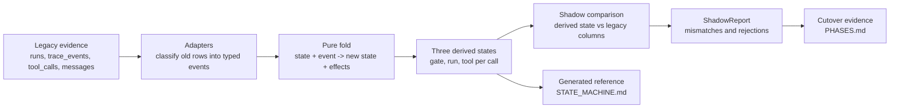

# State machine primer

Status: living primer. It describes Phase 0 as implemented; cutover evidence and
decision history live in [STATE_MACHINE_DESIGN.md](STATE_MACHINE_DESIGN.md) and
[PHASES.md](../PHASES.md).

The state-machine layer answers one question for a chaos run: given the durable
evidence we already wrote, what state is the run in, what happened at its gate,
and what happened to each tool call? Phase 0 makes that answer derivable from an
event log without changing runtime behavior. The legacy columns and score keys
still control the harness. The new machine code computes a second, explicit
answer and compares it with the old one.

That is the contract of this layer: deterministic derivation, replayable from
stored evidence, silent in production for now. It is not yet the owner of run
behavior. When a later phase gives it ownership, it will do so by replacing
scattered boolean checks and string heuristics with named states, typed events,
and auditable transitions.

## The one flow

There is one path through the system. Everything else in this primer is an
elaboration of it.



Follow one ordinary run through that path. It has a detected fault, an approval
event, one mutating repair call, a verification event, and a final row in
`runs`. Those records were written by the existing harness in several shapes:
some are `trace_events`, some are `tool_calls`, some are scalar columns on the
run, and some are message rows. None of them is a machine event yet.

The adapters read that mixed evidence. They decide that the approval event is a
diagnosis submission, that the mutating call is a repair proposal and then a
repair result, and that the verify event is the run's final verification. They
emit frozen `MachineEvent` objects with payloads, sequence numbers, and
idempotency keys. The fold walks those events in order. For each event it looks
up one cell in a transition table, applies any state update, and records the
effects the real persistence shell would eventually execute.

The result is three derived states: a gate state, a run state, and one tool state
per call. The shadow comparison then asks whether those states agree with the
legacy fields. A disagreement is a `ShadowMismatch`; an event the table refuses
is a rejection. The report is the evidence pack. It is how we earn the right to
cut over behavior later.

## The core is deliberately small

The pure engine lives in [`harness/state_machine.py`](../harness/state_machine.py).
It knows nothing about SQLite, LLM prompts, Kubernetes, or the benchmark loop.
Its main contract is the `transition()` function:

```python
result = transition(machine, state, event)
next_state, effects = result.state, result.effects
```

In practice callers use `Machine.transition()` or `fold()`. The important part is
the shape: a machine, a current state, and one event produce a `Transition`
containing the next state, zero or more `Effect` values, and an optional reason.
There is no hidden mutation and no database access. The same event replayed
against the same state always produces the same answer.

`fold()` is the loop around that contract. It starts from `machine.initial`,
applies events in order, and returns the final state. It also enforces two
properties that matter for replay: events with sequence numbers must be ordered,
and duplicate sequence numbers or idempotency keys are ignored. That is why an
adapter can attach `idempotency_key=f"approval:{seq}"` to a diagnosis event or
`idempotency_key="setup:reset:begin"` to a setup event without teaching the core
about approvals or setup.

A transition table cell is one of three things. A `Transition` is an ordinary
state change. A `Rejection` says the event does not belong here. A `Guards` rule
chooses between several transitions by inspecting the state and event payload.
For example, a mutating tool call that is cancelled after it started must become
`UNKNOWN_EFFECT`; a read-only call that is superseded after resume becomes
`SUPERSEDED`; a read-only cancel after start is rejected. Those are payload
facts, not new state-machine features.

`validate_machine()` runs over the whole table before tests use it. It checks
that every state has a spec, every state/event pair has a cell, targets exist,
ranks are sane, terminal states are not resumable, resumable states declare a
crash action, and run-terminal states require an end reason. This is a guard
against the most common failure mode in hand-rolled machines: a table that looks
complete until an unusual event reaches a missing cell.

## The three machines divide ownership

There are exactly three machines in Phase 0. The design explicitly rejects a
reset-ladder machine, a topology machine, an LLM-loop machine, an export machine,
and a health machine. The boundary is narrow because the immediate problem is
run correctness, not modeling every subsystem in the harness.

### The gate machine decides whether the agent earned a repair

[`harness/machines/gate.py`](../harness/machines/gate.py) owns the conversation
around diagnosis and repair. Its phases are `AWAIT_DIAGNOSIS`, `APPROVED`,
`REPAIRED`, `CLEARED`, and `ESCALATED`. A refused event is a `Rejection`, not a
`REJECTED` state. The important idea is that a correct, approved diagnosis is not
merely a boolean. It issues a receipt derived from the run identity via
`receipt_for(run_id)`, and that receipt is what makes a later repair legitimate.

The gate has two different "no" paths that old code tended to blur. A prompt-mode
decline with `approved=False` can keep `diagnosis_correct` true; the diagnosis was
right, but the repair receipt is withheld until approval is present. A wrong
diagnosis consumes an attempt. If the agent later submits the wrong diagnosis
from `APPROVED`, the receipt and repair projection are cleared and the gate moves
back to `AWAIT_DIAGNOSIS`; if the attempt cap is reached, it escalates with
`diagnosis_attempts_exhausted`. That behavior is what lets the gate answer not
just "was the diagnosis correct?" but "was the run allowed to repair?"

Repair events are also gate events. `REPAIR_PROPOSED` records the canonical tool
name and whether it is acceptable or forbidden. `REPAIR_FINISHED` moves an
approved gate to `REPAIRED`; a timeout or repair failure leaves it approved;
`UNKNOWN_EFFECT` escalates because a mutating action may have happened and its
outcome cannot be inferred. Repair completion or an unknown effect before
diagnosis is rejected, nudges after approval are rejected, and unknown effects
from the approved state escalate; none of them is a silent no-op.

### The run machine owns lifecycle and crash semantics

[`harness/machines/run.py`](../harness/machines/run.py) models the lifecycle that
was previously split across `runs.status`, `runs.phase`, `runs.end_reason`, and
control flow in the loop. It begins at `PENDING`, takes a lease, moves through
`RESETTING`, `BASELINING`, `INJECTING`, `FAULT_CHECK`, `AGENT_RUNNING`, and
`VERIFYING`, and ends in `FINISHED` or `ABORTED`.

The run machine also gives crashes a name. `INTERRUPTED` is a parked, resumable,
reason-required state, not a synonym for failure. `resume_triage()` maps a
previous phase to a crash action: early setup can resume after releasing the
lease, injection or fault-check states need a new run after reset, an agent run
with an unknown effect must abort and retry, and verification can be rerun. This
is the beginning of replacing "what was the scalar status when we died?" with
"what had the machine definitely done, and what is safe next?"

Lease effects are explicit in the table. Successful setup steps request lease
renewal; terminal steps release it. Phase 0 does not execute those effects, but
the table records them so the later persistence shell has one authoritative
source for what a transition means.

### The tool machine makes mutating side effects honest

[`harness/machines/tools.py`](../harness/machines/tools.py) exists because a
crash between "I am about to restart something" and "the restart succeeded" is
not recoverable by guessing from a status string. Its phases are `INTENDED`,
`STARTED`, `SUCCEEDED`, `FAILED`, `DENIED`, `UNKNOWN_EFFECT`, and `SUPERSEDED`.

Denial is only valid before start. After a mutating call has started, a cancel
or lease expiry cannot claim the call was denied; the machine marks it
`UNKNOWN_EFFECT` and asks the outer layer to abort and retry. Read-only calls are
different: they can be superseded after resume because replaying them has no
dangerous side effect. That distinction is encoded in guards that inspect the
`mutating` and `destructive` payload, not in ad hoc string checks.

The new tool states are internal aliases for this release. They map onto legacy
persisted statuses such as `finished`, `failed`, and `denied`, with a typed code
in the existing result field. That avoids a schema bump while still giving the
machine a richer vocabulary. No tool rows are written in Phase 0.

## Adapters translate history without rewriting it

[`harness/machines/adapters.py`](../harness/machines/adapters.py) is the bridge
between the legacy harness and the machine vocabulary. It has to be conservative:
old runs did not emit `gate.diagnosis_submitted` or `tool.unknown_effect`
events, so the adapter reconstructs typed events from the evidence that exists
and refuses to guess from a scalar default.

`classify_diagnosis()`, `classify_repair()`, and `classify_repair_result()` do the
semantic work. They normalize tool names, detect forbidden repairs, map legacy
result strings such as `ERROR:`, `BLOCKED:`, and `timeout waiting for` to typed
outcomes, and preserve fallback provenance from assistant and LLM-error rows.
Fallback is treated as provenance, not as a new chain identity: the chain stays
on the run, while the responder backend and attempted backends travel with the
event payload.

`legacy_gate_events()` turns approval events, nudges, repair tools, tool calls,
and terminal reasons into gate events. It can reconstruct early nudges from user
messages when no explicit nudge was recorded. It emits denial before start so
the tool machine sees a valid path. It adds terminal events from `end_reason`
only after folding the gate events already found, so legacy strings do not
overwrite a more specific machine decision.

`legacy_tool_events()` groups rows by call id and produces a separate event
stream per call. `legacy_run_events()` walks setup, fault-check, abort, gate
terminal, provider failure, and verification evidence. It uses the folded gate
state to decide whether the agent reached `AGENT_DONE` or `AGENT_TERMINAL`. That
dependency is the seam where the three machines begin to coordinate.

Adapters are not persistence. They do not write to SQLite and do not mutate the
harness. They are the translation layer that makes historical evidence foldable.

## Shadow replay is the proof, not the product

`shadow_replay()` in the same module ties the flow together. It accepts a run,
its events, tool calls, messages, and optional scenario, then returns a
`ShadowReport`. The report carries the derived gate state, run state, tool
states, the event streams that produced them, fallback provenance, mismatches,
and rejections.

The sequence is worth reading closely. First the adapter produces gate events
and the gate is folded. Tool events are grouped and folded per call. The run
events are produced with the folded gate state, then folded. Finally
`_compare_gate()`, `_compare_run()`, and `_compare_tools()` compare the derived
state against the legacy columns. A missing scalar is skipped; a present scalar
with a different value becomes a mismatch. Legacy `unknown` tool statuses are
skipped because they are not evidence of an outcome.

The design's intended coordination order for the later persistence shell is
tool, gate, run: unknown mutating effects escalate outward, gate terminal states
tell the run whether the agent succeeded, and only then can the run finish.
Phase 0 shadow replay already uses gate state as an input to the run adapter and
folds tool state independently. The important property today is that no machine
calls another machine directly; coordination is observed through folded state
and deterministic effects.

A mismatch and a rejection mean different things. A mismatch says the machine
and the legacy code disagree about a field; it may be explained legacy drift.
A rejection says the table refused an event in a state; it is a bug signal unless
the event is deliberately invalid and handled as an escalation. The Phase 0
report in [PHASES.md](../PHASES.md) records 13 unique runs, 171 tool calls, 22
explained mismatches, and 0 rejections. There are no gate-field mismatches. The
remaining differences are legacy `end_reason`, status/phase, `verify_ok`, and one
tool status whose result text says timeout while its status says finished.

That is why Phase 0 is inert. The legacy code still owns behavior; the machine
code is the shadow witness. Cutover waits until every difference is either fixed
or explicitly accepted.

## Documentation and tests close the loop

The transition tables are source code, not prose. The gate, run, and tool
modules define `StateSpec` values, event enums, rules, and effects in Python.
That is why [`scripts/gen_state_diagrams.py`](../scripts/gen_state_diagrams.py)
can generate [`docs/STATE_MACHINE.md`](STATE_MACHINE.md): it imports the tables
and emits Mermaid diagrams plus state and effect summaries. The generated file
is a projection of the code. Do not hand-edit it.

The design document is the argument; this primer is the map; the generated
reference is the table dump. Keeping those roles separate prevents the same
fact from being maintained in three places. When a transition changes, the table
changes, the generated reference is regenerated, and this primer is updated only
if the explanation of the system changed.

The tests enforce that separation. `tests/test_state_machine.py` exercises the
core engine, `tests/test_state_machine_tables.py` checks exhaustive table and
fold behavior, and `tests/test_state_machine_shadow.py` covers adapters, shadow
replay, and generated-document parity. The last full verification regenerated
the docs, ran the focused tests and the full suite, compiled the Python files,
checked shell syntax, and passed `git diff --check`.

## What exists now, and what is deliberately absent

Phase 0 exists: the pure core, three transition tables, legacy adapters, shadow
replay, exhaustive tests, generated state reference, design decisions, and the
recorded shadow report. These are committed and pushed on the `statemachine`
branch.

What does not exist yet is any behavior change. The `CHAOS_SM_GATE`,
`CHAOS_SM_RUN`, and `CHAOS_SM_TOOL` flags are designed but not wired. No machine
state is written to `state_json` or `state_snapshots`. No persistence shell owns
projections. The reaper and operator `--abandon` path are table semantics, not
runtime behavior. `gate-path-v1` is designed but the canonical scorer remains
unchanged.

That boundary is intentional. The first cutover will be the gate machine, after
Phase 0 evidence is green. Run lifecycle will follow in two slices: the shell
and lease foundation first, then the reaper and `--abandon`. Tool calls and typed
outcomes come after that. The annotation scorer and public parity report come
last, and a canonical score switch needs separate approval.

## How to keep this primer alive

Add explanation here when a new phase changes the shape of the system, not every
time a line of code moves. If a new machine is introduced, explain why the
existing three are insufficient. If a phase gives the machine runtime ownership,
replace the current "shadow witness" language with the new contract. If a
transition table gains a guard that changes how we reason about safety, describe
the reasoning here and leave the exhaustive list to the generated reference.

Keep one concept in one home. Link to the design for decisions and rollout
gates, link to `PHASES.md` for evidence, and link to the generated reference for
states and effects. This document should stay readable as the implementation
grows: one flow, one vocabulary, and a truthful snapshot of what the harness does
today.
