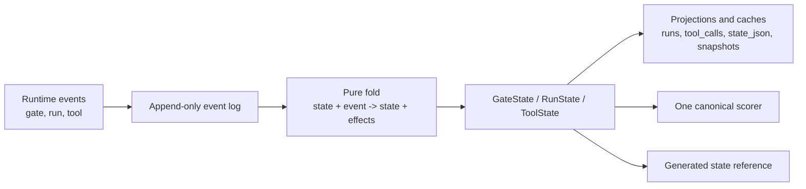

# State machine primer

Status: conceptual guide to the authoritative design.

The harness is driven by three state machines. They own behavior:

- `GateState` decides whether a repair is authorized;
- `RunState` owns the run lifecycle, lease, resume triage, and terminal outcome;
- `ToolState` owns each tool call's status and outcome.

`GateRuntime`, `RunRuntime`, and `ToolLedger` are always on. There are no gate
modes or runtime switches. The append-only event log is authoritative;
`state_json`, `state_snapshots`, UI rows, exports, scores, and replay views are
projections or caches derived from it.

## One source of truth

Every meaningful step is appended as a typed event with a sequence number and,
where the event is generated by the harness rather than an external action, an
idempotency key. `fold()` orders events by sequence, ignores duplicates, and
rebuilds current state. The persistence shell appends the event and writes
projections in one transaction; the reducer itself performs no I/O and reads no
clock.

An event that does not belong in the current state is appended as
`state_transition_rejected` and leaves projections unchanged. Rebuild, resume,
doctor checks, and replay fold `trace_events` directly; `state_json`,
`state_snapshots`, and scalar rows are projections or caches and cannot override
the log even when their sequence markers agree.

## GateRuntime and `GateState`

`GateRuntime` folds diagnosis, nudge, and repair events into one `GateState`.
Its phases are `AWAIT_DIAGNOSIS`, `APPROVED`, `REPAIRED`, `CLEARED`, and
`ESCALATED`.

The receipt is derived from `GateState` plus the current `run_id`. It is never
transported in a tool argument and never stored in an event payload. A repair is
authorized only when the folded gate state permits it; anything in the model's
arguments is untrusted evidence. A retry has its own `run_id` and therefore its
own receipt.

Canonical gate events include diagnosis submissions, nudges, repair proposals,
and typed repair outcomes. A correct approved diagnosis with no fault reaches
`CLEARED`; with a fault it reaches `APPROVED`. Wrong diagnoses consume attempts,
nudges are capped, forbidden or unacceptable proposals are recorded as
violations, and repair success, failure, timeout, or unknown effect is folded
back into the gate. `GatePath` is a derived artifact from this fold, not a second
source of truth.

## `RunState`

`RunState` owns status, phase, end reason, lease, verification, and terminal
outcome. It moves from `PENDING` through setup, fault check, agent execution, and
verification to `FINISHED` or `ABORTED`.

A crashed or expired run is parked in `INTERRUPTED` with a reason and its
`previous_state`. Resume triage is a lookup from that previous state: early
setup can resume, an injected or unproven fault starts a new run after reset, an
agent run with an unknown mutating effect aborts and retries, and verification
can be rerun. The reaper observes expired leases and never runs from the crashed
process. `--abandon` is the explicit operator exit from `INTERRUPTED`.

Verification belongs to the run machine. Export happens after the terminal state
and cannot make a finished run look unfinished.

## `ToolState`

`ToolState` owns tool status and outcome. Its phases are `INTENDED`, `STARTED`,
`SUCCEEDED`, `FAILED`, `DENIED`, `UNKNOWN_EFFECT`, and `SUPERSEDED`.

Denial is valid only before execution. After a mutating call starts, a cancel or
lease expiry becomes `UNKNOWN_EFFECT` and forces abort-and-retry. Read-only calls
may be superseded after resume. Human-readable result text such as `ERROR:` or
`timeout waiting for` is preserved for operators but is never parsed as the
authoritative outcome.

## Coordination and scoring

Machines do not call each other. A coordinator folds them in a fixed order:
tool states per call, then gate state, then run state. Unknown mutating effects
escalate outward; gate terminals tell the run whether the agent succeeded; only
then does the run finish.

One canonical scorer reads the folded gate path and run outcome. Funnel counts
are views over the same path, not independent scoring rules.

## Documentation and safety

Transition tables in code are the source; generated diagrams are a projection.
Update the design when ownership or safety semantics change, not for isolated
code moves.

`etcd-disk-full` remains excluded from live sweeps because filling an etcd data
filesystem can leave a member unrecoverable. Never write secrets to event
payloads, traces, prompts, exports, or commits.
