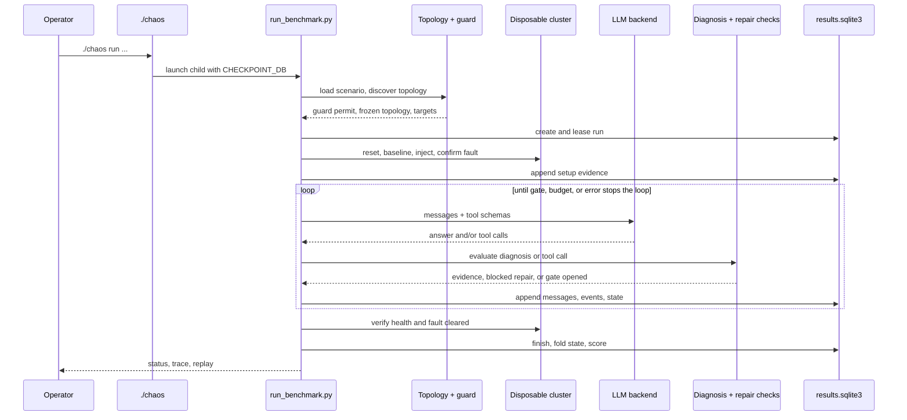

# One run, end to end

This walkthrough follows one benchmark run from the command you type to the evidence you can inspect. It is for operators who need to know:

- what touched the disposable cluster,
- what the model was allowed to see,
- why the run stopped,
- and how the score was decided.

> **Destructive benchmark.** `./chaos run`, reset scripts, fault scripts, state discard, and cluster nuke can break or erase a cluster. Use a disposable lab cluster only. Read the safety rules in [`README.md`](../README.md) before running anything.

This document is a walkthrough, not the full reference:

- [`README.md`](../README.md) covers commands, configuration, safety, and current status.
- [`ARCHITECTURE.md`](ARCHITECTURE.md) explains the parts of the system and why they exist.
- [`STATE_MACHINE.md`](STATE_MACHINE.md) is the generated reference for exact states and transitions.

The central rule is simple: the harness owns the cluster lifecycle, the model receives read-only investigation tools and gated repair tools, and the hidden truth plus scoring policy stay outside the prompt.

The values in this guide describe behavior, not a recorded result. Use the inspection commands at the end to learn what happened in your run.

## 1. Words used in this guide

| Word | Meaning here |
| --- | --- |
| Harness | The code that resets the cluster, injects the fault, runs the model, verifies the result, and stores evidence. |
| Scenario | A JSON file that defines the hidden fault, target rules, acceptable repairs, forbidden repairs, budgets, and verification commands. |
| Truth label | The scenario's hidden root cause. It is stored for scoring and never shown to the model. |
| Topology hash | A fingerprint of the discovered control-plane nodes, etcd members, member count, and probe node. It identifies the cluster layout, not its health. |
| Destructive guard | The preflight check that refuses a live run unless the current cluster context or cluster ID is explicitly allow-listed. |
| Probe node | The node from which the harness queries etcd for health, membership, and fault checks. |
| Fault-present check | A harness-side predicate that proves the injected fault really happened before the model is called. |
| Fault-cleared check | A harness-side predicate that asks whether that same fault is gone after the agent loop. |
| Gate | The internal decision path that records diagnosis correctness, authorization, repair proposals, and violations. |
| Receipt | A derived marker showing that the gate accepted a diagnosis and authorized repair. It is not supplied to the model as a tool argument. |
| Approve mode | The operator-facing `--approve` setting. `policy` authorizes internally; `prompt` asks the operator to confirm. It does not change the system prompt. |
| Nudge | A user message from the harness telling the model to submit a diagnosis or that time is running short. |
| Budget | The step and token limits that stop a run that does not reach a clean outcome. |
| Fold | Replaying stored events to rebuild state. Events are authoritative; folded state is the result. |
| Projection | A stored view rebuilt from events, such as a run row, score row, or `state_json` cache. |
| Machine phase | The internal state-machine name. Persisted run phases use `status:phase`, for example `running:baseline`. |
| Escalation | Two related ideas: an instruction telling the model to stop repairing and report the limit, or the terminal gate state `escalated` meaning repair is no longer authorized. |
| Strict loop success | The headline score. It requires a clean path, not merely a healthy cluster at the end. |

## 2. Lifecycle at a glance



The model loop ends before verification. Verification is a separate harness step, so a model claim never decides whether the cluster is healthy.

A run can stop in four broad ways:

| Stop kind | Plain meaning |
| --- | --- |
| Clean repair | The diagnosis and repair path completed. Verification still decides whether the run passes. |
| Healthy control | The model correctly identifies `no_fault`; no repair should be attempted. |
| Escalation or budget | The diagnosis was wrong twice, the gate escalated, or step/token limits ended the attempt. |
| Provider or run error | No usable LLM response, or the setup/verification path failed. |

## 3. Before the model speaks

The model is not called until the harness has already changed the cluster and proved that the intended fault is present. This is the most important boundary in the system.

### Start a run

Use a disposable cluster and fetch guard values from the live cluster immediately before the run:

```bash
export CHAOS_CLUSTER_ID="$(kubectl config current-context)"
export CHAOS_ALLOWED_CLUSTER_IDS="$CHAOS_CLUSTER_ID"
export CHAOS_ALLOWED_TOPOLOGY_HASHES="$(python3 tools/topology.py hash)"

./chaos run --scenario etcd-wrong-peer-url --backend ollama --runs 1 --verbose
```

Replace `ollama` with your configured backend name. The alternative hash command is:

```bash
./chaos target show --json | python3 -c 'import json,sys; print(json.load(sys.stdin)["topology"]["topology_hash"])'
```

A hash from an earlier run is not a guard value for the next run. Restores and membership changes can change it. The topology hash is built from control-plane name/IP pairs, etcd member id/name/node/peer URL records, member count, and the probe node. Health, noisy events, and transient faults are excluded.

### What preflight does

1. The scenario is loaded and validated. Invalid scenario files stop before topology discovery.
2. Topology is discovered from the live cluster, or from a fixture only when `CHAOS_TOPOLOGY_JSON` and `CHAOS_ALLOW_FIXTURE_RUNS=1` are set for offline tests.
3. The destructive guard checks the current cluster context or cluster ID, and the topology hash if an allow-list is configured.
4. The topology is frozen so later checks and prompts use one consistent view.
5. Capability checks and target resolution decide which nodes may be affected.
6. `target_nodes: ["second"]` means the second **non-local** control-plane node. A direct selector that points at the harness host is rejected.

If any preflight check fails, no fault is injected and the run exits before touching the cluster.

### What setup does

After preflight, the runner leases the run and performs four harness-owned steps:

| Step | What happens | Evidence left behind |
| --- | --- | --- |
| Reset | Restore the disposable cluster to a clean baseline. | Reset event and `reset_output_full`. |
| Baseline | Run the scenario's verify command to prove the cluster is healthy before injection. | Setup event and baseline result. |
| Inject | Run the scenario's fault command with resolved targets. | Injection event and `injection_output_full`. |
| Fault check | Poll the harness-side fault predicate until it is present or times out. | Fault observation event and artifact. |

The model never performs these steps. It starts with a broken cluster it has not been told how to reach.

## 4. What the model is given

A fresh run starts with exactly two messages:

1. A system message rendered from the prompt template.
2. A user message with the text: `Investigate the Kubernetes cluster for an etcd fault. Diagnose and repair if needed.`

A resumed run loads persisted messages from SQLite instead of rebuilding them. Earlier assistant, tool, and nudge messages continue the same conversation.

Every request includes the tool schemas. The schemas advertise all tools, including repair tools that the gate may later refuse. Advertising a tool is not the same as authorizing it.

| Visible to the model | Kept outside the prompt |
| --- | --- |
| Control-plane node names and default probe node | Scenario id and `root_cause` truth |
| Quorum sentence derived from frozen topology | Reset, baseline, inject, and verify commands |
| Six allowed diagnosis labels and generic cue mappings | Fault-present and fault-cleared predicates |
| One user instruction | Setup output and full untruncated command payloads |
| Tool names, parameters, and descriptions | Scenario acceptable and forbidden repair lists |
| Prior assistant messages, nudge messages, and truncated diagnostic tool output | Live gate phase, receipt, budget counters, and score formula |

The prompt mentions the gate concept, the two-attempt diagnosis cap, and the four-turn investigation guideline. It does not expose the live gate state, receipts, counters, hidden truth, or scoring formula.

Setup output is stored as evidence but is not an LLM message. Diagnostic tool output is truncated in the conversation and stored in full as an artifact.

## 5. The agent loop, in plain terms

Each turn sends the full conversation and tool schemas to the configured LLM backend. The harness appends the assistant response, executes requested tools, records the result, and repeats until a stop condition is reached.

Fixed call settings are `temperature=0.2` and `max_tokens=2048` so runs stay comparable. Backend identity is separate from backend provenance: the run row records the configured chain, while LLM request records show which backend actually answered and which candidates were skipped.

### What the model can do

- Call read-only investigation tools at any time.
- Submit one diagnosis label, with at most two attempts.
- Propose a repair only after diagnosis has been accepted.
- Stop and escalate when a repair is blocked or fails.

`submit_diagnosis` advertises six labels. Runtime normalization accepts exact lowercase labels, substring matches, underscore-to-space forms, and aliases such as `no fault`, `cluster healthy`, and `healthy`. The stored diagnosis is normalized to the enum label.

### Gate decisions

| Situation | What the gate does |
| --- | --- |
| Correct diagnosis with a real fault, plus required approval | Opens the gate internally and derives a receipt. Tool arguments cannot grant this. |
| Correct `no_fault` diagnosis | Clears the gate. No repair should be proposed. |
| Wrong diagnosis below the two-attempt cap | Leaves the gate waiting and may nudge the model to gather decisive evidence. |
| Wrong second diagnosis, budget exhaustion, abort, or unknown mutating effect | Moves the gate to `escalated`. No further repair is authorized. |
| Repair before diagnosis | Records a `premature_repair` violation and blocks the repair. |
| Forbidden or unacceptable repair | Records a violation and returns `BLOCKED`. The gate does not escalate solely because of this refusal. |
| Acceptable repair succeeds | Moves the gate to `repaired`. |
| Acceptable repair fails | Keeps the gate approved; verification later measures the cluster as it stands. |

In `prompt` approve mode, a correct diagnosis still asks the operator to confirm repair. In `policy` mode, the harness decides internally. Neither mode changes the reset, baseline, injection, or rendered prompt.

A nudge is a user message, not a new fact about the cluster. There can be at most two diagnosis-related nudges, plus one deadline nudge when the step count reaches the configured deadline without a submission.

Verification happens after this loop ends, not inside it.

## 6. Worked example: `etcd-wrong-peer-url`

This scenario is a useful example because it exercises target selection, injection, diagnosis, blocked repairs, and independent verification. It describes the stable path, not a stored historical result.

The scenario sets:

| Item | Value |
| --- | --- |
| Hidden truth | `etcd_config_error` |
| Target | Second non-local control-plane node |
| Allowed repairs | `restart_member`, `member_remove_readd` |
| Forbidden repair | `full_cluster_reset` |
| Fault-present signal | Registered etcd peer URL contains `:2399` |
| Budgets | 40 steps and 60,000 tokens |

### What happens

1. The runner resolves `second` to the second non-local control-plane node and avoids the harness host.
2. `faults/etcd_wrong_peer_url.sh` updates that member's registered peer URL to `https://$TARGET_IP:2399`. It does not restart the member.
3. The harness queries the member list from the probe node and confirms the `:2399` peer URL is present. Only then does the model run.
4. The model receives a prompt that says, generically, “A wrong peer URL is `etcd_config_error`.” The prompt does not say that this run has a wrong peer URL.
5. The decisive tool output is normally `etcdctl_member_list`, which can show the registered peer URL. Logs and pod status can add supporting evidence.
6. The model submits a diagnosis and may propose a repair. Every decision and blocked attempt is stored in the event log.
7. After the loop, verification checks health and asks whether the `:2399` peer URL is gone.

### How to read the outcome

Do not infer the result from any single field. A run has three separate signals:

| Question | Where to look |
| --- | --- |
| Did setup work? | Fault-present observation in `trace_events` and the run row's `fault_present`. |
| Did the model reason correctly? | Diagnosis messages, `submit_diagnosis` tool call, and the folded gate path. |
| Did the cluster heal? | Verification artifact, `verify_ok`, and the folded verification outcome. |

The model may find decisive evidence but still submit the wrong label. Verification may pass even when the diagnosis is wrong if the repair path still healed the cluster. Conversely, a correct diagnosis can fail the headline score if approval, repair, verification, or policy conditions are incomplete.

## 7. How the result is decided

Verification runs after the agent loop. It executes the scenario's health check and then the fault-cleared predicate. The result is stored as a verification artifact, a trace event, and a folded run outcome.

There are two different `end_reason` values:

| Value | Question it answers |
| --- | --- |
| Stored run row `end_reason` | Why the agent loop stopped, such as submitted, agent stopped, budget, or provider error. |
| Folded run state `end_reason` | What verification concluded, such as `verify_ok` or `verify_failed`. |

They can differ. A run whose agent loop stopped on `budget_tokens` can still have folded `end_reason=verify_ok` if final verification passed.

Scoring folds the event log again. `strict_loop_success=1` requires all of the following:

- the fault was observed before the model ran,
- the run is finished in both stored status and folded phase,
- the gate terminal is `repaired` or `no_fault_cleared`,
- approval was granted and a receipt was issued,
- the diagnosis was correct on the first attempt,
- verification passed and the folded end reason is `verify_ok`,
- no policy violations, budget reason, or exclusion reason exists,
- the repair was acceptable, or no repair was proposed for a no-fault run.

That is why `verify_ok` alone is not a strict pass.

SQLite holds the durable evidence. Trace events, messages, tool calls, LLM requests, and artifacts are append-only sources of truth. Run rows, score rows, `state_json`, JSONL exports, traces, and replay HTML are derived views. When a projection and the event log disagree, the event log wins.

## 8. When things go wrong

| Phase | Symptom | Meaning | Cluster touched? | Next check or action |
| --- | --- | --- | --- | --- |
| Startup | Backend configuration error, exit 2 | Config could not be parsed or is invalid. | No | Fix configuration and rerun. |
| Startup | No healthy LLM chain, exit 1 | No configured backend can serve the run. | No | Run `python3 scripts/llm_ready.py` and fix endpoint or model config. |
| Scenario load | `Invalid scenario`, exit 2 | JSON or schema validation failed. | No | Fix the scenario file; topology has not been discovered. |
| Preflight | `Topology preflight failed`, exit 2 | Guard, freeze, capability, target resolution, or target validation failed. | No | Fetch a fresh topology hash and check allow-lists and target rules. |
| Preflight | Fixture topology rejected, exit 2 | Offline fixture used without opt-in. | No | Use live topology, or set `CHAOS_ALLOW_FIXTURE_RUNS=1` only for offline tests. |
| Resume | Topology mismatch, exit 1 | Active DB epoch belongs to another topology identity. | No | Inspect `./chaos target show --json`; discard stale state only if intentional. |
| Setup | Reset, baseline, injection, or fault-not-observed failure | Harness could not establish a valid starting fault. | Maybe | Check setup events and artifacts; restore the disposable cluster before retrying. |
| Provider | All provider attempts fail | No usable model response. | Fault may already be injected | Check `llm_requests`, error artifact, and backend health; restore before a fresh run. |
| Gate | Wrong second diagnosis, budget, abort, or unknown mutating effect | Gate escalated; no further repair is authorized. | Fault remains | Check folded gate path and violations; restore explicitly if needed. |
| Gate | `BLOCKED: ...` repair | Policy refused the repair before execution. | No repair from that call | Check repair policy and gate path; do not treat the model's request as permission. |
| Lease | `INTERRUPTED` | Lease expired or reaper parked the run. | Prior state preserved | Check `previous_state`; resume, retry, or abandon deliberately. |
| Verification | `verify_failed` | Health check failed or the injected fault is still present. | Yes | Check verification artifact and fault-cleared predicate; restore before retrying. |

A stale topology hash is intentional protection, not a bug. Fetch a fresh one before each destructive command. `etcd-disk-full` remains excluded from live sweeps regardless of hash freshness.

## 9. Inspect any run

Start with the live views:

| Command | What it answers |
| --- | --- |
| `./chaos status --limit 20` | Which runs exist and what their current projection says. |
| `./chaos attach <run_id> --follow` | What events are streaming while a run is active. It does not change the run. |
| `./chaos replay --output replay.html` | What the redacted static view shows after the run. |
| `python3 db_cli.py --db results.sqlite3 status --limit 20` | The same run list from the database CLI. |
| `python3 db_cli.py --db results.sqlite3 doctor --strict` | Whether projections, events, leases, tools, and final records agree. |
| `python3 score.py --db results.sqlite3 --format json` | The derived score rows. |
| `python3 replay.py --db results.sqlite3 --output replay.html` | A rebuilt static replay. |

The doctor checks schema presence and version, canonical events, duplicate generated keys, rejected transitions, stale cache markers, expired live owners, in-flight tools, unknown mutating effects, incomplete interrupted runs, missing final records or scores, and cache/projection drift.

For a specific run, replace `[RUN_ID]` below with the run id from `./chaos status`. These Python snippets are read-only and use the standard library, so they work even when the `sqlite3` CLI is unavailable.

Show the run projection and cache markers:

```python
import json
import sqlite3

run_id = "[RUN_ID]"
con = sqlite3.connect("file:results.sqlite3?mode=ro", uri=True)
con.row_factory = sqlite3.Row
for row in con.execute(
    """SELECT run_id, scenario_id, status, phase, end_reason,
              fault_present, verify_ok, diagnosis, diagnosis_correct,
              repair, steps, tokens_used, seq, state_seq, topology_hash
       FROM runs WHERE run_id = ?""",
    (run_id,),
):
    print(json.dumps(dict(row), indent=2))
```

Show the append-only event log:

```python
import json
import sqlite3

run_id = "[RUN_ID]"
con = sqlite3.connect("file:results.sqlite3?mode=ro", uri=True)
con.row_factory = sqlite3.Row
for row in con.execute(
    """SELECT seq, ts, type, payload_json
       FROM trace_events WHERE run_id = ? ORDER BY seq""",
    (run_id,),
):
    item = dict(row)
    if item.get("payload_json"):
        item["payload_json"] = json.loads(item["payload_json"])
    print(json.dumps(item, indent=2))
```

Show the final record, folded gate path, verification output, and raw LLM response:

```python
import json
import sqlite3

run_id = "[RUN_ID]"
con = sqlite3.connect("file:results.sqlite3?mode=ro", uri=True)
con.row_factory = sqlite3.Row
for row in con.execute(
    """SELECT seq, kind, content_type, content
       FROM run_artifacts
       WHERE run_id = ? AND kind IN
             ('final_record', 'gate_path', 'verify_output_full', 'llm_response_full')
       ORDER BY seq""",
    (run_id,),
):
    print(json.dumps(dict(row), indent=2))
```

Show what the model saw and what tools returned:

```python
import json
import sqlite3

run_id = "[RUN_ID]"
con = sqlite3.connect("file:results.sqlite3?mode=ro", uri=True)
con.row_factory = sqlite3.Row
for table, columns, order in (
    ("messages", "seq, role, content_json, tool_calls_json, tool_call_id, backend", "seq"),
    ("tool_calls", "call_id, msg_seq, name, args_json, mutating, destructive, status, phase, result_code, reason, result_sent, truncated, error", "msg_seq, call_id"),
):
    print(f"## {table}")
    for row in con.execute(
        f"SELECT {columns} FROM {table} WHERE run_id = ? ORDER BY {order}",
        (run_id,),
    ):
        item = dict(row)
        for key in ("content_json", "tool_calls_json", "args_json"):
            if item.get(key):
                item[key] = json.loads(item[key])
        print(json.dumps(item, indent=2))
```

Read the outputs in this order:

1. The run row tells you what the projection claims.
2. The event log tells you what actually happened.
3. The gate path tells you why repair was allowed, blocked, or skipped.
4. The verification artifact tells you the final cluster result.
5. Messages and tool calls tell you what the model saw and did.

## 10. How scenarios differ

The setup, loop, verification, and scoring calls stay the same. Scenarios differ in hidden truth, target rules, decisive evidence, repair policy, and budgets.

Fault-present and fault-cleared predicates live in `tools/fault_checks.py`, not in scenario JSON.

| Scenario | Hidden truth | Decisive evidence | Allowed / forbidden repairs | Operator note |
| --- | --- | --- | --- | --- |
| `control-healthy-noisy` | `no_fault` | No stimulus; fault-present is always true. | None / all three | A correct diagnosis clears the gate without repair. |
| `etcd-member-down` | `etcd_member_unreachable` | Target pod not ready. | `restart_member` / `full_cluster_reset` | Pod status and logs are decisive. |
| `etcd-member-wiped` | `etcd_member_data_loss` | Pod down plus missing DB or manifest version. | `member_remove_readd` / `full_cluster_reset` | Data loss cannot be fixed by a plain restart. |
| `etcd-quorum-loss` | `etcd_quorum_loss` | Ready etcd pods below quorum. | `restart_member`, `full_cluster_reset` / none | Multiple targets and a quorum-loss impact class. |
| `etcd-wrong-peer-url` | `etcd_config_error` | Registered peer URL contains `:2399`. | `restart_member`, `member_remove_readd` / `full_cluster_reset` | Member list is decisive. |
| `etcd-disk-full` | `etcd_disk_exhaustion` | Filler marker or disk use at least 95%. | `restart_member`, `member_remove_readd` / `full_cluster_reset` | Same repair policy as wrong-peer-url; excluded from live sweeps here. |

All six use `cluster/verify_etcd_healthy.sh` as the health check. The scenario-specific fault-cleared predicate is appended to that result. Budgets are 40 steps and 60,000 tokens across these scenarios.

## 11. Where to change behavior

This map is for maintainers. Start at the narrowest layer that owns the behavior you want to change.

| What you want to change | Start here |
| --- | --- |
| Hidden truth, targets, repair policy, budgets | `scenarios/*.json`, `tools/scenario.py`, `tools/scenario_schema.py` |
| Topology discovery, target resolution, destructive guard | `tools/topology.py`, `tools/safety.py`, `chaos_cli.py` |
| Prompt language and diagnosis labels | `harness/prompt.py`, `common/vocab.py` |
| Tool schemas and read-only tool behavior | `tools/tool.py`, `harness/call.py` |
| Diagnosis normalization and repair authorization | `harness/tooling.py`, `harness/machines/gate.py` |
| Run lifecycle, lease, resume, reaper | `harness/machines/run.py`, `harness/run_runtime.py`, `harness/checkpoint.py`, `harness/reaper.py` |
| Tool-call lifecycle and outcomes | `harness/machines/tools.py`, `harness/tool_runtime.py` |
| Verification and fault predicates | `harness/verification.py`, `tools/fault_checks.py` |
| Cluster reset, injection, and health scripts | `cluster/*.sh`, `faults/*.sh` |
| Scoring and reports | `common/scoring.py`, `score.py` |
| Persistence, folds, and doctor checks | `storage/sqlite_store.py`, `db_cli.py` |
| Replay and redacted views | `replay.py`, `harness/journal.py`, `harness/message.py` |
| Generated state reference | `harness/machines/*.py`, `scripts/gen_state_diagrams.py`, `tests/test_generated_docs.py` |

## A. Prompt template

The system prompt is rendered from `SystemPrompt.render()` in `harness/prompt.py`. Braced expressions are filled from the frozen topology at render time.

```text
You are an etcd fault diagnosis and repair agent for a {count}-control-plane Kubernetes cluster.

The discoverable node names are: {', '.join(self.control_planes)}. Use only those exact names for node arguments.
The default probe node is {self.probe_node}.
Read-only investigation tools are safe to call at any time. Submit a diagnosis with submit_diagnosis before any repair.
root_cause MUST be exactly one of: {', '.join(ROOT_CAUSE_LABELS)}. Do not write a sentence, a node name, or an explanation in root_cause.

If the diagnosis is accepted, the harness gate is open internally; do not pass receipts or approval tokens to repair calls.
submit_diagnosis accepts at most two attempts. If rejected, gather one new decisive observation before the final attempt; do not brute-force labels.
Use etcdctl_member_list and etcdctl_endpoint_health from the default probe node, plus pod status and logs, to identify the affected member.
Investigate briefly: use at most four assistant turns of read-only tools, then call submit_diagnosis immediately. Do not keep investigating once the likely root cause is clear.
A stopped or unreachable member is etcd_member_unreachable. A wiped data directory is etcd_member_data_loss.
A wrong peer URL is etcd_config_error. A full disk is etcd_disk_exhaustion. {self.quorum_line}
A healthy cluster with only noisy events is no_fault. Do not repair a healthy cluster.
Choose only repairs allowed by the scenario. Keep steps efficient.
If a repair call is BLOCKED, forbidden, or rejected, do not try another repair; report the limitation and escalate to the operator.
If a repair reports a timeout, make at most one read-only health check, then report that the repair did not complete and escalate to the operator.
```

The six enum values come from `ROOT_CAUSE_LABELS` in `common/vocab.py`.

## B. Tool surface

Read-only tools are safe at any time. `submit_diagnosis` is required before repair. Repair tools are advertised but gated at invocation.

| Tool | Purpose | Kind |
| --- | --- | --- |
| `kubectl_get` | Get Kubernetes resources | Read-only |
| `kubectl_describe` | Describe a Kubernetes resource | Read-only |
| `kubectl_logs` | Get pod logs | Read-only |
| `kubectl_events` | Get namespace events | Read-only |
| `etcdctl_endpoint_health` | Check endpoint health across the cluster | Read-only |
| `etcdctl_endpoint_status` | Get endpoint status from a node | Read-only |
| `etcdctl_member_list` | List etcd members from a node | Read-only |
| `etcdctl_alarm_list` | List etcd alarms from a node | Read-only |
| `journalctl_tail` | Tail a systemd unit journal | Read-only |
| `crictl_ps` | List containers on a node | Read-only |
| `crictl_logs` | Get container logs on a node | Read-only |
| `systemctl_status` | Get systemd unit status on a node | Read-only |
| `df_path` | Check disk usage for a path on a node | Read-only |
| `ls_path` | List a path on a node | Read-only |
| `submit_diagnosis` | Submit one root-cause label; required before repairs | Diagnosis |
| `restart_member` | Restart an etcd member | Repair |
| `member_remove_readd` | Remove and re-add an etcd member | Repair |
| `kube_etcd_switch_rebuild` | Rebuild a member via kube-etcd-switch | Repair |
| `full_cluster_reset` | Full cluster reset without snapshot restore | Repair |
| `snapshot_restore_full` | Alias for full cluster reset | Repair |
| `reset_cluster` | Reset the whole cluster | Repair |

## C. Reference links

- Exact states and transitions: [`STATE_MACHINE.md`](STATE_MACHINE.md)
- System boundaries and terminology: [`ARCHITECTURE.md`](ARCHITECTURE.md)
- Operator commands and current status: [`README.md`](../README.md)
- Canonical scorer: `common/scoring.py`
- Generated-doc parity test: `tests/test_generated_docs.py`
